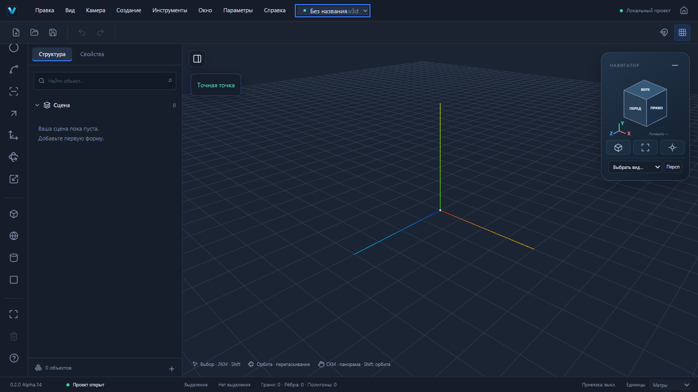

# VEXTRIO 3D

## Актуальная разработка — 0.2.0 Alpha.14

**Последние изменения опубликованы и готовы к проверке:** [PR №23](https://github.com/dmitriy5885as-design/vextrio-3d/pull/23) · [ветка Alpha.14](https://github.com/dmitriy5885as-design/vextrio-3d/tree/codex/editor-workspace) · [проверенный исходный код ee379b5](https://github.com/dmitriy5885as-design/vextrio-3d/tree/ee379b58d93ffb9856042a8d03e6f71ae114bfd6).

| Где | Версия | Ссылка |
| --- | --- | --- |
| Последние исходники и README разработки | **0.2.0-alpha.14** | [Открыть ветку](https://github.com/dmitriy5885as-design/vextrio-3d/tree/codex/editor-workspace) · [Diff PR №23](https://github.com/dmitriy5885as-design/vextrio-3d/pull/23/files) |
| Windows x64 | **0.2.0-alpha.14** | [Скачать установщик из GitHub Actions](https://github.com/dmitriy5885as-design/vextrio-3d/actions/runs/41273708098/artifacts/13071050209) |
| Основной сайт | **0.2.0-alpha.7** | [Открыть опубликованный редактор](https://dmitriy5885as-design.github.io/vextrio-3d/) |
| Код приложения в main | **0.2.0-alpha.7** | Этапы №17–23 ожидают приёмки и объединения |

README на главной обновлён отдельно от кода приложения: сайт пока показывает Alpha.7. В Alpha.14 точная версия находится в левом нижнем углу редактора и в заголовке окна. Для загрузки установщика-артефакта может потребоваться вход в GitHub.

### Что проверить в Alpha.14

- Новый VEXTRIO Home: настоящий новый проект, шаблоны, недавние файлы, восстановление и общие параметры.
- Скрыть/вернуть боковую панель и навигатор. Рядом с кубом работают виды, изометрия, фокус, вписывание и проекция. Средняя кнопка мыши — панорама, Shift+СКМ — орбита.
- Параметры перед Справкой; руководство с поиском, горячие клавиши, описания при наведении и рабочее меню у названия проекта.
- Создать куб → Свойства → «Редактировать вершины» → выбрать вершину в структуре → M. Проверить Delete, Undo/Redo, сохранение и повторное открытие.
- Файл → «Импорт модели»: OBJ/STL, STEP/IGES/BREP. Для STL/OBJ/BREP укажите исходные единицы. STEP читает настоящий локальный CAD Worker.
- В структуре доступны реальные вершины, рёбра и грани; внизу — счётчик граней, рёбер и полигонов отображения.

**Финальный независимый CI:** [run 41273708098](https://github.com/dmitriy5885as-design/vextrio-3d/actions/runs/41273708098) — **501 unit/integration, 97 Playwright E2E, Web build, check:deps, GitHub Pages/CSP smoke, Windows NSIS и 10 native Rust-тестов прошли**. Это результаты source `ee379b58d93ffb9856042a8d03e6f71ae114bfd6`.

[Подробный аудит, реализованные функции, входные данные, тесты и ограничения](https://github.com/dmitriy5885as-design/vextrio-3d/blob/ee379b58d93ffb9856042a8d03e6f71ae114bfd6/docs/0.2/WORKSPACE_ALPHA14.md) · [Полный отчёт PR №23 с итогами CI](https://github.com/dmitriy5885as-design/vextrio-3d/pull/23) · [Скриншот 1920×1080](https://github.com/dmitriy5885as-design/vextrio-3d/blob/ee379b58d93ffb9856042a8d03e6f71ae114bfd6/docs/0.2/images/workspace-1920x1080.png).



### Запустить именно Alpha.14 в браузере локально

```bash
git clone --branch codex/editor-workspace --single-branch https://github.com/dmitriy5885as-design/vextrio-3d.git vextrio-alpha14
cd vextrio-alpha14
pnpm install --frozen-lockfile
pnpm dev
```

Откройте адрес, который выведет Vite. Публичная ссылка выше по-прежнему ведёт к Alpha.7.

### Границы поддержки

CAD импортируется в редактируемую **фасетную геометрию**, без аналитического BREP и истории построения. Импорт ограничен 20 МБ и 3000 граней; материалы, текстуры и исходная сборочная иерархия пока не переносятся. Родные .blend/.m3d/.sldprt/.sldasm/.f3d требуют экспорта OBJ/STL или STEP в исходной программе. Реальная браузерная проверка CAD покрывает STEP; отдельная ручная приёмка IGES/BREP пока не проведена. Открытую дугу или цепочку отрезков нужно замкнуть перед выдавливанием.

Ручные установка/обновление Windows, native import chooser и offline WebView2 ещё не проверены. Поздние локальные перепроверки встретили сбои WebGL и исчерпание памяти ПК; финальный чистый CI прошёл целиком. Совместимость .v3d v1/v2, `format: "forma"`, внутренние @forma/* и Windows identifier сохранены.

### Этапы после Alpha.7

| Версия | Функции | PR |
| --- | --- | --- |
| Alpha.8 | Автоскладывание четырёхугольников при перемещении M | [№17](https://github.com/dmitriy5885as-design/vextrio-3d/pull/17) |
| Alpha.9 | Сгибы многоугольников и объединение плоских участков | [№18](https://github.com/dmitriy5885as-design/vextrio-3d/pull/18) |
| Alpha.10 | Сгибы граней с отверстиями без заполнения проёмов | [№19](https://github.com/dmitriy5885as-design/vextrio-3d/pull/19) |
| Alpha.11 | Соединение свободных линий в M | [№20](https://github.com/dmitriy5885as-design/vextrio-3d/pull/20) |
| Alpha.12 | Контакты свободных линий с неподвижными гранями | [№21](https://github.com/dmitriy5885as-design/vextrio-3d/pull/21) |
| Alpha.13 | VEXTRIO Home, проекты, шаблоны и восстановление | [№22](https://github.com/dmitriy5885as-design/vextrio-3d/pull/22) |
| Alpha.14 | Рабочее пространство, M/Delete, вершины примитивов, импорт моделей | [№23](https://github.com/dmitriy5885as-design/vextrio-3d/pull/23) |

PR №17–23 образуют последовательность зависимых этапов. Автоматического объединения с main нет; полный паритет со SketchUp пока не достигнут.

## Открыть в браузере

**[Запустить работающий прототип VEXTRIO 3D](https://dmitriy5885as-design.github.io/vextrio-3d/)** — без установки и регистрации.

«Придай идее форму» · Shape your ideas.

Локальный 3D-редактор на React, TypeScript и Three.js. Собственная сериализуемая модель документа; Web и Windows используют одинаковый редактор и формат `.v3d`.

Продуктовая цель — полноценный, полностью бесплатный универсальный редактор без регистрации, подписки и платных ограничений на моделирование, проекты, сохранение и экспорт. Установленная Windows-версия должна работать без интернета. Текущая версия для разработки: работающее рисование и объёмное моделирование с ограничениями, перечисленными ниже. Полный паритет со SketchUp ещё не достигнут. Направления платных редакций не планируются: [продуктовые принципы](PRODUCT_STRATEGY.md).

**Версия приложения в main: `0.2.0-alpha.7`.** [Что входит, проверки и ограничения альфы](docs/0.2/ALPHA_02.md).

Работают Sketch, ограниченное объёмное моделирование, группы/экземпляры, OBJ/STL, новый ориентационный куб, цвет native граней и локальная автокопия с восстановлением. В состав 0.2 Alpha включены S1–S6 и дальнейшие доработки. Состояние публикации видно в последнем успешном GitHub Pages deployment. Расширение `.v3d`, `format: "forma"`, schema v1/v2 и идентификатор Windows сохранены.

Новая доработка: P работает щелчок → движение → щелчок; R/L выбирают плоскость под курсором. Поддержаны сквозные окна в параллельных стенках, двойной щелчок для входа в группу, O/H и средняя кнопка для навигации. [Сценарии, проверки и границы поддержки](docs/0.2/SKETCHUP_WORKFLOW.md).

Новая alpha.3: дверные проёмы до нижнего края стены, исправленная привязка к видимому ребру и сохранение после завершения подтверждённых команд. [Сценарий, проект и проверки](docs/0.2/DOORWAYS.md).

Alpha.4: **окружность C**, точный радиус, сегменты, редактируемая грань, цилиндры и круглые проёмы. [Сценарии, численные результаты и ограничения](docs/0.2/CIRCLES.md).

Alpha.5: **дуга A** — два конца и выпуклость, точная хорда/выпуклость, 12 сегментов по умолчанию, автоматическая грань после замыкания и существующий Push/Pull. [Сценарий арочного профиля, реальные данные и ограничения](docs/0.2/ARCS.md).

Alpha.6: **Offset F** — точный внутренний/наружный отступ контуров выбранной грани, preview, отверстия, вогнутые области, реальные рёбра/грани и общая история. Фокус на объекте — Shift+F. [Сценарий стен, данные и ограничения](docs/0.2/OFFSET.md).

Alpha.7: **перемещение M** — настоящие вершины/рёбра/грани, связанные поверхности, точные координаты и расстояния, оси/привязки и копия Ctrl. [Сценарий двускатной крыши, проверки и ограничения](docs/0.2/MOVE.md).

## Первая объёмная модель

1. «Новый проект» → R → щелчок по началу координат.
2. В поле размеров введите `4000mm;3000mm`, нажмите Enter: получится настоящая грань 12 м².
3. Space → щелчок внутри грани → P → высота `3m` → дождитесь предпросмотра → Enter: замкнутое тело 36 м³.
4. R на верхней грани → `1000mm;1000mm` → Enter. Space → выберите внутреннюю грань → P → `-1m`: получится углубление, объём 35 м³.
5. В свойствах: «Сгруппировать всю геометрию сцены» → «Создать связанный экземпляр» → при необходимости «Сделать независимым». Меняйте положение и масштаб группы в свойствах либо M/Q/S для размещения верхнего уровня.
6. Сохраните `.v3d`. В браузере меню «Файл» также экспортирует OBJ (метры) и STL (миллиметры). Проверьте завершение скачивания.

Сборку из стен, перекрытий и деталей создавайте отдельными группами: группировка переносит **всю свободную геометрию корня**, существующие группы остаются на месте. Для новой отдельной детали выберите контекст «Сцена» в панели построения. Связанные компоненты имеют общую форму; для независимой правки сначала отделите экземпляр.

## Запуск в Windows

Установите Node.js 22 LTS и pnpm 11. В папке проекта:

```powershell
pnpm install
pnpm dev
```

Откройте `http://127.0.0.1:5173`. На стартовом экране выберите «Новый проект» или откройте `.v3d`.

```powershell
pnpm build
pnpm test
pnpm check:deps
pnpm exec playwright install chromium
pnpm test:e2e
```

Альтернатива после установки зависимостей: `npm run dev`, `npm run build`, `npm test`.

## Возможности

- Ориентационный куб: шесть видов, углы/рёбра, вращение мышью, XYZ и сохранение центра/масштаба при навигации.
- Окраска native граней с Undo/Redo; подтверждение изменения связанных экземпляров.
- Локальная автокопия и восстановление последнего редактируемого проекта после перезапуска.

- Выдавливание P: настоящий delta топологии, плоские профили с отверстиями, изменение высоты призмы и ограниченные углубления. Предпросмотр не меняет документ.
- Группы, связанные экземпляры, независимая копия, удаление сборки и Undo/Redo.
- Браузерный экспорт видимой топологии в OBJ/STL; старые примитивы не пропускаются молча.
- Линия L и прямоугольник R: мышь, точные размеры, автоматические грани, пересечения и общая Undo/Redo.
- Выбор топологических вершин/рёбер/граней: Space/V, Shift, hover и ID экземпляров; рисование в существующих native группах/компонентах.

- Режим «Точная точка» для v2: привязки к топологии, осям и сетке, inference, мировые/локальные координаты и рабочие плоскости.
- Точный ввод длины, XYZ и ширины/высоты preview с m/cm/mm и десятичной запятой. Выбранную вершину можно действительно переместить с Undo/Redo; [демонстрация и ограничения](docs/0.2/S5_REPORT.md).

- Куб, сфера, цилиндр, плоскость; отдельные объекты с уникальными ID.
- Выделение щелчком и через структуру сцены; поиск, видимость, блокировка.
- Манипуляторы перемещения, вращения и масштаба; точные координаты, углы в градусах и масштаб в свойствах.
- Материал: цвет, шероховатость, металличность.
- Перспективная и ортографическая камеры, орбита, панорама, зум, стандартные виды, фокус.
- Сетка, оси, начало координат, шаг привязки перемещения 0,25 м.
- Undo/Redo для изменений документа, дублирование и удаление.
- Новый проект, открытие, сохранение и сохранение как; проверка формата и предупреждение о несохранённых изменениях.
- Метры, сантиметры, миллиметры; внутри документа координаты хранятся в метрах.
- Русский интерфейс, тёмная и светлая темы, чувствительность навигации.

## Управление

`Space/V` — выбор, `L` — линия, `R` — прямоугольник, `P` — вытянуть/вдавить, `G` — перемещение, `E` — вращение, `S` — масштаб, `F` — фокус. `Ctrl+Z/Y` — история, `Ctrl+D` — дубликат, `Delete` — удаление одного поддерживаемого элемента. Shift добавляет/исключает топологический элемент. В рисовании ЛКМ задаёт точки, Enter принимает размеры, Esc отменяет незавершённое; ПКМ вращает камеру. В выборе перетаскивание свободной области вращает камеру. СКМ — панорама, колесо — зум. Каждый принятый отрезок и весь прямоугольник — по одному действию истории.

## Windows Desktop

Исходники оболочки находятся в `apps/desktop/src-tauri`. Требуются Rust stable MSVC, Microsoft C++ Build Tools и WebView2: [официальные требования Tauri](https://v2.tauri.app/start/prerequisites/).

```powershell
pnpm desktop
pnpm desktop:build
```

Сборка установщика NSIS появляется в `apps/desktop/src-tauri/target/release/bundle/nsis`. Установщик `VEXTRIO 3D_<версия>_x64-setup.exe` доступен в artifact **vextrio-windows-installer** последнего успешного [Verify editor and Windows installer](https://github.com/dmitriy5885as-design/vextrio-3d/actions/workflows/verify.yml). Проверяйте версию и commit сборки. Установка, обновление, native диалоги и offline smoke ещё требуют ручной Windows-приёмки; компиляция не заменяет её.

В браузере сохранение скачивает новый файл; успешная передача браузеру не подтверждает запись на диск. В Desktop предусмотрен отдельный адаптер с диалогом и атомарной заменой через временный файл. Нативный путь меняется только после проверки и принятия файла; ошибка или отмена сохраняют прежний путь. Браузерный download-started не снимает предупреждение о несохранённых изменениях. Закрытие Desktop защищено обработчиком несохранённых изменений (требует проверки в собранном приложении).

## Структура

```text
apps/web/src/             интерфейс React и свойства
apps/desktop/src-tauri/   оболочка Windows и файловые команды Rust
packages/shared/         типы объектов, проекта и камеры
packages/document/       создание объектов, формат, проверка и сериализация
packages/commands/       обратимые команды, история до 100 операций
packages/editor/         документ и действия редактора, Zustand
packages/viewport/       Three.js, камеры, выбор и манипуляторы
packages/geometry/       топология, пересечения, контуры и объёмные операции
packages/tools/          инструменты и горячие клавиши
packages/snapping/       Snap Engine, точный ввод и координаты
packages/file-io/        браузерный и нативный адаптеры
packages/ui/             палитра и русская локаль
tests/                   модульные и браузерные проверки
public/vextrio.svg         векторный знак приложения
```

## Ограничения

Это версия для разработки, не полная замена SketchUp. Нет boolean, сквозного прорезания тела, криволинейного B-Rep/OpenCascade, произвольного перемещения ребра/грани, внешнего импорта CAD/OBJ/STL, произвольных операций над выделенным фрагментом и сборками с вложенными дочерними узлами. Выдавливание ограничено 128 вершинами контура и бюджетом проверок контактов; неоднозначные/неподдерживаемые операции отклоняются. Геометрическое ядро пока выполняется локально через асинхронный GeometrySession, выделенного production Worker ещё нет. Группировка действует на свободную геометрию корня целиком; экземпляры с дочерними узлами пока нельзя копировать/отделять/удалять этими новыми командами. M/Q/S для native групп — только верхний уровень; числовые свойства поддерживают вложенное размещение. Экспорт OBJ/STL доступен в браузере, STL требует замкнутых тел без отдельных линий; это не сертификация пригодности к 3D-печати. Native Windows-экспорт новых форматов ещё не подключён.

Есть локальная автокопия последнего редактируемого проекта в IndexedDB, но не гарантированное сохранение файлов или полной истории. На стартовом экране доступно восстановление. Сохраняйте `.v3d` вручную. Настройки оформления действуют в текущем сеансе. Целевая ширина — от 1000 px, рекомендуется 1366×768. Windows installer собран на CI; native диалоги, установка/обновление и offline работа требуют отдельной ручной приёмки. Локально Cargo отсутствует. Успешная компиляция не подтверждает все сценарии установленного приложения.
