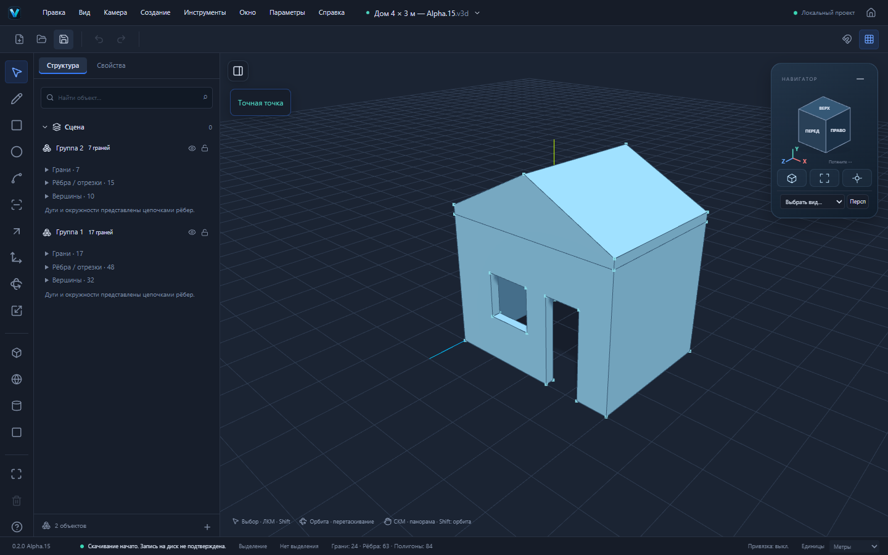

# Alpha.15 — редактирование граней и проверенный сценарий дома

Версия: `0.2.0-alpha.15`. Основа: опубликованная Alpha.14, commit `514b4bd7d9530e8ee2ce00d6e2866e7194f0214a`. Ветка `codex/alpha15-editing`. Отдельный PR в main; автоматическое объединение и публикация не выполняются.

## Что изменилось

### Delete объединяет соседние плоские грани

Выбор внутреннего ребра и Delete удаляет разделитель и строит общую редактируемую грань. Прямоугольник 4 × 3 м, разделённый пополам, снова становится одной гранью площадью 12 м². Работают несколько соседних областей, отверстия, грани с противоположной параметризацией и грани замкнутого тела.

Алгоритм находится в `packages/geometry/src/erase-merge.ts` и включён в существующий `prepareSketch`. Он строит граф только по явно удаляемым внутренним рёбрам и копланарным граням. Парные внутренние coedge исключаются; оставшиеся ориентированные границы собираются в наружный контур и отверстия. Проверяется копланарность в мировой метрике, материалы обеих сторон, принадлежность shell и ориентация. Итог проходит существующую валидацию всей геометрии. Three.js в вычислении топологии не участвует.

Граничные вершины и рёбра сохраняют ID. Новая грань и контуры получают новые ID; provenance связывает старые грани с новой через `reason: "merge"`. Изменение остаётся единым GeometryDelta в существующей истории, с точным inverse. Shell/body сохраняются и перепроверяются. Схема файлов не меняется.

Ранее удалённые области не восстанавливаются: глобальный поиск граней здесь не запускается. Явное удаление самой грани имеет приоритет. При удалении наружной границы или неплоского стыка сохраняется существующее каскадное поведение удаления прилегающих поверхностей.

### Дверь до пола в контуре четырёх стен

При проверке сквозного проёма исправлена проверка нижней поверхности стены с внутренним контуром комнаты. Нижняя полоса дверного проёма теперь может касаться внутренней границы стены, оставаясь внутри материала. Проверки пересечений, входа в пустоту и внутренней точки сохранены. Обычный профиль не получает такого разрешения; оно применяется только к проверке полосы откоса.

До исправления дверь в кольце четырёх стен ошибочно отклонялась как пересечение с другой гранью. Теперь окно и дверь последовательно создают корректное замкнутое тело. Чрезмерная глубина по-прежнему отклоняется атомарно.

### Явный возврат к рабочей плоскости

В панели точного построения добавлена кнопка «Рабочая плоскость: …». Она снимает автоматически выбранную плоскость грани и использует существующие настройки рабочей плоскости. Это позволяет начать отдельную крышу на заданной высоте без переключения между несколькими плоскостями. Во время незавершённой цепочки кнопка недоступна. Документ и история не изменяются.

## Настоящий сценарий дома

[Открываемый проект .v3d](examples/alpha15-house.v3d) создан браузерными действиями Playwright, а не генерацией документа в тесте.

1. Новый пустой проект, единицы — метры. R: прямоугольник 4 × 3 м.
2. F: внутренний отступ 200 мм; удалить внутреннюю грань. P: поднять кольцо стен на 3 м. Объём материала — 7,92 м³.
3. На передней стене R: окно 1 × 1 м с нижним углом на высоте 1 м. P: −200 мм. Объём — 7,72 м³.
4. На той же стене R: дверь 800 × 2000 мм от пола. P: −200 мм. Объём — 7,4 м³. Сгруппировать стены.
5. В корневом контексте выбрать XZ, нажать возврат к рабочей плоскости. R: первая точка `0m;3m;0m`, размер 4 × 3 м. P: 200 мм.
6. L: линия конька от `(2;3,2;0)` до `(2;3,2;3)`. Выделить ребро, M, ось вверх, точный подъём 1 м. Сгруппировать крышу.
7. Сохранить, перезагрузить страницу, открыть скачанный файл. Геометрия и узлы групп идентичны сохранённым.

Получено два независимых GeometryModel: стены — 32 вершины, 48 рёбер, 17 граней, объём 7,4 м³; крыша — 10 вершин, 15 рёбер, 7 граней, объём 8,4 м³. Вместе 24 грани, 63 ребра, 84 треугольника отображения. Объёмы относятся к материалу тел, а не к внутреннему объёму дома. Обе оболочки замкнуты. Построение крыши не меняет геометрию стен.

## Проверки

- `pnpm test`: 521/521, 39 файлов. Все прежние 501 тест прошли; добавлено 20 геометрических и интеграционных регрессий.
- Production Playwright: 103/103, 4,6 минуты, без retries и увеличения индивидуальных timeout. Использован отдельный Vite preview на порту 4186. Эквивалент `pnpm test:e2e` с отдельным production webServer вместо занятого порта разработки.
- Новые шесть E2E используют реальные клики, клавиатуру, поля размеров, скачивание и загрузку .v3d. Прямых вызовов команд редактора или построения геометрии в E2E нет; функции ядра используются только для проверки скачанного результата.
- `pnpm build`: TypeScript и Vite успешно; предупреждение о размере основного JS chunk остаётся.
- `pnpm check:deps`: успешно, 12 workspaces, импорты/объявления/циклы.
- `pnpm check:pages`: успешно. Production Home, редактор, логотипы и настоящий STEP Worker проверены под `/vextrio-3d/` с Windows CSP.
- Локальный Cargo недоступен. Удалённая Windows-сборка и native-тесты проверяются в CI PR. Локальная установка Windows, offline-запуск установленного приложения и ручная приёмка установщика не проверялись.

Регрессии охватывают отверстия и ранее удалённые области, материал-конфликт, неполное удаление внутренних разделителей, замкнутое тело, противоположные нормали, вложенные преобразования с положительным неравномерным масштабом, копирование и makeUnique, Undo/Redo, provenance, JSON roundtrip, неизменность dirty/revision/истории при отказе. Отрицательные отражённые масштабы по-прежнему отклоняются существующей политикой атомарно.

## Ограничения

- Объединение требует одинаковых ID материалов передней и задней сторон с учётом ориентации. Автоматическое согласование материалов пока отсутствует.
- Все внутренние разделители объединяемой области нужно удалить одной командой. Висячие внутренние рёбра, самокасания, несколько наружных контуров и неманифолдные ситуации отклоняются. Лимиты: 512 граней и 8192 coedge на одну объединяемую область.
- Это оболочка небольшого дома: стены, проёмы и крыша. Отдельные двери, стекло, перекрытия, лестница, помещения и строительная документация в пример не входят.
- Push/Pull не является универсальным булевым CAD-оператором: сложные пересекающиеся тела и произвольные сквозные конфигурации остаются за пределами поддержки.
- Формат `.v3d`, `format: "forma"`, v1/v2, внутренние пакеты и Windows identifier сохранены. Браузерное скачивание не считается подтверждением записи на диск.
- Полный паритет со SketchUp не заявляется. Публичный сайт остаётся на Alpha.14 до отдельного разрешения на публикацию.

## Следующие задачи

Приёмка дома и операций Delete пользователем; затем расширение безопасного редактирования поверхностей и поведения Push/Pull на сложных конфигурациях. Для будущего выпуска отдельно обязательны установленная Windows-версия, offline-проверка и производительность больших моделей. Объединение PR и обновление сайта — отдельное действие после приёмки.
