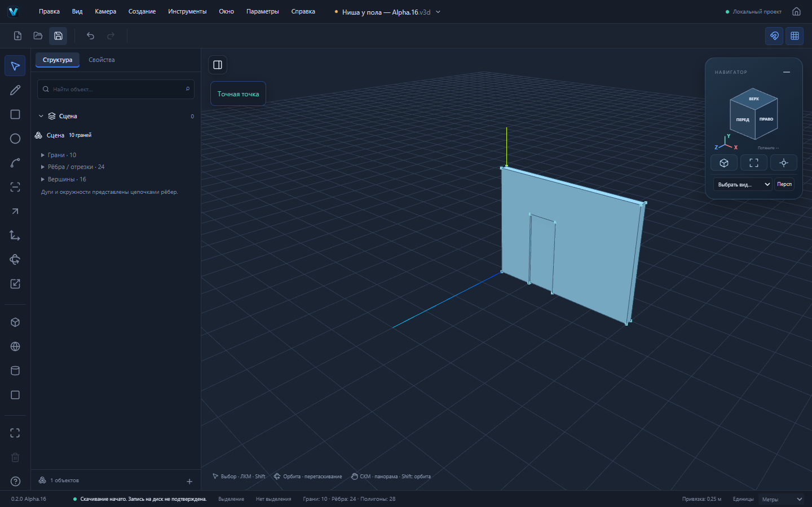

# Alpha.16 — ниши у края стены и последовательный Push/Pull

Ветка `codex/alpha16-boundary-pockets`, основана на Alpha.15 / PR №25 (`3d252fbdc830007be183f717116bcf8b617ae6de`). Это следующий независимый шаг надёжности поверхностей. Alpha.15 пока не объединена с main; новый PR имеет базой её ветку, а не main. Публичная Alpha.14 не заменяется автоматически.

## Пользовательское изменение

Раньше Push/Pull контура, доходящего до пола или края стены, принимал только полную глубину стены. Например, ниша 800 × 2000 мм у пола в стене 200 мм не могла иметь глубину 50 мм. Теперь она создаёт настоящую замкнутую выемку с сохранённой задней гранью. Можно продолжить тем же P, углубить нишу ещё раз или закончить её до противоположной грани.

Также исправлено завершение обычного внутреннего кармана до сквозного окна повторным P: существующие откосы распознаются как поверхности позади выбранной грани, а проверка призматического перемещения не перехватывает сквозное завершение.

Новых кнопок и отдельной архитектуры нет. Используются существующие P, числовой ввод, preview, кнопка «До противоположной грани», группы и общая история.

## Сценарий

1. Новый пустой проект. R: 4 м × 200 мм; P: высота 3 м. Объём стены 2,4 м³.
2. На передней стене R: от точки `(1;0;0,2)` профиль 800 × 2000 мм.
3. P: `-50mm`. Предпросмотр показывает 2,32 м³; Enter создаёт нишу. Геометрия до Enter не меняется.
4. Space, выбрать заднюю грань ниши, P. Кнопка «До противоположной грани» показывает остаток 0,15 м. Нажать её и Enter.
5. Получен сквозной дверной проём, объём материала 2,08 м³. Undo возвращает точную нишу с прежними ID; Redo восстанавливает проём.
6. Сохранить .v3d и открыть повторно: модели и узлы идентичны сохранённым.

[Пример настоящей ниши](examples/alpha16-recess.v3d) создан Playwright через интерфейс. В нём 16 вершин, 24 ребра, 10 граней, одна замкнутая оболочка и тело; 28 треугольников отображения. Объём 2,32 м³. Формат `forma`, схема 2.

## Реализация и атомарность

Существующий `boundary-cut.ts` расширен с полного сквозного выреза до ограниченного выреза: внутренний `boundaryThrough` переименован в `boundaryCut`, с явным признаком сохранения задней грани. Публичный API геометрического пакета не меняется.

Используются splitSegments и planar arrangement. При частичной глубине разрезаются только соприкасающиеся наружные поверхности, противоположная поверхность не затрагивается. Создаются настоящие откосы; выбранная грань сохраняет ID и материалы, получает новую границу и перенесённую плоскость. При полной глубине применяется прежний сквозной путь. Висячие атомы очищаются только в обрабатываемом теле; независимая геометрия сохраняется.

`extrusionStop` различает примыкающие поверхности, находящиеся позади задней грани кармана, и наружные граничные поверхности, которые надо подрезать. Это позволяет учитывать оставшуюся толщину при повторном P, сохраняя запрет схлопывания целой крышки тела.

Кандидат строится отдельно, целиком валидируется вместе с контактами всех граней, замкнутостью и положительным объёмом. Применяется один GeometryDelta с обратным изменением и lineage. Невалидная глубина, конфликт геометрии, блокировка и устаревший результат не должны менять документ или историю. Сохранены существующие проверки GeometrySession и команды редактора.

Three.js используется для отображения и экранных координат кликов E2E; не вычисляет геометрическую топологию. Схемы v1/v2, миграция, format: "forma", внутренние пакеты и Windows identifier не изменяются.

## Проверки

- До реализации: новые тесты действительно обнаружили отказ частичной ниши — 4 отказа из первых 5 сценариев; тест чрезмерной глубины проходил.
- После реализации: 535/535 unit/integration, 40 файлов. Добавлено 14 проверок: ниша, последовательное завершение, угол стены, обратная сторона, кольцо стен, повторное углубление, численные отказы, неравномерный масштаб, независимые группы, блокировка и историческая регрессия половинной глубины.
- Прежний тест отказа частичной глубины обновлён по изменившемуся контракту. Вместо удаления защиты оставлены две проверки превышения толщины (-210 и -300 мм для стены 200 мм) и добавлен положительный тест -100 мм с точным объёмом и inverse.
- Три новых Playwright E2E прошли на production preview: preview и Escape, применение, Undo/Redo, открытие .v3d, остаточная глубина через настоящую кнопку и изоляция группы. Все действия выполняются мышью/клавиатурой; прямых вызовов ядра для построения в E2E нет.
- Полный production Playwright: 106/106, 4,8 минуты, без retries и увеличения индивидуальных timeout. Отдельный preview на порту 4188, все прежние 103 сценария также прошли.
- `pnpm build` и `pnpm check:deps` прошли. Сохраняется предупреждение о размере главного JS chunk.
- `pnpm check:pages`: успешно. Проверены Home, редактор, логотипы и настоящий STEP Worker под `/vextrio-3d/` с Windows CSP.
- CI Windows будет отражён в PR по фактическому результату. Ручная установка и offline-приёмка Windows не выполнялись; локальный Cargo недоступен.

## Границы поддержки

Поддержаны призматические выемки из плоского контура без собственных отверстий в одной замкнутой оболочке, с существующей распознаваемой противоположной плоскостью и допустимыми контактами. Глубина не должна превышать оставшуюся толщину. Случаи произвольных булевых пересечений нескольких тел, наклонной противоположной поверхности, отражённого масштаба и неоднозначных контактов не заявляются.

Повторный вырез может сохранять копланарные разделяющие рёбра между старым и новым откосами: это настоящие редактируемые рёбра, а не разрыв оболочки. Для совместимых граней их можно удалить существующим Delete из Alpha.15.

Браузерное скачивание не подтверждает запись файла на диск. Полный паритет со SketchUp не достигнут. Публикация на основной сайт и объединение PR остаются отдельными действиями после приёмки.

Следом: приёмка последовательного моделирования, затем надёжная работа Push/Pull при более сложных поверхностях и контактах; отдельно производительность крупных моделей и проверка установленной Windows-версии без сети.

## Стабилизация E2E

Первый Linux CI: 535 unit и 105 E2E прошли, один зависимый сценарий дома получил неожиданную повторную навигацию после записи примера в docs. Артефакты дома, ниши и workspace теперь генерируются только в игнорируемом test-results, а CI отдельно проверяет git diff --exit-code после E2E. Статические примеры отчётов не перезаписываются во время тестов. Это сохраняет проверки геометрии, реального picking и площади; таймауты и retries не увеличиваются.
