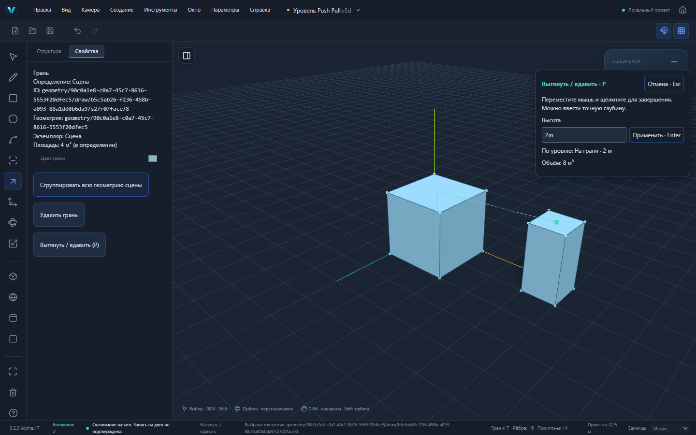

# Alpha.17 — точный уровень Push/Pull

Основа: main `4c29ae7b35734a97e4748f36c4ad590fb647d3da`, опубликованная Alpha.16. PR №25 и №26 объединены по запросу пользователя. Сайт Alpha.16 прошёл отдельную проверку реальной версии, viewport, STEP-топологии, локального CAD WASM и лицензии: [deployment](https://github.com/dmitriy5885as-design/vextrio-3d/actions/runs/41292437845).

Alpha.17 — отдельный этап, ветка `codex/alpha17-depth-inference`. Не является заявлением полного паритета со SketchUp.

## Как работает

1. Включить «Привязки к геометрии и сетке».
2. P: щёлкнуть грань, начать движение мыши.
3. Навести курсор на реальную вершину, конец/середину ребра, точку на ребре или поверхности либо топологическое пересечение.
4. Подсказка «По уровню» и мятная направляющая показывают выбранную опору. Грань перемещается только вдоль исходной нормали, до уровня опорной точки.
5. Второй щелчок подтверждает существующую команду Push/Pull. Ввод числа снимает привязку; Enter подтверждает число. Esc отменяет предварительное построение.

Отключение привязок сразу убирает подсказку и направляющую. Смена контекста отменяет неподтверждённый жест. Подтверждённая асинхронная команда сохраняет существующую защиту от отмены при потере фокуса.

## Настоящий сценарий

Опорный объект: отдельная группа с параллелепипедом 1 × 1 × 2 м в X=4…5 м. Исходная грань: квадрат 2 × 2 м в X=0…2 м, Y=0.

P начинается в `(1;0;1)`. Курсор наведён на верх опорной группы, например `(4,5;2;0,5)`. Уровень равен 2 м, конечное положение точки оси `(1;2;1)`. После подтверждения возникает замкнутое тело объёмом 8 м³; геометрия опорной группы побайтно сохраняется в сравнении JSON. Два независимых GeometryModel, суммарно 16 вершин, 24 ребра, 12 граней, два замкнутых тела. Опорный объект имеет объём 2 м³.

Числовой ввод `3m` вместо привязки даёт исходному квадрату объём 12 м³. Это отдельный проверенный сценарий.

[Сохранённый проект после выравнивания](examples/alpha17-aligned.v3d)

## Архитектура

В `packages/snapping` добавлен `resolveDepthSnap`: скалярная проекция мировой опорной точки на нормализованную нормаль жеста. Бокового перемещения не происходит. Синтетические grid/axis/inference-кандидаты не выдаются за реальную геометрию. Нулевая глубина и опора за допустимой противоположной стенкой не получают статус привязки.

Snap Engine получил необязательный фильтр видов кандидатов до ранжирования и hysteresis. Старые запросы не меняют поведение. Viewport повторно использует существующий пространственный индекс, обновляя его при изменении геометрии/узлов/определений/политики, а не на каждом движении мыши. Действуют существующие отсечение скрытого, проверки видимости, блокировок, радиусов и контекста.

Поиск использует каноническую топологию, а не временный Mesh предпросмотра. Это предотвращает обратную связь с движущейся виртуальной гранью. Three.js рисует только направляющую и маркер; их ресурсы освобождаются при размонтировании viewport.

В состоянии жеста хранится временная ссылка на опору. Она не записывается в документ или .v3d. Применение остаётся существующей атомарной GeometrySession/GeometryDocumentCommand с общей историей и проверками геометрии. Не добавлены новые пути изменения топологии, схемы файлов или обход блокировок. Сохраняются v1/v2, format: "forma", внутренние пакеты и Windows identifier.

## Проверки

- 545 unit/integration, 41 файл: десять новых проверок проекции нормали, мировой глубины, знака, предельной стенки, синтетических и невалидных целей, владения числовым вводом, отмены, фильтра кандидатов, снятия предыдущей привязки и сохранения идентичности подтверждённого жеста при смене фокуса.
- Три новых реальных Playwright-сценария прошли: выравнивание по независимой группе с Undo/Redo и повторным открытием; ручной ввод и Esc; отключение привязок.
- Полный production Playwright: 109/109, 6,1 минуты, без retries. После финального усиления защиты подтверждённого жеста прошли 12/12 целевых сценариев новых привязок и прежнего Push/Pull. Скриншот ожидает готового объёмного preview 8 м³.
- TypeScript и production build прошли. Предупреждение о размере основного JS chunk сохраняется.
- check:deps прошёл, новых библиотек нет. check:pages прошёл: Home, редактор, логотипы и настоящий STEP Worker под `/vextrio-3d/` с Windows CSP. Независимый Web/Windows CI фиксируется в PR после фактического завершения.
- Ручная установка Windows и offline-приёмка не выполнены; локальный Cargo недоступен.

Все новые снимки и .v3d генерируются в test-results; статические копии для отчёта переносятся после завершения тестов. CI проверяет неизменность отслеживаемых исходников.

## Ограничения

Привязка задаёт уровень точки вдоль нормали; она не гарантирует булево соединение тел и не решает пересечение с наклонной стенкой. Допустимость результата по-прежнему определяет геометрическое ядро. Для наклонной опорной поверхности уровень зависит от точки под курсором.

Работает с настоящей топологической геометрией. Старые примитивы сначала следует преобразовать существующим «Редактировать вершины». Независимость соседней группы проверена; правка общего определения компонентов по-прежнему требует существующего подтверждения изменения всех экземпляров.

Скрытые и заблокированные опоры исключаются существующей политикой Snap Engine. Можно ограничить поиск активным контекстом. Бюджеты пространственного поиска прежние; большие сцены требуют отдельного нагрузочного тестирования.

Публичный сайт остаётся на Alpha.16 до отдельной публикации новой ветки. Следом — расширение надёжных конфигураций Push/Pull и сквозных проёмов, проверка проекта с перегородками и перекрытиями и установленной Windows-версии без сети.
