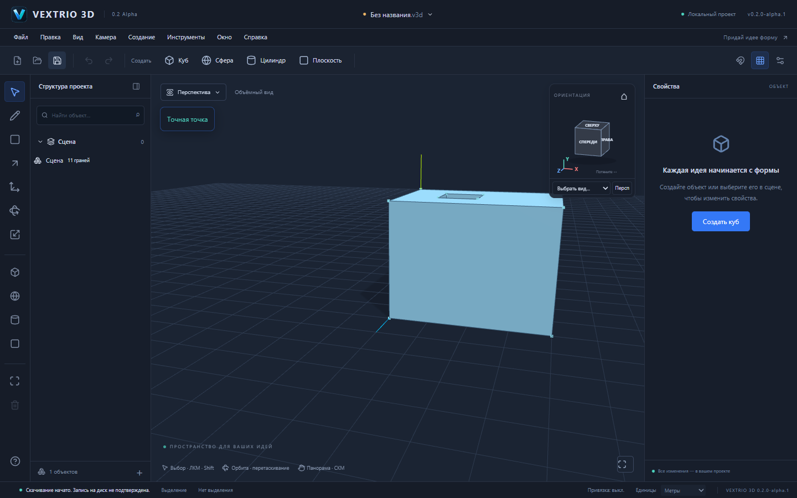
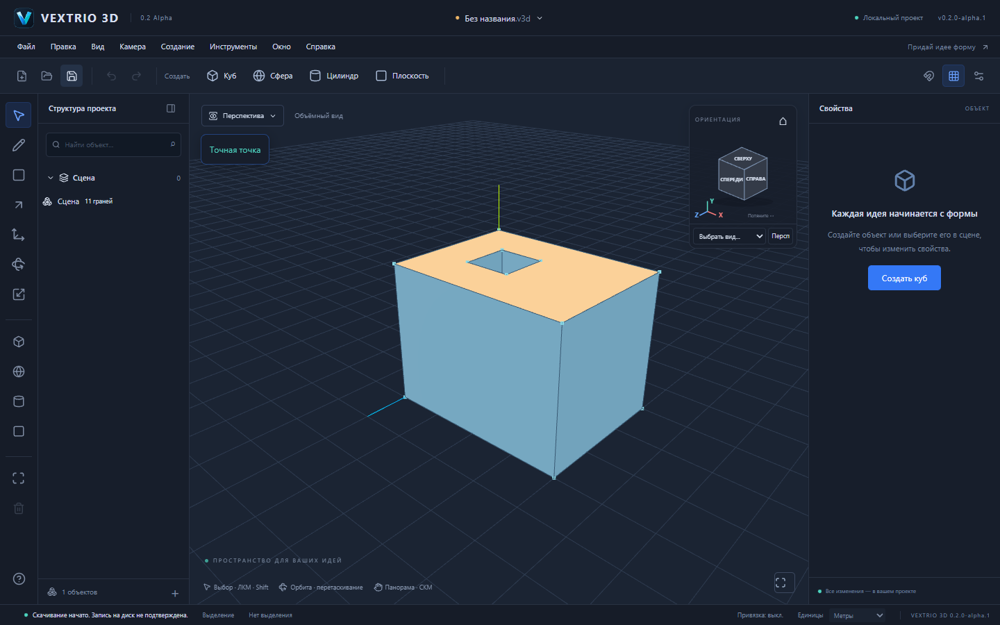

# VEXTRIO 3D 0.2.0-alpha.1

Альфа для приёмки. Эта ветка включает объёмное моделирование PR №9 и доработки, необходимые для повседневного Sketch. Полный паритет со SketchUp и стабильный выпуск 0.2 не объявляются. Main автоматически не объединяется.

## Что входит

- Линии L и прямоугольники R, точные размеры, привязки, пересечения, реальные редактируемые грани и отверстия.
- Выдавливание P, изменение высоты призмы, выступы и ограниченные углубления; группы, экземпляры и независимые копии. [Подробности ядра и границы операций](VOLUME_REPORT.md).
- Новый ориентационный куб в верхнем правом углу вместо неподвижной имитации. Шесть главных видов, выбор видимых рёбер/углов, вращение перетаскиванием, триада XYZ, изометрия и переключатель проекции. Куб соответствует текущей камере, доступен мышью и клавиатурой; скрытые виды доступны через список.
- Переключение вида сохраняет target и расстояние; переход перспектива ↔ ортография сохраняет высоту поля зрения. Оси существующего проекта не менялись: Y направлена вверх. F для native экземпляра учитывает его размещение, общий обзор учитывает модель.
- Цвет настоящей топологической грани с обеих сторон. Сохраняются ID и параметры материалов; новые материалы не перекрашивают другие грани случайно. Связанные определения требуют явного подтверждения в UI; блокировки проверяются. Окраска — одна атомарная команда в общей Undo/Redo.
- Локальная автокопия последнего редактируемого проекта в IndexedDB через 1,2 секунды после изменения документа. На стартовом экране можно восстановить или удалить её. Восстановленная копия помечается несохранённой; путь native файла сбрасывается, файл пользователя не перезаписывается. Проверяются schema и топология; повреждённая копия не становится документом. Очередь упорядочивает write/delete и отбрасывает устаревшие callbacks.
- Согласованная версия `0.2.0-alpha.1`: пакеты, интерфейс, Cargo и Tauri. Название окна — `VEXTRIO 3D — 0.2 Alpha`. Старые `.v3d`, `format: "forma"`, schema v1/v2, `@forma/*`, binary и app identifier сохранены.

## Приёмка и проверки

`pnpm test`: **322/322**, 23 файла. Новые проверки покрывают очередь автокопии, удаление во время незавершённой записи, ошибки хранилища, отмену, атомарную окраску, сохранение параметров и Undo/Redo, блокировки и согласованность версий.

`pnpm test:e2e`: **33/33** в Chromium. В том числе:

1. Загрузить модель, сдвинуть центр камеры панорамированием, переключить все шесть видов. Target, расстояние и геометрия сохраняются.
2. Переключить перспективу/ортографию, проверить физическую высоту поля зрения; потянуть куб и получить реальный новый ракурс без команд в Undo.
3. Выбрать видимую native грань, изменить цвет, дождаться автокопии, перезагрузить страницу, восстановить. Получить идентичную топологию и материалы; история после восстановления начинается заново.
4. Повреждённая автокопия отклоняется, удаляется через UI; новый документ остаётся доступен.
5. Все прежние проверки S1–S6, объёмных операций, групп, старых v1, сохранения/открытия продолжают проходить.

Полный прогон выявил регрессию первого выбора после открытия: raycast мог использовать матрицу предыдущего кадра. Исправлен picker, который теперь обновляет camera.matrixWorld непосредственно перед лучом. Ошибка устранена без искусственных задержек в тестах; повторный полный прогон прошёл.

`pnpm build`, `pnpm check:deps`, frozen-lockfile install и `pnpm check:pages` прошли. Последняя команда действительно открывает production-сборку с `/vextrio-3d/` в Chromium и проверяет welcome/editor, оба логотипа, HTTP и JS ошибки. Цифры тестов не включают несуществующие Windows UI smoke: сборка NSIS и три Rust FileSession теста проверяются отдельно в Actions, статус конкретного commit виден в PR.

## Ограничения альфы и следующие функции

Автокопия — дополнительная локальная страховка, а не гарантированная запись `.v3d` на диск. Хранится один последний проект для данного origin, не все проекты и не общая история команд; несколько вкладок могут перезаписывать эту копию. Последние 1,2 секунды могут не попасть в неё при аварии. Очистка данных сайта или переполнение/отключение IndexedDB лишает этой страховки; ошибки отображаются, ручное сохранение остаётся доступно. Движение камеры без правок модели само по себе не запускает автокопию. После восстановления Undo не содержит действий предыдущего сеанса.

Нет сквозных вырезов/CSG, круга и дуги как отдельных интерактивных инструментов, произвольного переноса ребра/грани, внешнего CAD-импорта, текстур, production Worker и расширенных операций над вложенными сборками. Выдавливание сохраняет ограничения, описанные в VOLUME_REPORT. Цвет — стандартный параметр материала, не полноценная библиотека визуализации.

Следующий приоритет: Worker и измеримые бюджеты больших сцен; затем сквозные проёмы и надёжное изменение формы, круг/дуга и конверсия legacy примитивов, импорт. Native установка/обновление, диалоги, восстановление IndexedDB в WebView2 и работа без интернета требуют ручной Windows-приёмки. Успех CI-компиляции не выдаётся за эту проверку.

Семантическая prerelease-версия задана в Tauri согласно [официальному описанию config.version](https://v2.tauri.app/reference/config/#version); фактическая совместимость NSIS подтверждается сборкой конкретного commit, а не предположением о преобразовании версии.
