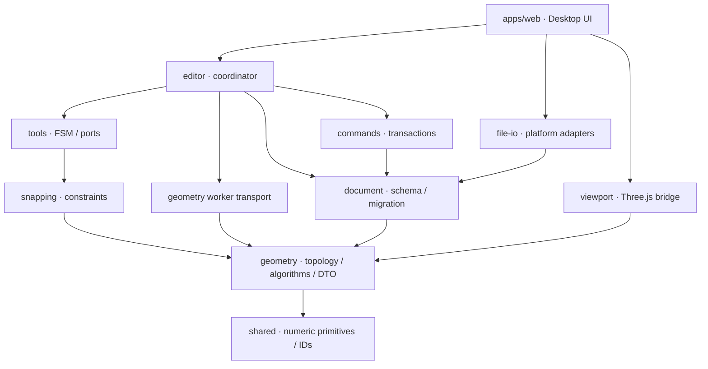

# Архитектура прямого моделирования FORMA 0.2

Статус: предложение для утверждения. Ниже описаны будущие правила, не реализованная функциональность. Основание — [аудит](AUDIT.md) и [принципы продукта](../../PRODUCT_STRATEGY.md).

## 1. Модель и владение данными

Авторитетен документ FORMA. Геометрия — координаты и связи сущностей, а не треугольники Three.js. Производные данные: тесселяция, normals, bounds, adjacency indexes, BVH, плоские DCEL, GPU buffers. Их можно удалить и построить заново без изменения проекта.

Разделяются три понятия:

- **GeometryModel** — свободная топология одного контекста редактирования. Вершины и связи хранятся в локальной системе определения.
- **Definition** — содержимое сцены, уникальной группы или компонента: до одной native GeometryModel и дочерние placements. Вложенные определения образуют DAG без циклов.
- **Node/placement** — размещение определения или legacy-примитива с transform, видимостью и блокировкой. Геометрия компонента хранится в definition один раз, размещений может быть несколько.

Корень проекта — scene definition. Свободные линии и грани в одном открытом definition используют одну GeometryModel и взаимодействуют между собой. Body — связная часть этой геометрии, а не изолирующий контейнер. Разные группы/компоненты и legacy-примитивы не свариваются от визуального совпадения.

У group definition ровно одно размещение: обычное дублирование группы глубоко копирует содержимое с новыми IDs. Component definition может иметь много placements: изменение внутри определения видно во всех экземплярах. «Сделать уникальным» клонирует определение и перенаправляет только выбранный instance. Эту семантику нельзя заменять обычным копированием Mesh.

Группировка переносит транзитивное замыкание выбранных faces/loose edges и нужных им boundary entities. Сущности, используемые только переносимой частью, сохраняют IDs и меняют owner GeometryModel; общие с оставшейся частью boundary vertices/edges клонируются для нового контекста с новыми IDs, coedges обновляются, исходные shared IDs остаются снаружи. Изоляция не оставляет cross-model refs. Вся операция вместе с новым placement, преобразованием local coordinates и remap references обратима. Начать UI с полных связных Bodies, затем отдельно принять и протестировать частичную группировку. Разгруппировка вставляет геометрию в родительский контекст через тот же normalize/intersection pipeline, может менять топологию; только Undo группировки гарантирует точное восстановление прежних IDs.

## 2. Сущности и инварианты

| Сущность   | Истинные данные                                                | Инварианты                                                                                                                                       |
| ---------- | -------------------------------------------------------------- | ------------------------------------------------------------------------------------------------------------------------------------------------ |
| Vertex     | id, local position Float64                                     | Конечные значения; один ID обозначает одну вершину, не произвольный индекс массива                                                               |
| Edge       | id, начало/конец VertexId, straight curve                      | Разные концы; длина выше допуска; нет дублирующего ребра между теми же вершинами в одном контексте                                               |
| Coedge     | id, EdgeId, направление +1/-1, LoopId                          | Одно использование ребра в конкретном обходе; направление согласовано с обходом                                                                  |
| Loop       | id, упорядоченные CoedgeId                                     | Обход замкнут по вершинам, нет самопересечений и нулевой площади у границы грани                                                                 |
| Face       | id, plane, outerLoopId, innerLoopIds, front/back material      | Плоская область; отверстия внутри внешней границы, не касаются и не пересекают друг друга; нет перекрывающихся областей граней в одной плоскости |
| Shell      | id, ориентированные FaceUse                                    | Грани связаны по рёбрам; ориентация использования отдельна от собственного направления грани                                                     |
| Body       | id, наборы Vertex/Edge/Face/Shell                              | Связная топология; принадлежность и ссылки проверены; изолированный wire допустим; solid выводится из проверки, не из флага пользователя         |
| Definition | id, kind, geometryId, childNodeIds                             | Один native geometry context; group не разделяет одно определение между независимыми placements                                                  |
| Node       | id, parentDefinitionId, definitionId либо primitive, transform | Корректная ссылка, один родитель-контекст, ненулевая обратимая матрица; definition graph без циклов                                              |
| Material   | id, параметры                                                  | Стабильная ссылка, отдельная от геометрической идентичности                                                                                      |

IDs уникальны в документе, неизменны, не переиспользуются после удаления. Обратная команда восстанавливает те же IDs. Связность и классификация wire/sheet/closed-solid/non-manifold вычисляются и валидируются, при сохранении не доверять кешу. Несвязанные геометрии получают разные Body IDs. Разделение/слияние Bodies отражается в lineage.

Глобальная модель допускает открытые и неманифолдные участки, необходимые при рисовании. Поэтому **не навязывается один twin для каждого ребра всей 3D-сцены**. Ребро имеет любое число coedge-использований, вычисляемых индексом. Для solid требуется замкнутая ориентируемая оболочка, ровно два согласованных использования каждого граничного ребра, отсутствие самопересечений оболочки и валидный объём. До такой проверки не объявлять тело solid.

Для вычисления областей на отдельной плоскости применяется производное DCEL-разбиение: у его полурёбер есть twin/next/prev и ограниченные/неограниченная области. Это локальный алгоритмический индекс, не второе авторитетное хранилище 3D-топологии. Модель DCEL и разбиение плоскости описаны в [официальной документации CGAL](https://doc.cgal.org/latest/Arrangement_on_surface_2/classCGAL_1_1Arrangement__2.html); подключать CGAL как зависимость для этого не предлагается.

## 3. Координаты и численная политика

В документе метры и binary64; единицы проекта относятся к отображению/вводу. Y остаётся вертикальной осью ради совместимости 0.1. Quaternion + translation + positive scale задают local transform нового placement; v1 Euler переводится с сохранением порядка XYZ. Мировая матрица — произведение матриц occurrence path. Невырожденные world matrices с shear от вложенных nonuniform scales допустимы для отображения/проекции; операция, требующая недоступного разложения в local TRS, отклоняется явно. Mirror и редактирование произвольного shear не входят в обязательства 0.2.

Каждая рабочая плоскость имеет origin и ортонормальные u/v/normal, `u × v = normal`. Ввод и числовая длина разрешаются в мировой метрической системе; затем результат переводится обратной матрицей выбранного occurrence в локальный документ. Не сравнивать расстояния в разных пространствах. После вставки повторно проверить геометрию в контексте и world metric. Плоскости объединяются по нормали и расстоянию с проверкой всех точек, не по округлённому строковому ключу.

Предлагаемые стартовые допуски для архитектурных моделей, подлежащие испытанию на S2/S5: `distance = max(1e-7 м, 1e-12 × D)`, где D — diagonal bounds затрагиваемой области в world metric; angular `1e-10 рад`; area `distance²`. При слишком больших D, неразличимости деталей или обусловленности преобразования выше 1e8 — диагностическая ошибка, а не молчаливое увеличение сварки. Граница применимости и фактические числа должны быть зафиксированы после численных fixtures.

Экранная привязка (например 8 CSS px) и численный допуск топологии — разные величины. Не округлять все координаты к grid для «лечения» модели. Пользовательский grid snap — отдельное ограничение. Проверка положения на плоскости, равенства вершин, касания и пересечения использует одну GeometryPolicy с сохранённой версией в документе.

Orientation-предикаты должны быть адаптивно устойчивыми, а построенные точки пересечения — канонизированными с общей VertexId и проверкой после округления. Устойчивый знак предиката **не доказывает** точность конструкции пересечения. Почти вырожденный случай, который не проходит постпроверку, возвращает NUMERICAL_AMBIGUITY и оставляет документ прежним. Основание для выбора предикатов — [работа Shewchuk](https://www.cs.cmu.edu/~quake/robust.html). Конкретную JS/WASM-реализацию выбрать на S2 после проверки API и лицензии, не копировать случайный алгоритм из примера.

## 4. Добавление отрезка и автоматическое образование граней

Все шаги ниже выполняются над candidate транзакции; результат публикуется целиком или отвергается.

1. Разрешить активный definition/occurrence и locks, зафиксировать base revision, plane и числовые ограничения. Preview не меняет документ.
2. Отбросить нулевой отрезок. Через пространственный индекс выбрать кандидатов существующих рёбер/граней. В базовой корректной реализации допустим полный перебор внутри малой области; оптимизация не меняет результата.
3. Найти настоящие 3D-пересечения segment/segment: proper crossing, T-junction, общий endpoint и коллинеарное перекрытие. Пересечение только экранных проекций не соединяет геометрию.
4. Получить параметры t вдоль каждого отрезка, отсортировать, канонизировать точки в пределах GeometryPolicy без транзитивного «цепочного» слияния далёких точек. При равных кандидатах выбирать детерминированный существующий ID. Коллинеарное перекрытие заменить минимальным набором уникальных атомарных интервалов. Повторное рисование существующего ребра — no-op, не новый дубликат.
5. Разделить все затронутые рёбра, включая coedge-использования существующих граней в других плоскостях. Старый EdgeId retired, потомки получают новые IDs и `sourceEdge + parameterRange` provenance. Вне затронутой области IDs сохранить.
6. Определить затронутые плоские области: рабочая плоскость эскиза и поддерживающие плоскости затронутых граней. Вложить релевантные компланарные сегменты в их u/v-системы. Для свободного 3D-контура без назначенной плоскости вычислить кандидат по неколлинеарным точкам и проверить все вершины; неплоский контур остаётся рёбрами с объяснением.
7. Построить/обновить плоское разбиение: упорядочить исходящие полурёбра устойчивым angular comparator через quadrants + orientation, задать next/prev и обойти границы областей. Один atan2 с epsilon не считается решением численной устойчивости.
8. Классифицировать bounded/unbounded области и вложенность границ point-location-проверкой. Внешнюю неограниченную область не превращать в грань; dangling edges не являются контурами. Не перечислять все простые циклы графа: это порождает перекрывающиеся faces.
9. Разрешить заполненность областей по правилам следующего раздела, создать/разделить грани с outer/inner loops. Тесселяция — только после валидных контуров, с поддержкой отверстий и проверкой суммы площадей. Треугольники не становятся рёбрами документа.
10. Пересчитать связные Bodies, Shell classification, bounds, picking-map и локальные spatial indexes. Проверить все инварианты, пересечения границ и отсутствие перекрытий coplanar faces.
11. Вернуть delta + inverse + lineage + diagnostics + RenderMeshDTO. Применить только при совпадении base revision и живой сессии документа. Последний отрезок и созданная им грань — одна команда Undo.

### Заполненность, отверстия и удаление

Новый bounded cell, возникший из ранее неограниченной пустой области при замыкании контура, автоматически заполняется. В уже заполненной грани диагональ создаёт две заполненные грани. Внутренний прямоугольник в заполненной грани создаёт внутреннюю грань и внешнюю грань с внутренним loop; **не отверстие насквозь**. Удаление только внутренней грани оставляет её граничные рёбра и настоящий незаполненный участок.

Пустые ранее ограниченные области определяются по before-arrangement и отсутствию соответствующей Face. Они не заполняются повторно от незатрагивающей их операции или простого разбиения. Их дочерние cells наследуют пустоту. Для намеренного восстановления предусмотрена команда «Создать грань» по валидному закрытому контуру. Новый контур внутри явно оставленной пустой области также требует этой команды — это явное правило 0.2, а не автоматическая догадка о намерении.

Удаление внутреннего общего ребра двух компланарных заполненных граней объединяет область; material наследуется от выбранной исходной грани, иначе от грани с минимальным стабильным ID, с предупреждением при различии материалов. Удаление граничного ребра снимает зависимые грани, которые больше нельзя замкнуть. После операции показывать preview затрагиваемых сущностей. Удаление грани не удаляет автоматически используемые другими гранями рёбра. Не удалять некомпланарные грани ради «слияния».

### Область пересечений 0.2

Поддерживаются отрезки, T/X-соединения, совпадения и коллинеарные перекрытия в одном edit context, coplanar face subdivision и реальная общая 3D-точка непараллельных сегментов. Скрещивающиеся отрезки не пересекаются. Отрезок поперёк плоскости грани может получить узел в точке пересечения, но это само по себе не создаёт отверстие или разрез поверхности. Автоматический поиск и boolean всех некомпланарных face/face пересечений, кривые поверхности и solid boolean не входят в 0.2. Такой запрос даёт UNSUPPORTED_OPERATION без частичного изменения. Это ограничение должно быть утверждено и отражено в интерфейсе.

## 5. Устойчивые ссылки и происхождение

EntityRef = definitionId + geometryId + entity kind/id + occurrence path для выбранного экземпляра. Индекс треугольника — только входной ключ picking table конкретной render revision. Нельзя сохранять его как геометрическую ссылку.

- Неизменённая сущность сохраняет ID после tessellation, камеры, сохранения и повторного открытия.
- Split: исходный ID retired, каждый потомок получает новый; lineage содержит диапазоны параметров/областей.
- Merge: новый ID с несколькими предками. Никакой скрытой эвристики «первый победил» для пользовательской ссылки.
- Resolve возвращает exact, one-to-one descendant, ambiguous candidates либо deleted. Ссылка на середину старого ребра может разрешаться по параметру; ссылка на целую разделённую грань без дополнительного намерения остаётся неоднозначной.
- Commit сохраняет provenance; Undo восстанавливает прежние IDs и связи, Redo воспроизводит сохранённый delta, а не генерирует новые UUID/округления.
- Retired/provenance хранятся только пока нужны persisted references, текущая геометрия и история. При checkpoint допускается компактизация после проверки ссылок; история Undo не обязана сохраняться в файл.

## 6. Команды, Worker и конкурентность

На первом этапе **UI document store остаётся авторитетным**. Geometry Worker хранит ревизионную реплику затронутых моделей и строит proposals. Он не публикует собственный альтернативный документ. Protocol содержит protocolVersion, documentSessionId, requestId, operationId, baseContentRevision, active context и geometry policy version.

Только один commit-intent на документ выполняется одновременно. Preview-запросы заменяют устаревшие; навигация/наведение не блокируются. Worker возвращает proposed delta и inverse; main thread проверяет ожидаемые ревизию, IDs, locks и структуру ответа и применяет транзакцию атомарно. Геометрические инварианты уже проверены worker; в dev/test повторно проверяются на main. После применения Worker получает ack(newRevision), при stale/cancel — discard/resync. Новый проект/открытие меняют sessionId, поэтому старый результат не может попасть в новый документ с тем же номером ревизии.

У каждой принятой команды новые монотонные revisions, включая Undo/Redo. Для dirty используется отдельный content state token, восстанавливаемый Undo/Redo; возврат к сохранённому состоянию должен снимать dirty. Camera/view token сохраняется отдельно. Snapshot во время save помечается токеном: правки, выполненные во время записи, остаются dirty. События preview/selection не являются содержимым.

GeometryModel хранит binary64/JSON-совместимые сущности; worker render DTO передаёт Float32 positions/normals, Uint32 indices и entity mapping. Переносится buffer DTO, **не** buffer авторитетной модели. Transfer отделяет ArrayBuffer от отправителя, поэтому владение нужно фиксировать явно: [MDN Transferable objects](https://developer.mozilla.org/en-US/docs/Web/API/Web_Workers_API/Transferable_objects). Общая память/SharedArrayBuffer не требуется для первой реализации.

Undo во время compute отменяет proposal, затем выполняет историю; запоздалый ответ отбрасывается. Авария Worker: прежний документ сохраняется, preview снимается, повторный запуск восстанавливает реплику из документа. Долгие задачи прерываются между шагами; когда синхронный WASM не поддерживает cooperative cancel, worker завершается и восстанавливается. Пока операция не принята, «Сохранить» сохраняет только последний принятый документ, не preview, с понятным статусом.

## 7. Геометрические движки и OpenCascade

Первый native planar backend — собственный проверяемый алгоритмический слой над straight edges. LegacyPrimitiveBackend остаётся для 0.1. Оба возвращают независимый RenderMeshDTO. Типы topology/DTO не импортируют Three.js, React, Zustand, DOM или Tauri. На переходе старый PrimitiveAdapter переезжает в renderer bridge; внутренний geometry backend не строит BufferGeometry.

Позднее OpenCascadeBackend обрабатывает команды по capabilities: wires/faces, поверхности, solid operations. Он живёт в Worker, создаёт TopoDS/Geom из канонической модели и возвращает валидированную топологию/opaque serialized B-Rep с engine version. Планарная топология и B-Rep не редактируются независимо как две истины: у asset есть один authoritative representation, другая — кеш/производный результат. Конверсия между representations — явная транзакция с отчётом об ограничениях и потерях. Точные сферы/цилиндры legacy не объявляются точным B-Rep от факта тесселяции.

OpenCascade IsDone/Error и проверка полученной геометрии обязательны. История Generated/Modified/IsDeleted — вход для lineage, не гарантия устойчивого именования. Для face builder ограничения wires проверяет FORMA до вызова и после результата: [OCCT MakeFace](https://occt3d.com/dev/doc/refman/html/class_b_rep_builder_a_p_i___make_face.html). API wrapper и версию привязок необходимо проверить на фактической сборке; документация [OpenCascade.js custom builds](https://ocjs.org/docs/app-dev-workflow/custom-builds) показывает возможность отдельного WASM-модуля, но не подтверждает его готовность в FORMA.

Для операций с неполной историей refs разрешаются по provenance + смежности/геометрическим признакам с confidence; неоднозначность возвращается пользователю. Проверки backend-specific naming входят в приёмку интеграции. WASM handles никогда не попадают в файл или EntityId. Явное освобождение `.delete()`/heap, бюджет памяти, локальная поставка worker/wasm, startup без сети и licenses — release gates будущего подключения. Зависимость OpenCascade не добавлять до такого этапа.

## 8. Пакеты и постепенная интеграция

ToolController получает DocumentPort, PickingPort, CameraPort, CommandPort через интерфейсы, не импортирует Zustand/viewport implementation. Editor соединяет порты. Viewport постепенно теряет зависимость от editor store и получает RenderChangeSet; пока bridge не заменён, legacy путь работает как раньше. Новый отдельный пакет создаётся только при наличии кода и обоснованной границы: на 0.2 достаточно существующих пакетов и внутренних каталогов `topology`, `planar`, `runtime`, `legacy`, `migrations`.

Сохраняются камеры, render-on-demand, палитра и оболочка. В каждой точке интеграции legacy 0.1 E2E обязаны оставаться зелёными. Замена целого редактора или новый движок ради названия не предусмотрены.
