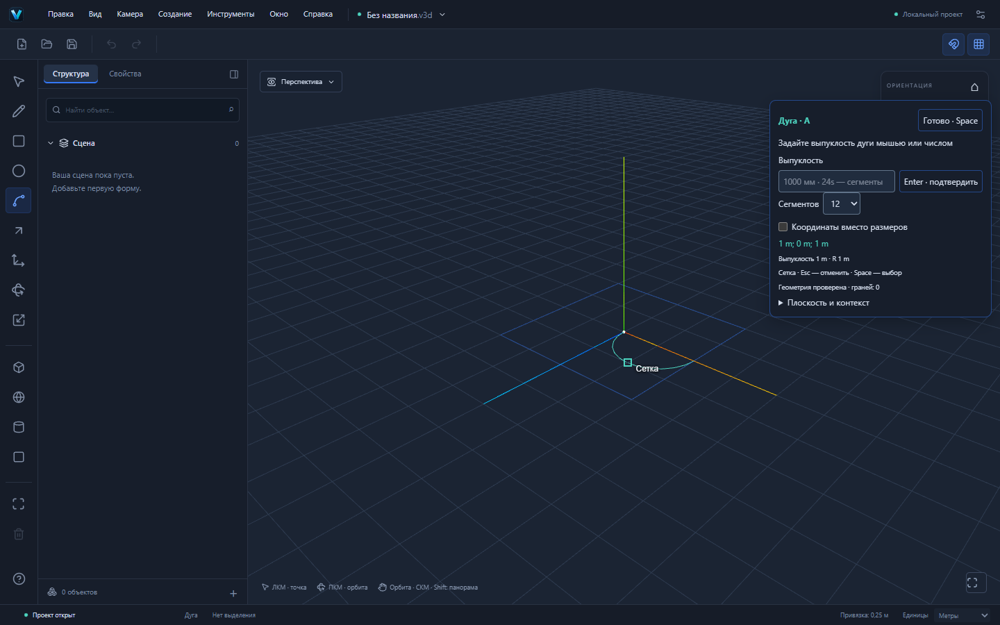
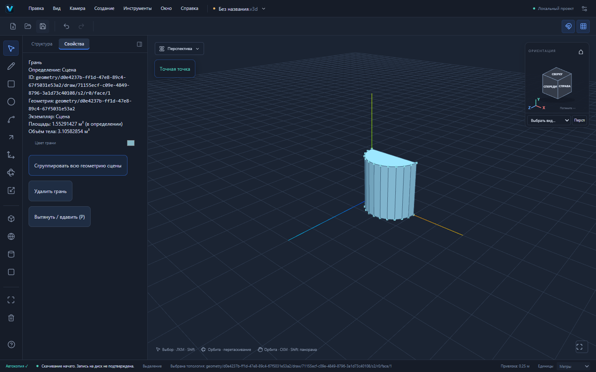

# VEXTRIO 3D 0.2.0-alpha.5 — дуга A

Дуга подключена к существующим ToolController, Snap Engine, GeometrySession и общей истории. Базовая последовательность соответствует [2-Point Arc в официальной справке SketchUp](https://help.sketchup.com/en/sketchup/drawing-arcs): два конца, затем выпуклость; 12 сегментов по умолчанию. Наш инструмент имеет собственные интерфейс и реализацию.

## Как построить

1. **A** или «Дуга» в меню/панели. Первый щелчок задаёт начало. Плоскость берётся с поверхности под курсором либо из активной рабочей плоскости.
2. Движение показывает хорду. Щёлкните второй конец или введите длину (`2000mm`, `200cm`, `2m`) и Enter. Без движения числовая хорда направлена по первой оси рабочей плоскости. Хорда остаётся preview: в документе пока нет ни одного нового ребра.
3. Двигайте мышь для выпуклости. Третий щелчок подтверждает дугу одной командой. Точка привязки сохраняется как вершина сегментированного контура, в том числе вне середины хорды.
4. Вместо третьего щелчка введите точную выпуклость и Enter. Без явного знака сторона следует за курсором; `+` и `-` задают сторону относительно normal × направления хорды. Без движения положительное значение использует положительную сторону. Нулевая выпуклость отклоняется. При числовой выпуклости снимите фиксацию мировой оси; рабочая плоскость сохраняется.
5. Список «Сегменты дуги» или `24s` выбирает число отрезков: 2–128, по умолчанию 12. Это настройка до подтверждения, она не пишет историю. Поддерживаются координаты, миллиметры/сантиметры/метры и десятичная запятая.
6. Esc на любой стадии отменяет всё незавершённое построение. Space переключает на выбор. После завершения A готов к следующей дуге. Смена контекста/плоскости, blur и pointercancel используют прежнюю систему отмены; повторные события не создают второй объект.
7. Открытая дуга не является гранью. Замкните её линией L: ядро автоматически создаст грань. Space → выберите её → P → высота → Enter создаёт объём.

[Проект, сохранённый через интерфейс Playwright](examples/arc-solid.v3d).

## Численные данные и топология

В плоскости XZ: A=(0,0,0), B=(2,0,0), точка выпуклости P=(1,0,1), n=12. Получается полуокружность радиуса 1 м, представленная 12 отрезками. Никакой линии A–B до явного замыкания в модели нет.

| Операция | Результат |
|---|---|
| Только A и B | исходный документ, dirty-state и Undo/Redo не меняются |
| Подтвердить P | 13 вершин, 12 рёбер, 0 граней |
| Замкнуть L от B к A | 13 вершин, 13 рёбер, 1 грань; площадь 1,55291427062 м² |
| P на 2 м | 26 вершин, 39 рёбер, 15 граней; замкнутая оболочка; объём 3,10582854123 м³ |
| Пересечь открытую дугу линией x=0,6 в XY | разбиение настоящего ребра; общая вершина степени 4, всего 16 вершин / 15 рёбер |
| Провести дугу между нижними углами грани 4×3 м | два редактируемых региона с общей площадью 12 м²; исходные вершины сохраняют ID |

Площадь относится к реальному вписанному сегментированному профилю: `12 × sin(π/12) / 2`. Она не подменяется идеальными π/2. При нечётном числе сегментов или точке вне середины две части дуги получают пропорциональные бюджеты; указанная точка остаётся точной вершиной.

## Архитектура и исправленные регрессии

`packages/geometry/src/arc.ts` вычисляет круговую геометрию в ортонормированной физической плоскости. Для малой выпуклости применяется устойчивая формула без вычитания близких radius/offset и `cos(angle)-1`. Концы и точка привязки сохраняются точно; тригонометрия канонизируется по порядку концов, чтобы обратное построение давало те же координаты.

ToolController хранит второй конец и число сегментов; только третье подтверждение передаёт массив сегментов в прежний drawSegments. Последующие пересечения, контуры, грани, материалы, ID/lineage и inverse delta обрабатывает существующее ядро S3/S4. Three.js не вычисляет топологию. Preview не становится источником данных документа.

Исправлена обнаруженная дугами ошибка edge-builder: вычисленный параметр 0,9999999999999998 на уже совпавшей конечной вершине больше не заставляет заменять неизменённое ребро. Параметр нормализуется только по точному совпадению топологических ID начала/конца, без расширения epsilon; реальные разбиения сохраняются. Повтор дуги, в том числе в обратном направлении, — настоящий no-op.

У граничных вершин/рёбер triangle raycast иногда промахивался и выбирал неверную плоскость. Для рисования добавлен fallback через смежные канонические грани и кэш incidence. Он проверяет видимость и occurrence path, не заполняет picking внутри отверстий; обычный выбор и Push/Pull используют прежний face picking.

## Проверки и ограничения

378 unit-тестов в 27 файлах прошли локально: 15 проверок дуги, две проверки boundary plane inference и отдельная регрессия параметров наклонного ребра дополняют прежние тесты. Четыре новых E2E используют реальные мышь/клавиатуру, файлы и UI: профиль/объём/roundtrip, точные размеры/отмена на 1024×768, разбиение существующей грани и масштабированная группа с независимым соседом. Финальные полные результаты 47 E2E, production и Windows CI фиксируются в описании PR.

Это сегментированная дуга, а не сохранённая параметрическая кривая. После подтверждения изменение радиуса/числа сегментов как единой сущности, автокасательность/скругление и другие режимы дуги пока не поддерживаются. Дуга не добавляет скрытую хорду и сама по себе не создаёт сектор. Слишком малые, неплоские, неоднозначные и выходящие за диапазон координаты отклоняются; ограничения reference arrangement и отсутствие production Worker сохраняются. Vite предупреждает о chunk больше 500 kB; лимиты не увеличивались.

Формат .v3d, format:"forma", схемы v1/v2, @forma-пакеты, Windows identifier и пути данных сохранены. v1 преобразуется явно прежней миграцией. Номер alpha.5 согласован в приложении, manifests, Tauri и Cargo. Ручная установка/обновление/offline WebView2 не выдаются за проверенные сборкой CI. Следующий инструмент — Offset; автоматического merge в main нет.
