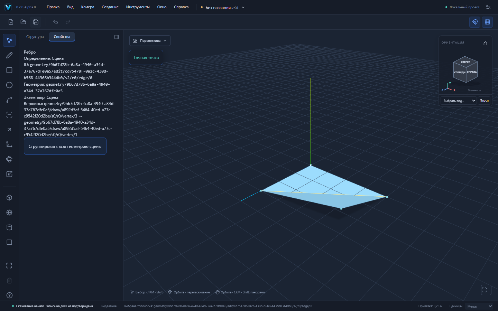
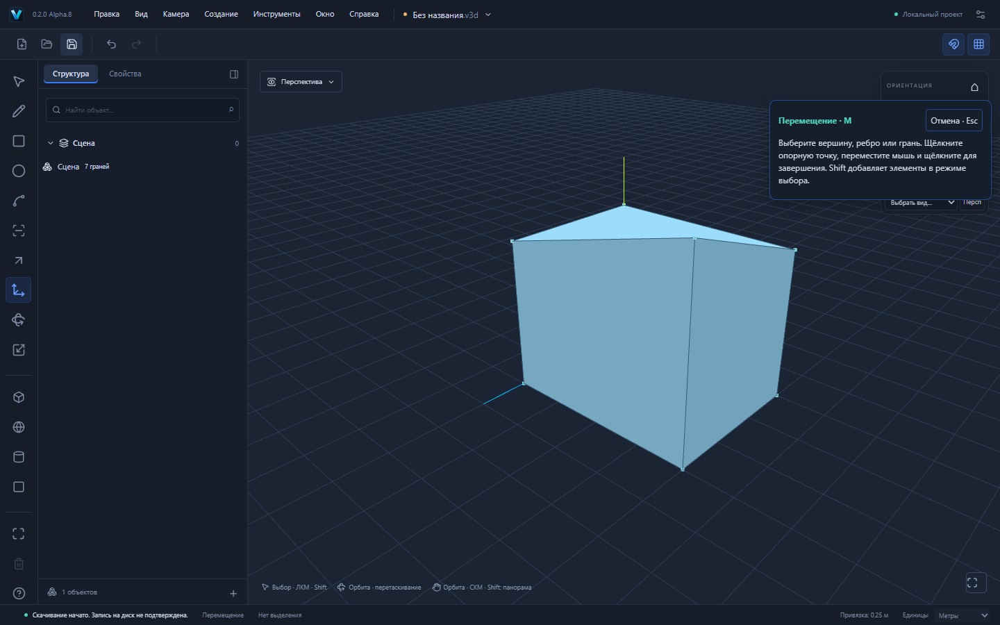

# VEXTRIO 3D 0.2.0-alpha.8 — Auto-fold четырёхугольников

Первый ограниченный этап автоматического складывания настоящей топологии. Основа — опубликованный main Alpha.7; новый этап оформляется отдельным PR и не публикуется автоматически.

## Пользовательский сценарий

R: 4000×3000 мм в XZ → Space: выбрать угол (4,0,3) → M → щелчок на углу → ↑Y → 1000mm → Enter. Вместо отказа из-за неплоскости получаются две канонические плоские грани и настоящее ребро сгиба. Ребро можно выбрать обычным Space; копирование, последующие перемещения и файлы используют ту же модель.

| Вход | Результат |
|---|---|
| Прямоугольник 4×3 м; один угол поднят на 1 м | 4 вершины, 5 рёбер, 2 грани; площади 6 и 6,5 м² |
| Замкнутый блок 4×3×3 м; угол (4,3,3) поднят до Y=4 | 8 вершин, 13 рёбер, 7 граней, 1 оболочка и 1 тело; объём 38 м³ |
| Перемещение в исходной плоскости | Грань и её ID сохраняются, ребро сгиба не добавляется |
| Вогнутый четырёхугольник | Выбирается только внутренняя допустимая диагональ |
| Неплоский контур с отверстием или больше чем 4 вершинами | Явный отказ; документ, dirty-state, история и Redo сохраняются |

[Лист из реального UI](examples/fold-sheet.v3d) · [Замкнутый блок из UI](examples/fold-solid.v3d).

## Алгоритм и связи

До изменения плоскостей анализируется исходный ориентированный контур и физические мировые координаты после перемещения. Если все точки остаются в одной плоскости в пределах GeometryPolicy tolerance, дополнительная топология не создаётся. Почти плоский frame ортогонализуется; координаты не округляются и не проецируются на искусственную поверхность.

Для простого четырёхугольника без отверстий рассматриваются две диагонали. Отбрасываются варианты с перевёрнутым или вырожденным исходным участком; это исключает внешнюю диагональ вогнутого контура. Приоритет — диагональ с меньшим количеством перемещаемых концов, затем физическая длина и стабильный порядок ID. Поэтому при подъёме одного угла сохраняется неизменная плоская половина. Уже занятая несогласованным ребром диагональ отклоняется.

Результат — настоящие Edge, Face, Loop и Coedge, а не производные треугольники Three.js. Оригинальные вершины и граничные рёбра сохраняют ID. Новые грани наследуют оба материала; каждый участок получает собственную плоскость и контур. Грани оболочки заменяются с исходной ориентацией; принадлежность телу обновляется без потери замкнутости. Новые ID выделяет существующий allocator с reserved IDs.

Старая грань и внешний контур получают split lineage, старые coedge — convert в соответствующее новое использование границы. Forward/inverse delta сохраняют исходные сущности для точного Undo; Redo не перевычисляет разбиение. Документ сохраняет provenance и цепочки retired ID. Проекты .v3d/schema v1/v2/format:"forma" и Windows identity/data paths не переименовываются. Новых зависимостей нет.

После складывания действуют прежние проверки вырождения, нормалей, столкновений и контактов. Новая диагональ проверяется как изменённое ребро, даже если оба её конца оставались неподвижными. Никакой частичной записи до валидации нет. Действуют прежние GeometrySession, отмена, stale guards, общая история, owner/revision preview и save barrier. Production Worker не добавлялся.

## Проверки и границы

Модульные проверки: площади, объём и оболочка, сохранение материалов/границ, lineage, точные Undo/Redo и roundtrip, детерминированный preview, плоское перемещение и допуски, вогнутость, повёрнутая неравномерно масштабированная группа и сосед, столкновение с другой гранью, занятая диагональ. Три новых Playwright сценария действительно используют UI: folded sheet/preview/выбор ребра/история/файл, замкнутый блок и отказ для отверстия. Финальные результаты полного набора, production-приёмки и Windows CI приведены в PR.

Поддерживаются только четырёхугольники из четырёх граничных вершин, без отверстий. Коллинеарные дополнительные вершины не удаляются ради обхода ограничения; сложный контур нужно сначала разделить линиями. За операцию складывается не более 128 граней; прежние ограничения Move/валидации сохраняются. Новые контакты не сливаются автоматически. Нет Auto-heal, мягких/скрытых рёбер, сгиба произвольных многоугольников и автоматического удаления ставшего плоским ребра: ручной возврат угла сохраняет разделение, а Undo восстанавливает исходную единственную грань. Диагональ детерминирована, но не обязана совпадать с выбором SketchUp во всех случаях. Переворот участка через 90° и вырожденные результаты отклоняются прежними guards.

Ручные установка/обновление Windows и offline WebView2 остаются отдельной приёмкой. Следующие задачи — многоугольники, отверстия и проверяемое слияние новых контактов, по отдельным этапам.
