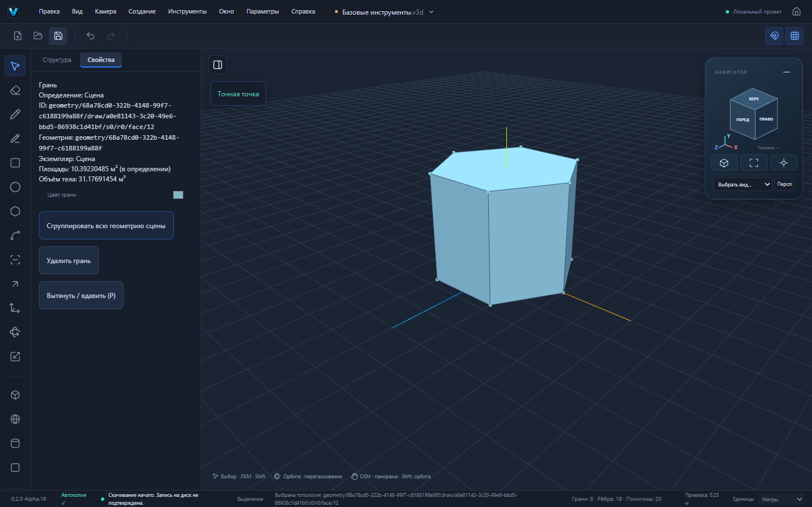
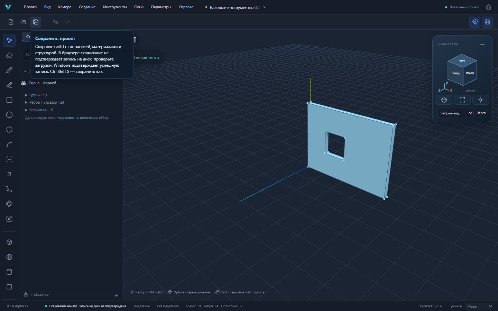
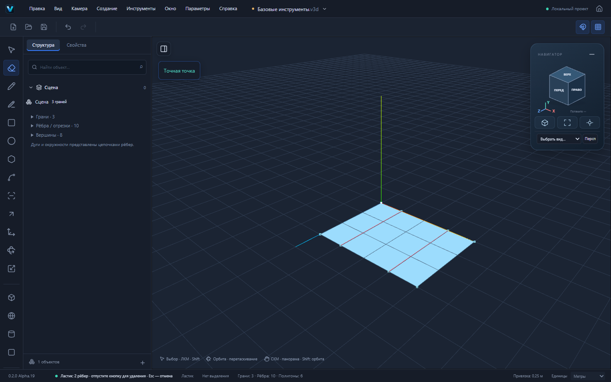

# Alpha.19 — многоугольник, свободное рисование и ластик

Основа — актуальный main `2a192a746b945b8435699932ffbe69e4cc19e97a` (опубликованная Alpha.18). Ветка `codex/alpha19-basic-tools`. Приоритет пользователя изменён на расширение набора базовых инструментов. [Матрица покрытия и следующие блоки](SKETCHUP_TOOL_COVERAGE.md) фиксирует готовые, частичные и отсутствующие функции. Полный набор SketchUp не заявляется завершённым.

## Многоугольник

Панель инструментов/меню Создание → Многоугольник. Выберите 3–128 сторон или введите `5s`, щёлкните центр, укажите вершину мышью либо введите радиус. Радиус измеряется от центра до вершины. По умолчанию шесть сторон. Настройки независимы от числа сегментов окружности.

Контур идёт через существующий ToolController, preview, Snap Engine, GeometrySession и planar Sketch. Получаются реальные рёбра и грань, которую можно выдавить P. Многоугольник с шестью сторонами и радиусом 2 м имеет площадь 6√3 м²; при высоте 3 м получается замкнутая призма 18√3 ≈ 31,17691454 м³, с 12 вершинами, 18 рёбрами и 8 гранями.

[Настоящий проект призмы](examples/basic-polygon.v3d)

## Свободное рисование

Выберите Свободное рисование, удерживайте ЛКМ и рисуйте. Начало фиксирует рабочую плоскость: существующая активная грань либо настроенная мировая/локальная плоскость. Штрих дискретизируется по движению курсора. После отпускания кнопки весь штрих создаётся одной обратимой командой. Открытый штрих остаётся рёбрами, замкнутый образует грань. При включённых привязках начало/конец используют топологические точки; возврат к началу в пределах экранного радиуса замыкает контур. Esc отменяет незавершённое построение.

Проверен штрих на вертикальной стене, создающий внутреннюю грань около 1 м², затем P −200 мм делает настоящий сквозной проём. Остаток материала стены 4 × 3 × 0,2 м — около 2,2 м³. Указание точек мышью имеет погрешность экранного ввода; модель не округляется ради точного десятичного значения.

[Сохранённая стена с проёмом](examples/basic-freehand-window.v3d)

## Ластик E

Щёлкните ребро либо проведите по нему с зажатой ЛКМ. Красный предпросмотр отмечает выбранные рёбра. Между событиями курсора выполняется ограниченный проход для захвата пересечённых рёбер. Отпускание удаляет собранный набор одной командой. Esc отменяет жест, Undo возвращает все исходные ID.

Удаление разделителей совместимых копланарных граней объединяет области через существующий алгоритм Delete. Проверен прямоугольник 4 × 3 м с двумя разделителями: до отпускания три грани не меняются, после остаётся одна грань 12 м²; один Undo восстанавливает все три области. Граничные рёбра удаляются вместе с утратившими границу гранями согласно прежней политике.

## Архитектура и надёжность

- Многоугольник расширяет существующий контроллер рисования; собственное число сторон не изменяет Circle.
- Жесты свободного рисования и ластика выделены в `packages/viewport/src/PointerTools.ts`, не разрастают основной App/Viewport.
- `freehandSegments` в packages/tools проверяет плоскость, точки, вырождение и ресурсный предел. Preview-отрезки Three.js не являются источником сохраняемой геометрии.
- Ластик выбирает только реальные рёбра по EntityRef через picking bridge; вершины не перекрывают выбор ребра, закрытые поверхностью рёбра не выбираются насквозь.
- Применение идёт через drawSegments/editGeometry и общую историю. Проверяются revision, контекст, блокировки и устаревший результат. Предпросмотр не меняет документ; подтверждённый жест не отменяется только из-за потери фокуса.
- Отдельные группы и разные геометрические контексты не смешиваются. Для удаления геометрии общего компонента требуется сделать экземпляр независимым, как у существующего Delete. Freehand сохраняет существующую политику подтверждения правки общих определений.
- Формат `.v3d`, `format: "forma"`, схемы v1/v2, внутренние имена @forma и Windows identifier сохранены. Новых сторонних библиотек нет; viewport объявляет внутреннюю workspace-зависимость от общих tools.

## Проверки

- Unit/integration: 582/582, 46 файлов; добавлены четыре проверки правильного многоугольника, независимости настроек, настоящей геометрии штриха, истории, плоскости и ресурсного отказа.
- 11/11 новых настоящих Playwright UI-сценариев прошли: призма и roundtrip, свободная грань и объём, отмена штриха, щелчок/проход ластиком, одна история жеста, защита группы, окно на вертикальной стене, отмена/модификаторы ластика, открытый штрих, пять сторон и независимость Circle, Escape диалогов при незапущенном жесте.
- Полный production Playwright до финальной правки буфера preview и Escape: 123/123. После правки — все 11/11 целевых UI-сценариев. Финальный полный набор включает 124 сценария и проверяется в CI PR.
- TypeScript, production build и check:deps прошли. check:pages проверяет Home, viewport, логотипы и настоящий STEP Worker под /vextrio-3d/ с Windows CSP. Сохраняется предупреждение о размере основного JS chunk.
- Все новые доказательства создаются в игнорируемом test-results; статические материалы отчёта копируются после тестов. Сохраняется CI-проверка неизменности отслеживаемых исходников.
- Установка/обновление и offline Windows вручную не проверены.

## Границы первого блока

Один свободный штрих содержит не более 128 точек, с экранным шагом выборки. Это сегментированная линия, а не аналитический сплайн или отдельная редактируемая Curve-сущность. Контур рисуется в одной плоскости. Превышение лимита отменяет весь штрих.

Один жест ластика удаляет не более 128 рёбер одной геометрии в активном контексте. Скрытие/смягчение/сглаживание модификаторами ещё не добавлены; модифицированный жест не должен молча удалять геометрию. Разные материалы и неподдерживаемые объединения отклоняются прежним ядром. Старые примитивы для работы по рёбрам сначала преобразуются в настоящую топологию.

Следующий функциональный блок: рулетка и направляющие, транспортир/пользовательские оси и недостающие способы построения; затем вращение/масштаб топологии, копии/массивы, Follow Me, материалы/текст/размеры, теги/сцены/сечения. Подробная матрица обновляется по реализации, без неработающих кнопок.
