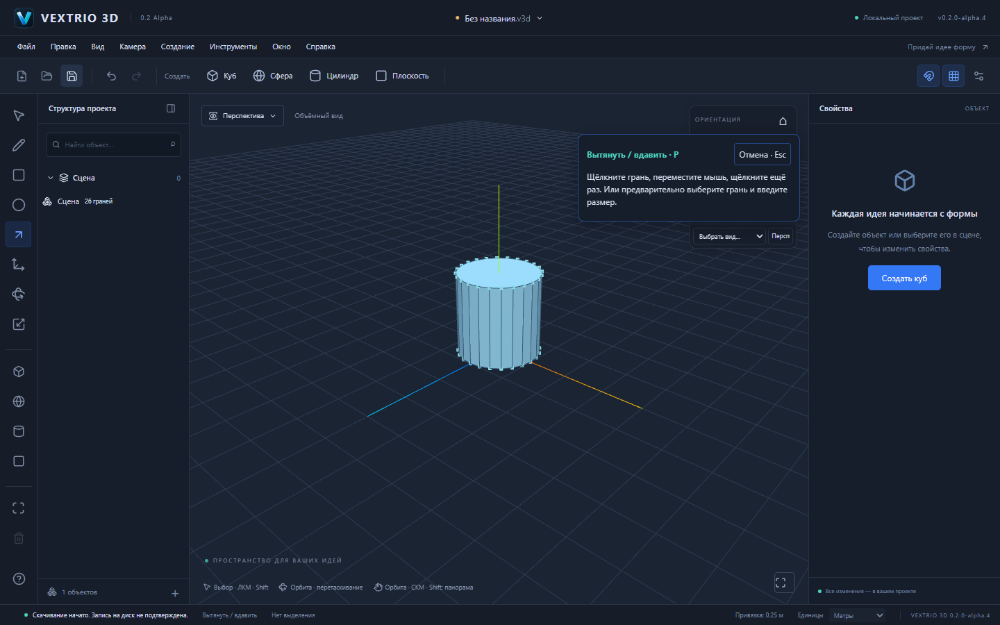
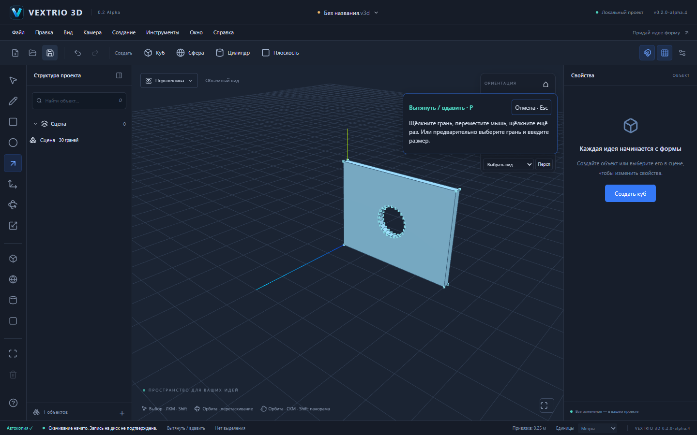

# VEXTRIO 3D 0.2.0-alpha.4 — окружность C

Новый работающий инструмент окружности встроен в существующий Sketch Controller, привязки, GeometrySession и общую историю. Центр задаётся первым щелчком, радиус — движением и вторым щелчком либо числом и Enter. Замкнутый контур создаёт настоящую редактируемую грань; он поддерживает пересечения, деление линией, сохранение и существующий Push/Pull.

Этот этап основан на [PR №11 с дверными проёмами](https://github.com/dmitriy5885as-design/vextrio-3d/pull/11). Пока он не объединён, PR окружностей имеет его ветку в качестве базы. Для публикации в main сначала принимается PR №11, затем PR окружностей переводится на main; автоматического merge нет.

## Как пользоваться

1. Выберите **C** или значок «Окружность» на панели. Первый щелчок задаёт центр на рабочей плоскости или выбранной поверхности.
2. Двигайте мышь: появятся весь контур, маркер привязки, радиус и результат проверки геометрии. Второй щелчок завершает окружность одной командой.
3. Для точного радиуса после центра введите, например, `1000mm`, `50cm` или `1,5m` и нажмите Enter. Предварительно двигать мышь не обязательно.
4. Поле «Сегментов» или ввод `48s` выбирает число сторон до завершения. По умолчанию 24, допустимо целое число от 3 до 128. Изменение настройки само не меняет документ или Undo.
5. Esc отменяет незавершённое построение. Двойной щелчок не создаёт второй объект. После завершения C остаётся активным для следующего центра.
6. P на полученной грани создаёт объём. Окружность на стене можно продавить до противоположной параллельной поверхности, получив настоящий круглый проём.

Число сегментов определяет реальную форму: окружность сейчас является **вписанным правильным многоугольником**, радиус измеряется до его вершин. Это не аналитическая кривая/NURBS и не картинка поверх сцены. Площади, объёмы и экспорт соответствуют фактическим рёбрам. Изменение радиуса как параметра уже завершённой окружности пока не реализовано.

Сохранённые через интерфейс примеры: [цилиндр](examples/circle-cylinder.v3d), [круглый проём](examples/circular-window.v3d).

## Численные результаты

Площадь n-угольного контура радиуса R: `n × R² × sin(2π/n) / 2`.

| Сценарий | Настоящая топология | Измеренный результат |
|---|---|---|
| R=1 м, n=24 | 24 вершины, 24 ребра, 1 грань | площадь 3,10582854123 м² |
| Выдавливание этого контура на 2 м | 48 вершин, 72 ребра, 26 граней; замкнутая оболочка | объём 6,21165708246 м³ |
| Контур R=0,5 м на стене 4 × 3 × 0,2 м, сквозной вырез | 56 вершин, 84 ребра, 30 граней; отверстие в обеих поверхностях | объём стены 2,24470857294 м³ |
| Диаметр через круг R=1 м | две отдельные редактируемые грани | каждая 1,55291427062 м² |

Никакие значения не подменяются идеальными πR²/πR²h: измеряется каноническая геометрия. Периметр хранится в GeometryModel как обычные рёбра, поэтому старые v2-редакторы могут открыть эти проекты. Геометрических сущностей Three.js в документе нет.

## Интеграция и надёжность

- Общий `isSketchTool` определяет активацию рисования, интерфейс и защиту старых v1; новый отдельный движок не создавался.
- Circle строится в ортонормированной рабочей плоскости. Точки передаются в прежний `drawSegments`; occurrence inverse учитывает вложенные преобразования. Unit проверяет физический радиус в неравномерно масштабированной группе и неизменность другого контекста.
- Буфер предпросмотра расширен до полного максимального контура. Preview не пишет документ/историю; ошибочные радиус, плоскость и число сегментов отклоняются. Настройка числа сторон не изменяет уже подтверждённую геометрию.
- Подтверждение мышью Push/Pull теперь использует зафиксированные параметры жеста и общую проверку ядра, не зависит от незавершённого preview. Смена контекста/ревизии отменяет устаревший результат; потеря фокуса не выбрасывает уже подтверждённую команду.
- Исправлена двойная обработка Esc: отмена P больше не закрывает группу в том же событии. Ввод в поле тоже не вызывает скрытый выход из группы. E2E явно проверяет сохранение edit-context после отмены.
- Вертикальная панель инструментов прокручивается в низком окне; circle E2E работает при 1024 × 768.

## Проверки

`pnpm test`: **354 passed, 25 файлов**. Включены 16 новых проверок: три плоскости, 3/8/24/48/128 сторон, физический радиус и площадь, история/ID roundtrip, нулевые/неплоские/нечисловые входы, изменение preview, цилиндр, масштабированная группа, явная миграция v1, диаметр и совпадающий контур без дубликатов.

`pnpm test:e2e --workers=2`: **42 passed**. Три новых E2E используют настоящие мышь, поля, скачивание и открытие: цилиндр, 48-сегментный preview с отменой/двойным щелчком, круглый сквозной проём. Прежний дверной сценарий усилен проверкой, что Esc сохраняет контекст группы. При отладке полный прогон обнаружил гонку отмены P; после исправления повторный полный прогон прошёл без retries или увеличения timeout.

Production build, `check:deps`, frozen-lockfile и Pages smoke прошли. Отдельная production-приёмка и Windows NSIS/три FileSession теста фиксируются в итоговом описании PR. Предупреждение Vite о chunk больше 500 kB сохраняется; лимиты для его скрытия не повышались.

Формат `.v3d`, `format: "forma"`, schema v1/v2, @forma-пакеты, Windows identifier/пути данных сохранены. Номер alpha.4 согласован в приложении, manifests, Cargo и Tauri. Ручная установка, обновление и offline WebView2 на Windows не выдаются за проверенные сборкой CI.

Следующие инструменты — дуга и Offset, затем изменение существующих рёбер/граней и более общие операции Push/Pull. Production Worker, большие сцены и полный функциональный паритет со SketchUp остаются дальнейшими задачами.
