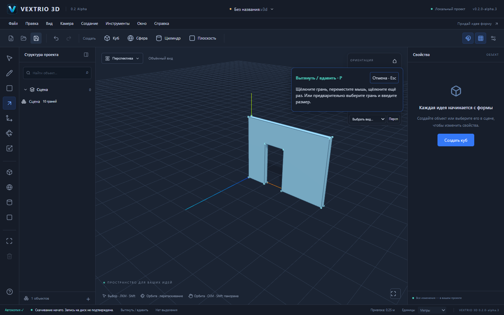

# VEXTRIO 3D 0.2.0-alpha.3 — дверные проёмы

Продолжение alpha.2: теперь контур, касающийся нижнего края стены, можно продавить насквозь обычным P. Противоположная поверхность и нижняя полоса стены перестраиваются как настоящая топология; порог исчезает, остаются два косяка и перемычка. Новых декоративных инструментов нет.

## Повторить в редакторе

1. Новый проект → R → начало координат → `4m;0.2m` → Enter.
2. P → щелчок внутри основания → высота `3m` → Enter: стена 4 × 3 × 0,2 м, объём 2,4 м³.
3. R → первая точка **на нижнем ребре видимой стены**. Проверьте маркер привязки к ребру; задайте направление вверх и вправо, затем размеры `1m;2m` → Enter.
4. P → внутренняя грань двери → переместите мышь внутрь до противоположной поверхности → щелчок. Можно вместо движения задать точную глубину кнопкой «До противоположной грани» и подтвердить Enter.
5. Стена имеет сквозной проём без порога и объём 2 м³. Ctrl+Z/Ctrl+Y восстанавливают контур/проём; `.v3d` сохраняется и открывается с теми же ID.

Для двери важно привязать первую точку к нижнему ребру. Ввод ширины/высоты задаёт размер относительно этой точки, а не перемещает её на пол. Для точного абсолютного положения доступен ввод координат.

[Сохранённый через интерфейс проект doorway.v3d](examples/doorway.v3d). Это результат реальных действий Playwright, не программно подставленная сцена.

## Алгоритм и целостность

`extrusionStop` различает внутреннее окно и контур, использующий край оболочки. Он ищет противоположную параллельную грань **того же тела**, проверяет весь спроецированный контур, его сегменты и полосы пересекаемых граничных поверхностей. Нельзя пересекать существующие отверстия, выходить за поверхность или удалять опорную поверхность целиком.

`boundaryThrough` использует существующие `splitSegments` и `planeCells`: разрезает канонические рёбра, получает области противоположной и граничных поверхностей, удаляет вырезанные области и создаёт откосы. Уцелевшие поверхности наследуют материалы и ориентацию. Сохраняются ID тела/оболочки и уцелевших сущностей; удалённые ID получают lineage. Полная валидация, проверка контактов, замкнутости и положительного объёма выполняются до публикации общей GeometryDelta. Undo восстанавливает исходную топологию и идентификаторы.

Three.js отвечает за показ и указатель; треугольники не используются как источник топологии. Поддержка остаётся в существующих GeometryModel/GeometrySession и общей истории S1–S6. Формат документа не меняется.

Численный корпус: исходный прямоугольник `(0,0,0) → (4,0,0) → (4,3,0) → (0,3,0)`, толщина `±0.2m`; контур двери X=1…2, Y=0…2.1, на внешней плоскости. После выреза:

| Показатель | Результат |
|---|---:|
| Объём | 1,98 м³ |
| Вершины / рёбра / грани | 16 / 24 / 10 |
| Части нижней поверхности | 2 |
| Их суммарная площадь | 0,6 м² |
| Внутренние отверстия в гранях | 0: дверь является выемкой внешнего контура |

Неравномерный масштаб `[2,3,4]`, поворот и перенос группы сохраняют физическую глубину 0,8 м и дают объём 47,52 м³. Две двери 1 × 2,1 и 0,6 × 2 м плюс окно 0,4 × 0,5 м оставляют 1,7 м³. Независимый соседний экземпляр не изменяется.

## Два исправления надёжности

1. Реальное ребро теперь имеет приоритет перед близким узлом сетки, повышенным до осевой привязки. Раньше при начале на нижнем ребре тонкой стены мог выбираться узел сетки за стеной. Отдельный unit и оба дверных E2E проверяют исправление; геометрический допуск не увеличивался для маскировки ошибки.
2. Сохранение дожидается уже подтверждённых геометрических команд. Это устраняет гонку быстрого нажатия «Сохранить» сразу после второго щелчка P. Предпросмотры не входят в очередь подтверждений и сами не попадают в файл. В браузере скачивание по-прежнему не считается гарантированной записью на диск.

Старый нестабильный E2E масштабированной группы нажимал R, пока открытие файла ещё блокировало горячие клавиши. Теперь он ждёт заголовок загруженного проекта и `aria-busy=false`, а не только видимый canvas. Таймауты и retries для обхода ошибки не добавлялись.

## Проверено и что осталось

- `pnpm test`: **338 passed**, 24 файла. Включены прежние S1–S6, окна, две стороны двери, материалы, физические трансформации, повторные проёмы, сохранение после подтверждения, атомарный отказ при частичной/избыточной глубине.
- `pnpm test:e2e --workers=2`: **39 passed**, без retries. Новые сценарии рисуют дверь мышью в сцене и внутри группы, отменяют preview, вырезают, немедленно сохраняют, выполняют Undo/Redo и открывают файл заново. Сравниваются реальные канонические ID и соседний экземпляр.
- Production Web, `check:deps`, frozen-lockfile и Pages smoke проверяются перед PR. Windows NSIS и три FileSession теста проходят отдельным CI; итог конкретного head указан в PR.
- `.v3d`, `format: "forma"`, schema v1/v2, внутренние пакеты и Windows identity/пути данных сохранены. Версия alpha.3 согласована в Web, workspace manifests, Cargo и Tauri.

Ограничение этого шага: сквозной вырез между параллельными поверхностями одной оболочки. Граничные поверхности должны содержать направление выдавливания. Частичная глубина граничного проёма, пересечение существующих отверстий, исчезновение целой опорной поверхности и общие CSG не поддерживаются и отклоняются. Поддержка произвольных сложных тел и деформаций не заявляется.

Следующие приоритеты для привычного моделирования: круг/дуга, Offset, изменение формы существующих рёбер/граней и более общие операции Push/Pull; затем Worker и измеримые бюджеты больших сцен. Полный паритет со SketchUp ещё не достигнут. Ручная проверка установки, обновления и offline WebView2 на Windows остаётся обязательной и не заменяется компиляцией CI.
