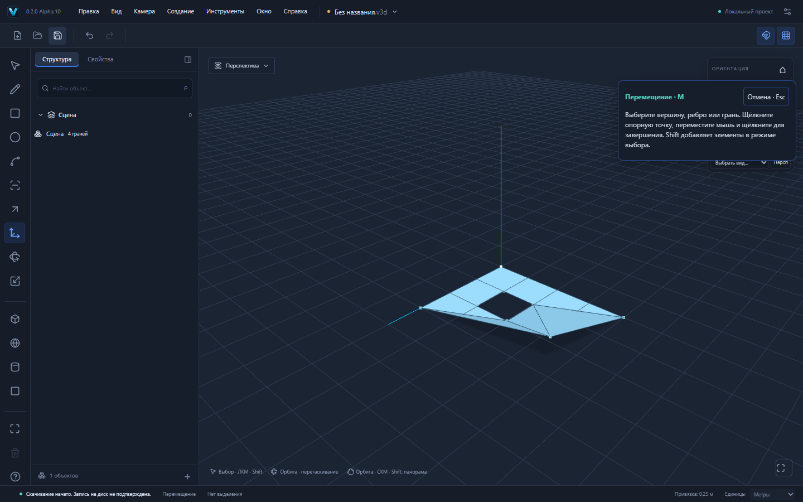

# VEXTRIO 3D 0.2.0-alpha.10 — сгибы граней с отверстиями

Продолжение Alpha.9 / PR №18. Отдельная ветка `codex/holed-fold`; PR №17 и №18 ещё не объединены. Опубликованный сайт Alpha.7 эта работа не изменяет.

## Пользовательский сценарий

В новой сцене R: начало (0,0,0), размеры `4m;3m` в плоскости XZ. Ещё R: начало (1,0,1), размеры `1m;1m`. Space: выбрать внутреннюю грань и Delete. Получится плоская область 11 м² с настоящим отверстием, 8 вершинами и 8 рёбрами.

Выбрать внешний угол (4,0,3), M, нажать на опорный угол, ↑Y, `1m`, Enter. Получается **8 вершин /12 рёбер /4 грани**. Все восемь исходных рёбер и вершин сохраняют ID. Проекция поверхности на XZ равна **11 м²**: проём не заполняется. Если вместо внешнего поднять угол отверстия (2,0,2), также получаются **8 вершин /12 рёбер /4 грани**, и проекция остаётся 11 м².

Отверстие после сгиба может проходить между несколькими гранями: отсутствие `innerLoopIds` у отдельных участков не означает его заполнения. Проверяются реальные границы, площадь проекции и ray picking через проём. При удалённом отверстии XY (0.5…1,0.5…1) и подъёме внешнего угла (4,3,0) на 1 м остаются две грани, одна с целым внутренним контуром; проекция равна 11.75 м².

Undo/Redo возвращают точную топологию и ID; сохранение и повторное открытие дают идентичные `geometries`. [Внешний угол](examples/holed-fold-4.v3d) · [Угол отверстия](examples/holed-fold-2.v3d).

## Геометрический алгоритм

Исходные ориентированные внешние и внутренние coedge-контуры проецируются в физическую плоскость исходной грани с полной матрицей экземпляра. Это канонические данные GeometryModel, а не Three.js Mesh или renderer DTO. Существующая зависимость earcut используется только как кандидат разбиения исходной области. Для локального изменённого внешнего угла сначала отсекается допустимое выпуклое ухо, если оно не содержит других граничных вершин: удалённый проём сохраняется в плоском остатке.

Коллинеарные граничные вершины, отфильтрованные earcut, восстанавливаются по исходным направленным цепочкам. Затем независимая проверка требует положительную ориентацию участков, их центры внутри исходной области вне отверстий, совпадение суммы площадей, каждое исходное направленное граничное ребро ровно один раз, каждое внутреннее ребро дважды в противоположных направлениях, использование всех исходных вершин. Вырожденные участки после перемещения отклоняются.

Соседние сонаправленные участки объединяются только при копланарности всех вершин в пределах GeometryPolicy. Восстанавливаются внешние и внутренние циклы; неоднозначные и разорванные границы отклоняются. Новые участки становятся реальными Face/Loop/Coedge, общие сгибы — Edge. Исходные граничные Edge/Vertex остаются прежними; материалы обеих сторон наследуются. Shell/Body membership обновляется, а retired Face/Loop/Coedge получают проверяемые split/convert/merge связи provenance.

Новые грани всегда проходят пересчёт frame и проверку контактов, даже если их собственные вершины не двигались. Это также сохраняет строгий JSON roundtrip без расхождения знака нуля в нормали. Ненулевые координаты не округляются.

Операция проходит прежние GeometrySession, команду редактора, валидацию и общую историю. Ошибка ничего частично не записывает. Preview, блокировки, reserved ID, stale guards и save barrier сохранены.

## Проверки

Девять новых unit/integration: внешний угол с материалами, provenance, picking, историей и файлами; угол отверстия; удалённый внутренний контур; жёсткое перемещение; замкнутая призма с проёмом (исходный объём 22 м³); два отверстия; коллинеарные точки обоих контуров; повёрнутая группа с неравномерным масштабом без изменения соседней геометрии; атомарный отказ для 17 отверстий.

Два новых Playwright E2E реально рисуют оба прямоугольника, удаляют внутреннюю грань, перемещают выбранный угол через M и числовое поле, отменяют/повторяют, скачивают и повторно открывают проект. Прежний браузерный отказ для отверстий заменён проверкой схлопывания граничного ребра, поскольку сам сгиб отверстия теперь поддержан. Прежний unit отказ заменён нечисловым перемещением с проверкой сохранения Redo.

Локально прошли **443 unit/integration теста в 33 файлах, 68/68 Playwright E2E**, `pnpm build`, `pnpm check:deps` и `pnpm check:pages`. Production-проверка двух новых сценариев на 4180 — **2/2**. Первый полный dev-прогон дал 67/68 из-за перезагрузки Vite при записи этого отчёта; повторный полный прогон без изменений файлов прошёл. Timeout и retries не повышались. Скриншоты и примеры выше получены из готовой production-сборки.

## Совместимость и ограничения

Схемы v1/v2, `.v3d`, `format: "forma"`, @forma/*, Windows identifier `studio.forma.editor` и пути пользовательских данных не менялись. Новых зависимостей нет. Маркировка исходников, UI, Tauri и Cargo согласована: Alpha.10.

До **128 граничных вершин суммарно на грань, 16 отверстий, 128 складываемых граней, 512 их вершин за операцию**, общий бюджет 200000 проверок ориентированности; максимум 512 промежуточных треугольников. Сложные и численно неоднозначные случаи отклоняются. Не обещается минимальное число участков или совпадение диагоналей SketchUp.

Нет автоматического объединения новых контактов, auto-heal старых канонических рёбер, мягких рёбер, production Worker и проверки всей траектории движения. Остаются прежние ограничения Move. Ручные установка/обновление Windows и offline WebView2 не проверены; CI-сборка указывается отдельно в PR. Production JS имеет прежнее предупреждение размера chunk (>500 kB).
