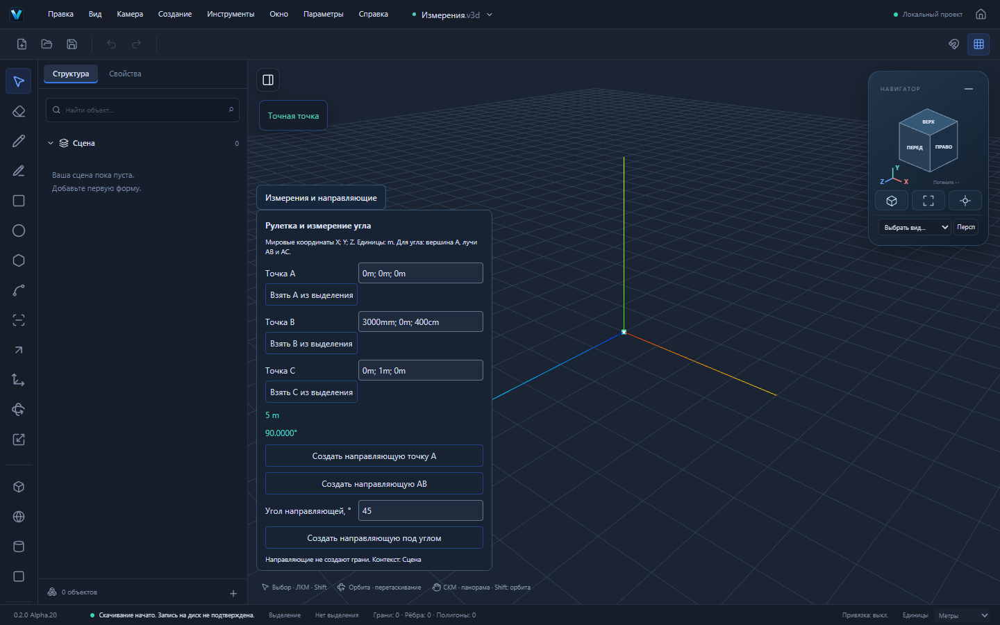

# Alpha.20 — измерения и сохраняемые направляющие

Рабочая ветка `codex/alpha20-measure-guides`, зависимость: PR №32 / Alpha.19. Публичный main остаётся Alpha.18. Это очередной функциональный блок, а не завершение аналога SketchUp.

## Работающие действия

1. Открыть «Измерения и направляющие» снизу слева в редакторе.
2. Ввести мировые координаты A, B, C через `;`, например A=`0m; 0m; 0m`, B=`3000mm; 0; 400cm`, C=`0; 1m; 0`. Получить AB=5 м, BAC=90°.
3. Вместо ввода выбрать настоящую вершину модели и нажать «Взять A/B/C из выделения». Учитывается полная трансформация выбранного экземпляра.
4. Создать направляющую точку A или бесконечную прямую AB. Задать угол, например 45°, и создать прямую через A от направления AB к стороне C в плоскости ABC. Десятичная запятая и отрицательные углы поддерживаются.
5. Рисовать инструментом «Линия» с включёнными привязками: маркер «Направляющая» фиксирует точку на вспомогательной прямой. Созданное ребро принадлежит GeometryModel.
6. Удалить направляющую из списка текущего контекста. Undo/Redo восстанавливает точные ID. Сохранить `.v3d`, открыть снова — направляющие и ID сохраняются.
7. Сменить единицы: 5 м отображаются как 5000 мм, физические точки остаются на месте.

## Хранение и безопасность

- Типизированное и валидируемое расширение `vextrio:construction`, версия 1, в существующем Document v2. Геометрическая схема, `format: "forma"`, пакеты `@forma/*` и Windows identifier не переименованы.
- Направляющие имеют уникальный ID, владельца definitionId и локальные координаты. Они следуют вложенным трансформациям и не превращаются в топологические рёбра, поэтому не разрезают грани.
- Snap Engine преобразует направляющие в мировые координаты каждого видимого экземпляра, соблюдает контекст и блокировки, использует отдельный SnapKind без фиктивного EntityRef. Кеш сбрасывается при изменении расширения.
- Все команды проходят существующую валидацию до записи в общую историю. Ошибка сохраняет документ, revision, dirty-state и redo.
- Общий компонент нужно сначала сделать уникальным. При отделении копируются направляющие с новыми ID; при удалении последнего экземпляра удаляются его направляющие. Скрытые экземпляры не рисуются и не участвуют в привязках.

## Проверки

- `pnpm test`: **591/591**, 47 файлов.
- Новые браузерные сценарии: **4/4** — измерение/угловые направляющие, сохранение и повторное открытие, реальное ребро по направляющей, смена единиц, отказ на неверном вводе.
- Полный локальный E2E: **127/128** в первом прогоне. Единственный сбой — гонка выбора грани на 1024px после изменения canvas. Тест теперь ждёт завершения ResizeObserver, без увеличения таймаутов; исправленный сценарий прошёл **3/3 повторения**. Полный Web CI ещё выполняется.
- `pnpm build`, `pnpm check:deps`, `PLAYWRIGHT_CHANNEL=msedge pnpm check:pages`: успешно. Pages проверяет настоящий локальный STEP Worker под Windows CSP и размещение в `/vextrio-3d/`.
- [Windows CI исходного кода f4b89e5](https://github.com/dmitriy5885as-design/vextrio-3d/actions/runs/43688439971): установщик собран, **10/10 native-тестов**. [Артефакт установщика](https://github.com/dmitriy5885as-design/vextrio-3d/actions/runs/43688439971/artifacts/14151586690). Последующие изменения касаются тестов и отчёта, исходный код приложения не изменён.
- Существующее предупреждение Vite о JS-файле больше 500кБ остаётся.

Модульные проверки включают угол около нуля/180°, метры, roundtrip, IDs, отказ без изменения истории, блокировки, копирование компонентов, очистку рендера и привязку за пределами отображаемого участка прямой. Браузерные сценарии используют настоящий интерфейс и скачанные `.v3d`, включая построение ребра по направляющей.

## Ограничения

- Пока используется координатная панель и захват выбранных вершин; жестовая рулетка T и интерактивный транспортир ещё впереди. Пользовательские оси не добавлены.
- Направляющая в математической модели бесконечна; отображаемый участок ±1000 м. Сама привязка не ограничена этим участком.
- Защитный бюджет: 256 определений направляющих и 4096 видимых экземпляров. Это вычислительная защита с явной ошибкой, а не платное ограничение.
- Нет перетаскивания, скрытия отдельных направляющих, автоматического пересечения направляющих или масштабирования модели по измерению.
- Локально отсутствует Rust/Cargo: Windows-установщик и 10 native-тестов проверены отдельным CI; ручная установка и автономная работа в этом блоке не подтверждены.
- Следующие функциональные блоки: пользовательские оси и жесты измерения; Rotate/Scale настоящей топологии, отражение и массивы; Follow Me; материалы/размеры; теги, сцены и сечения. Полная карта — [SKETCHUP_TOOL_COVERAGE.md](SKETCHUP_TOOL_COVERAGE.md).
