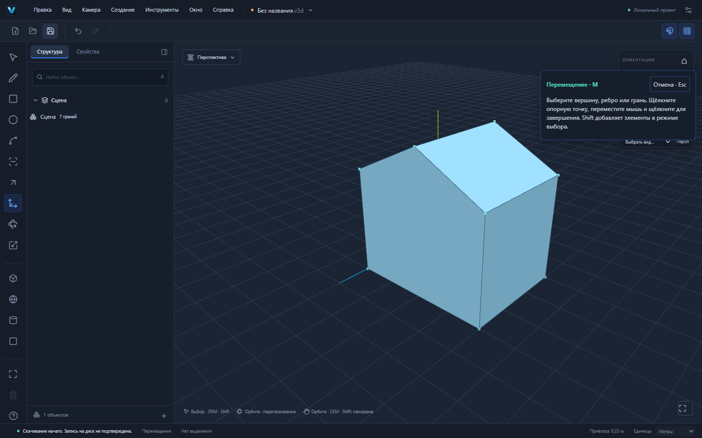

# VEXTRIO 3D 0.2.0-alpha.7 — перемещение M

M работает с каноническими вершинами, рёбрами и гранями. Прежнее перемещение целых legacy-объектов и узлов групп через gizmo сохранено. Ветка основана на PR №15 (Offset), который основан на PR №14 (дуга). Автоматического объединения и публикации на основной сайт нет.

## Проверяемый пользовательский сценарий крыши

1. R: прямоугольник 4000×3000 мм в XZ. Space: выбрать грань. P: 3 м — замкнутый блок 36 м³.
2. L: линия между точками (2,3,0) и (2,3,3) делит верхнюю грань на два будущих ската. Esc завершает рисование; Space возвращает выделение.
3. Выбрать ребро конька, M, щёлкнуть опорную точку на нём. Стрелка ↑ фиксирует мировую ось Y. Ввести `1000mm`, Enter.
4. Ребро поднимается с Y=3 до Y=4. Два ската и торцевые стенки перестраиваются. Результат: **10 вершин, 15 рёбер, 7 граней, 1 оболочка, 1 тело; объём 42 м³** (36 + 4×3×1/2).
5. Undo/Redo и сохранение/повторное открытие восстанавливают точные таблицы и ID.

[Проект, сохранённый через UI](examples/move-roof.v3d).

Это замкнутый демонстрационный объём дома, а не комплект раздельных строительных стен/крыши. Для толщины стен используйте Offset и отдельные группы.

## Управление

Space выбирает элементы; Shift добавляет элементы. M: первый щелчок задаёт опорную точку, движение показывает проверяемый preview, второй щелчок подтверждает одну команду. Можно выбрать элемент непосредственно первым щелчком M. Предварительно выбранные элементы двигаются вместе; опорная точка может находиться на другой геометрии того же активного контекста.

Стрелки ↑ / → / ← фиксируют Y / X / Z, повтор снимает фиксацию. Система координат наследуется из существующего точного позиционирования. Без фиксации движение идёт в плоскости вида через опорную точку; общий Snap Engine предлагает вершины, концы/середины рёбер, грани и прочие существующие привязки. Числовое расстояние положительно и использует выбранное направление; знак перемещения можно задать относительными координатами X;Y;Z. mm/cm/m и десятичная запятая работают. Координаты поддерживают относительный режим и явные `@` / `=`.

Ctrl или флажок создаёт независимую копию выбранных элементов с новыми ID. Копируется только явно выбранная грань/ребро/вершина и её необходимые границы; для копии всего тела выделите все его грани или копируйте группу существующими средствами. Отверстия и материалы выбранной грани сохраняются. Если скопированы все грани оболочки, копируется оболочка. Исходная геометрия сохраняет ID. Копия с нулевым смещением отклоняется.

Esc, blur, pointercancel, смена инструмента, геометрической revision, контекста или выделения отменяют неподтверждённый жест. Уже подтверждённая команда участвует в save barrier: немедленный Ctrl+S ждёт результат. Ctrl после подтверждения не превращает ожидающее перемещение в копирование. Поколения жестов защищают от позднего pointerup и повторных событий.

Группу сначала откройте для редактирования. Выбор из разных контекстов не объединяется. Физическое мировое смещение переводится через полную обратную матрицу occurrence; неравномерный масштаб и вложенность не теряют точности. Общий компонент меняется только после явного подтверждения всех экземпляров; заблокированный экземпляр запрещает изменение определения.

## Архитектура и надёжность

Новый intent `translate-entities` разворачивает выбранные сущности в единственный набор вершин. Общая команда `move-vertices` теперь пересчитывает плоскости затронутых граней по ориентированному внешнему контуру. Границы, материалы, coedge/loop/shell/body связи и ID сохраняются; неплоский результат не заменяется визуальными треугольниками.

Копирование выделяет новые ID общим allocator с reserved IDs, копирует необходимые таблицы и использует прежний rebuildBodies. Перемещение не создаёт lineage для неизменённых ID; копирование не выдаёт новые ID за потомков удалённых исходных сущностей. Обычные forward/inverse delta обеспечивают точный Undo/Redo. Валидация GeometrySession и GeometryDocumentCommand выполняется до записи в документ. Ошибка оставляет документ, dirty-state, историю и Redo без изменений.

Проверяются вырожденные рёбра, контуры и инверсия граней, совпавшие разные вершины, новые несоединённые пересечения рёбер, контакты граней, проход свободного ребра через внутренность грани с учётом отверстий. Проверки выполняются в физическом мировом масштабе. Three.js используется для отображения и луча курсора; топология хранится в GeometryModel.

Preview использует общий useGeometryPreview с owner `translate` и revision. Сессии отменяются при изменении параметров; устаревший ответ не применяется. Сохранены format:"forma", .v3d, схемы v1/v2, @forma/*, идентификатор Windows и пути данных. Новых зависимостей нет; версия alpha.7 согласована в manifests/Cargo/Tauri.

## Исправления, найденные тестированием

Фиксация оси ранее проецировала точку плоскости вида на ось, что давало ошибку в перспективе. Теперь вычисляется ближайшая пара луч/ось; почти параллельные и направленные за камеру решения отклоняются. Это проверено математически и реальным перемещением курсора.

В первом полном прогоне новая отмена M ошибочно отключала точное позиционирование активных L/C/A после Esc. Отключение ограничено M; прежние сценарии повторного рисования после Esc проверены повторно. Один прежний тест после создания/Undo примитива теперь явно нажимает Space перед выбором грани: M приобрёл реальную геометрическую семантику и перестал быть только режимом gizmo.

## Проверки и ограничения

Новые модульные тесты проверяют наклон граней и крышу 42 м³, изменение высоты блока до 48 м³, копию с отверстием/материалами, ID, Undo/Redo, файлы, невалидные и повторные параметры, нулевой ход, stale/cancelled ответы, save barrier, масштабированную повёрнутую группу, блокировку общего определения, осевую проекцию и свободное ребро в отверстии. Семь настоящих Playwright сценариев проверяют крышу, числовой ввод и Ctrl-копию, мышь/ось/немедленное сохранение, ошибки/Esc/blur/held pointer на 1024×768, группу, общий компонент и Shift-выделение двух вершин. Полные окончательные результаты и Windows CI приведены в PR.

Автоматического Auto-fold, разбиения и слияния при новых контактах нет: неподдерживаемый результат явно отклоняется. Перед сгибом разделите грань линией. Перемещение не является булевой операцией. Копии не свариваются с существующей геометрией; используйте отдельный контекст или другое смещение. Нет массивов копий, вращения/масштаба выделенных топологических элементов и production Worker. Проверяется конечное положение, а не непрерывная физическая траектория. Construction-вершины не являются инструментом для разрезания граней.

Бюджет: до 512 выбранных элементов, 4096 вершин/рёбер; проверки контактов рёбер, вершин и ребро/грань ограничены по 200000 пар, сверх бюджета операция отклоняется. Прежние ограничения валидатора и проверки контактов граней сохраняются. Большие сцены и долгие вычисления требуют отдельной оптимизации. Предупреждение размера JS chunk остаётся. Ручные установка/обновление Windows и offline WebView2 не заменяются успешной CI-сборкой.

Следующий этап — проверяемые Auto-fold и обработка новых соединений при перемещении, затем расширение редактирования геометрии.
