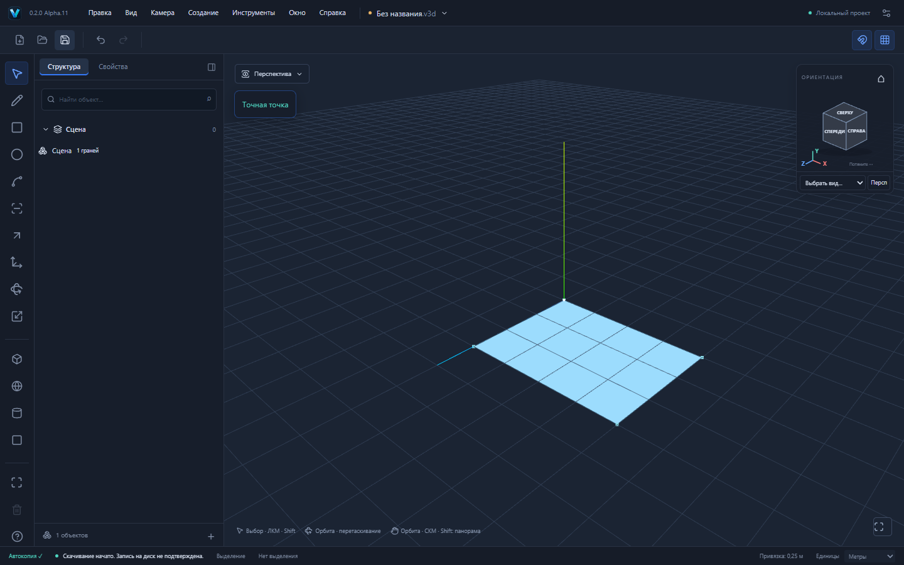

# VEXTRIO 3D Alpha.11 — контакты свободных линий в M

Первый шаг соединения геометрии при перемещении. Основа — Alpha.10 / PR №19; PR №17–19 ещё не приняты. Новая ветка `codex/move-wire-contacts`. Сайт Alpha.7 не изменяется автоматически.

## Реальные операции

В плоскости XZ инструментом L нарисуйте отрезок (0,0,0)→(4,0,0), затем отдельный (2,0,2)→(2,0,1). Space, выбрать (2,0,1), M, опорная точка там же, режим координат, `0;0;-1m`, Enter. Вместо двух несоединённых линий получится T-узел: **4 вершины /3 ребра**, общая вершина (2,0,0) имеет три инцидентных ребра. Старое горизонтальное ребро получает split provenance.

L нарисуйте незамкнутый контур (0,0,0)→(4,0,0)→(4,0,3)→(0,0,3)→(0,0,1). Переместите последний конец на `0;0;-1m`. Получится **4 вершины /4 ребра /1 грань площадью 12 м²**. Грань выбирается обычным Space и доступна существующим инструментам. Undo/Redo и повторное открытие проекта восстанавливают точные ID и топологию.

[Модель T-узла](examples/move-contact-t.v3d) · [Замкнутая грань](examples/move-contact-face.v3d).

Дополнительные модульные сценарии: вершина на существующей вершине; перемещение целой линии через другую (X: 5 вершин /4 ребра); совмещение двух параллельных линий (2 вершины /1 ребро); частично перекрывающая копия (4 вершины /3 ребра); близость в пределах допуска; скрещивающиеся линии остаются раздельными; схлопывание ребра отклоняется без потери Redo; удалённая грань не восстанавливается посторонним перемещением; повёрнутая группа с неравномерным масштабом не меняет соседние компоненты.

## Архитектура

M по-прежнему строит атомарную delta внутри GeometrySession. Если исходный контекст не содержит граней и есть реальное перемещение, новый граф проходит существующий `splitSegments`: физические допуски, T/X, перекрытия, неоднозначные tolerance-кластеры и ресурсные пределы остаются общими со Sketch. Затем существующий алгоритм областей обнаруживает замкнутые плоские ячейки и создаёт реальные Face/Loop/Coedge. Three.js участвует только в отображении.

Исходный граф до перемещения используется как база сравнения областей. Это важно: уже замкнутая область без грани могла быть намеренно удалена; постороннее перемещение не должно её заполнять. Общая финализация Sketch извлечена в функцию без изменения поведения остальных инструментов: provenance, разбиение/объединение тел и обратная delta рассчитываются одинаково. Нет второй реализации алгоритмов пересечений.

ID сохраняются у неизменившихся сущностей; объединённые вершины и заменённые рёбра получают lineage. Представитель совпавших вершин выбирается существующим детерминированным алгоритмом Sketch по ID, поэтому ID целевой вершины не гарантируется. Компоненты и группы разделены по GeometryModel; общие определения сохраняют прежние блокировки и подтверждение редактирования экземпляров. Копии проходят ту же канонизацию и общий Undo/Redo.

## Проверки

Прошли **454 unit/integration теста в 34 файлах, 70/70 Playwright E2E**, `pnpm build`, `pnpm check:deps` и `pnpm check:pages`. Два новых E2E реально рисуют линии, выбирают вершину, вводят перемещение через M, проверяют результат и точную историю, скачивают и повторно открывают проект. Production-сборка на 4181 отдельно прошла **2/2**. Скриншоты и файлы выше получены из production UI. Timeout/retries не увеличивались. Одиннадцать новых unit проверяют T/X, совпадения, замыкание, копию, допуски, ошибки, историю, файлы и группу.

## Границы

**Только контекст без существующих граней.** Даже свободное ребро рядом с поверхностью в той же GeometryModel пока использует прежние проверки Move. Контакты граней, соединение тел и врезка движущихся поверхностей не реализованы этим этапом; они не маскируются автоматическим слиянием.

Действуют бюджеты reference Sketch: до 2048 вершин в кластерах, до 250000 пар результирующих рёбер, бюджеты обнаружения плоскостей/ячеек, Move и валидации. Сложный случай отклоняется атомарно; production Worker и полнотраекторная проверка не добавлены. Нулевое перемещение остаётся no-op, схлопывание ребра — ошибка.

Формат .v3d, `format: "forma"`, схемы v1/v2, @forma/* и Windows identity/data paths не менялись, новых зависимостей нет. Версия UI/package/Tauri/Cargo — Alpha.11. Ручные установка/обновление Windows и offline WebView2 не проверены. Результаты CI и ссылка на установщик указываются в PR отдельно.
