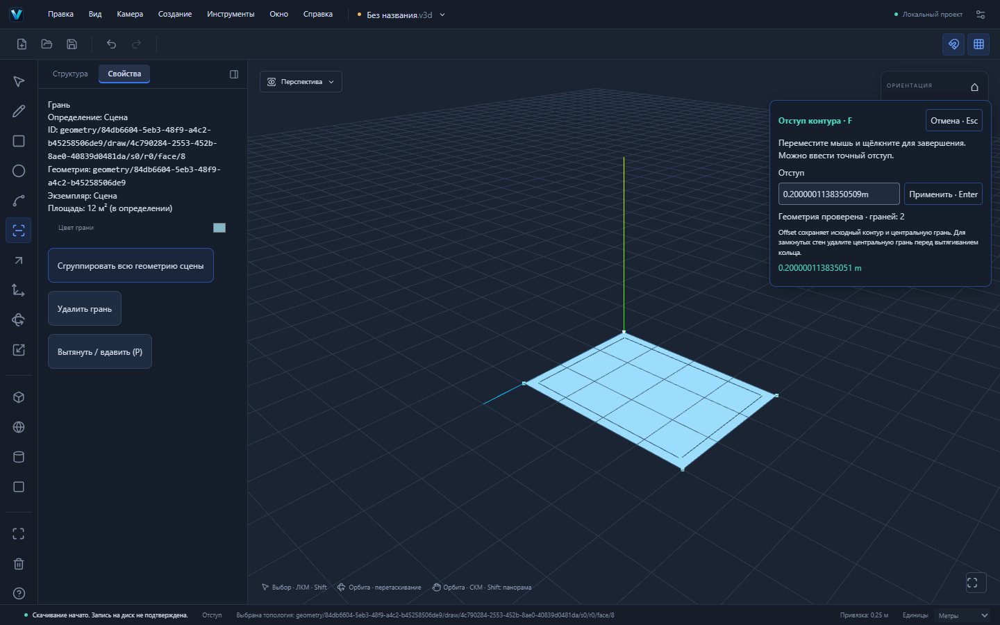
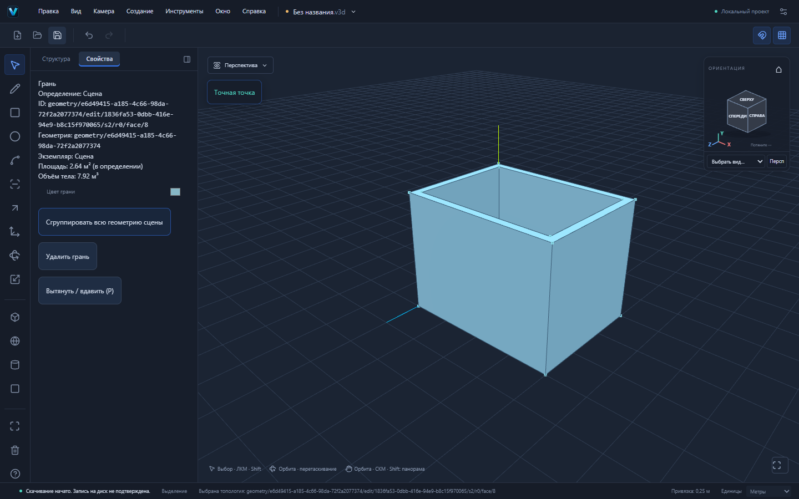

# VEXTRIO 3D 0.2.0-alpha.6 — Offset F

Рабочий отступ контуров выбранной топологической грани. Новый intent offset-face проходит существующие GeometrySession, GeometryDelta, GeometryDocumentCommand и общую историю. Ветка основана на PR №14 с дугой; его изменения сохранены. Автоматического merge в main нет.

## Пользовательский сценарий

1. R: прямоугольник 4000×3000 мм. Space: выберите грань.
2. **F** / «Отступ»: введите `200mm` и Enter, либо щёлкните грань у нужного ребра, переместите мышь на 200 мм внутрь и щёлкните ещё раз. Первый щелчок задаёт опорную точку; расстояние считается от неё по нормали к ближайшему ребру в плоскости грани.
3. Положительный числовой отступ направлен внутрь области материала: внешний контур сужается, контуры отверстий расширяются. Отрицательный — наружу. m/cm/mm, десятичная запятая и текущие единицы поддерживаются. F раньше фокусировал объект; теперь фокус доступен через **Shift+F** и прежнее меню камеры.
4. Preview показывает результат, но не пишет документ. Enter или второй щелчок создаёт настоящие рёбра/грани одной командой. Esc, blur, pointercancel, смена инструмента/контекста отменяют неподтверждённое действие. Подтверждённая команда участвует в save barrier, даже если её UI effect ещё не запустился.
5. Offset сохраняет исходные контуры и центральную грань. Для замкнутых стен выберите центральную грань Space, Delete. Выберите кольцо стен, P, высота `3m`, Enter.
6. Сохраните .v3d, откройте снова: геометрические таблицы, связи и ID должны совпасть. В группе сначала войдите в контекст. Общий компонент меняется только после явного подтверждения всех экземпляров; блокировки проверяются до записи.

Схема взаимодействия ориентирована на [официальный Offset SketchUp](https://help.sketchup.com/en/sketchup/offsetting-line-existing-geometry). Открытые цепочки рёбер и повтор Offset двойным щелчком в этом этапе не реализованы.

[Файл стен, сохранённый через настоящий UI](examples/offset-walls.v3d).

## Реальная геометрия

| Вход / операция | Результат |
|---|---|
| Плоскость XZ, 4×3 м; внутрь 0,2 м | внутренний прямоугольник 3,6×2,6 м, 9,36 м²; кольцо 2,64 м²; 8 вершин, 8 рёбер, 2 грани |
| Удалить центральную грань, вытянуть кольцо на 3 м | замкнутое тело стен: 16 вершин, 24 ребра, 10 граней; объём 7,92 м³ |
| 4×3 м; наружу 0,2 м | внешний прямоугольник 4,4×3,4 м; общая площадь 14,96 м²; исходные рёбра сохраняют ID |
| L-контур (0,0),(4,0),(4,1),(1,1),(1,4),(0,4); внутрь 0,2 м | inset 3,96 м², исходная область 7 м² сохраняется и разделяется новыми рёбрами |
| Две комнаты 2×3 м с перемычкой шириной 1,4 м; внутрь 0,8 м | два отдельных offset-контура; суммарно 1,12 м², без самопересекающегося preview |
| Внешний 6×6, отверстие 2×2; внутрь 0,25 м | сдвинутые границы 5,5×5,5 и 2,5×2,5; offset-область 24 м²; существующее отверстие остаётся пустым |

Offset добавляет линии, а не выполняет CSG и не заполняет ранее удалённые отверстия. Исходная центральная грань сохраняется: если оставить её и вытянуть кольцо, свободная модель может иметь присоединённую поверхность пола; объём замкнутого тела не обещается до удаления центра. Для толстой плиты пола используйте отдельную группу.

## Алгоритм и точность

Контуры получаются из coedge/loop/face канонической модели. Геометрия переводится в физическую ортонормированную плоскость через существующую world metric и inverse occurrence transform; неравномерный масштаб и вложенные преобразования не меняют заданную физическую толщину. Three.js используется только для отображения и луча курсора.

Вогнутые области, отверстия и исчезновение перемычек обрабатывает закреплённый **clipper2-ts 2.0.1-18**, TypeScript-порт Clipper2 ([исходный проект](https://github.com/countertype/clipper2-ts)). Он применяется для геометрии контуров, а не для замены топологии треугольниками. Полученные сегменты передаются существующему S3 arrangement; далее обычные ID, материалы, lineage и inverse delta.

Перед вычислением координаты переводятся относительно начала плоскости и на целочисленную сетку с шагом не больше GeometryPolicy tolerance /32. Небольшой grid-noise на углах устраняется пересечением исходных точных параллельных линий, только если поправка меньше tolerance /8; топология остаётся результатом clipping. Очень большой диапазон, слишком острый угол, схлопнувшаяся область и превышение бюджетов отклоняются атомарно. Для мыши проверяется соответствие фактическому измеренному расстоянию; инженерная точность обеспечивается числовым вводом.

Угловое соединение Miter; бюджет — до 256 исходных и 256 результирующих сегментов, miter ratio до 1000, безопасная масштабированная координата до 2^50. Нулевой/нечисловой отступ и область, исчезнувшая при сужении, не меняют документ, dirty-state, Undo/Redo. Ограничения существующего reference arrangement (в том числе 512 source segments на операцию) сохраняются.

Preview использует общий useGeometryPreview с owner/revision; useVolumePreview остаётся совместимым alias. Offset не может показать устаревший preview Push/Pull и наоборот. Подтверждение мышью фиксирует параметры жеста и валидируется отдельно от незавершённого preview. Изменение контекста и revision, поколение pointer-событий и отмена исключают запоздалые операции. Поздние ответы GeometrySession проверяются по прежнему envelope.

Для выбора узких стен hit-band рёбер уменьшен относительно точек: точные рёбра/вершины сохраняют приоритет, но середина узкой грани больше не перехватывается соседними рёбрами. Это покрыто unit и пользовательским сценарием стен.

## Проверки и совместимость

Пять новых Playwright E2E выполняют реальные действия: стены/файлы/история, мышь/немедленное сохранение, ошибки/отмена/held pointer на 1024×768, масштабированная группа/запрет чужого контекста, явное подтверждение общего компонента. Unit охватывают площади, отверстия, вогнутость/разделение, дуги, большие координаты, физический масштаб, блокировки, preview, stale/cancelled replies и save barrier. Финальные полные результаты и Windows CI приведены в описании PR.

Формат .v3d, format:"forma", v1/v2, @forma-пакеты, Windows identifier и пути данных не изменялись. Новый инструмент требует явной миграции v1 и настоящей грани. Версия alpha.6 согласована в manifests, приложении, Cargo и Tauri. В зависимостях добавлен только один exact-пакет; lockfile и Boost Software License 1.0 включены. Текст лицензии доставляется с Web/Windows по public/licenses/clipper2-ts.txt. Offset не загружает CDN или WASM при работе; нужный код включён в сборку.

Произвольный CSG, открытые offset-цепочки, постпараметрическая правка, production Worker и большие сцены остаются отдельными задачами. Отступ наружу на замкнутом solid может создать неманифолдный контакт; ограничения S3/валидации не обходятся. Ручные установка/обновление/offline WebView2 должны проверяться отдельно от Windows CI. Следующий геометрический приоритет — изменение настоящих вершин, рёбер и граней.
