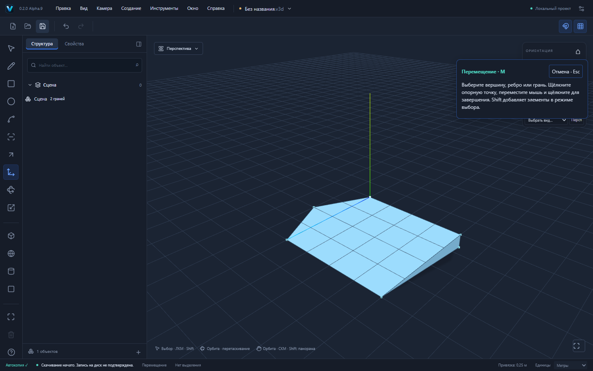
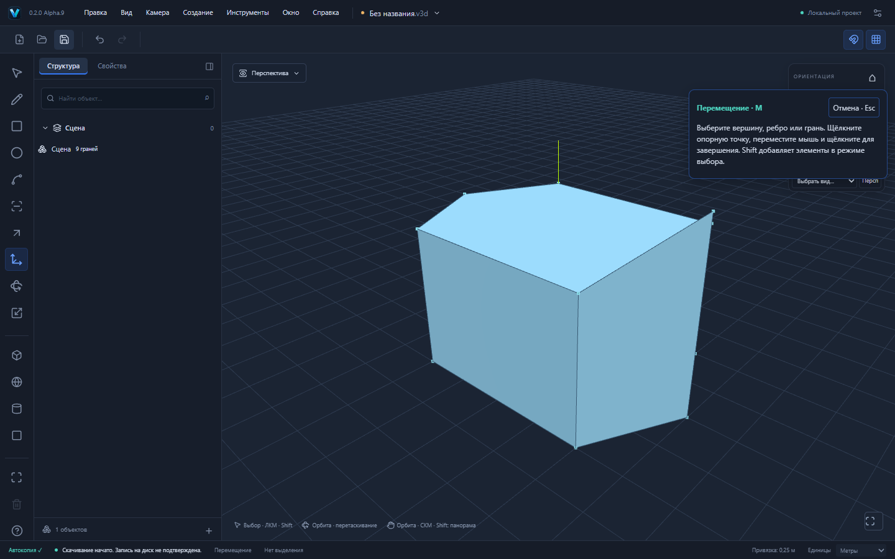

# VEXTRIO 3D 0.2.0-alpha.9 — складывание многоугольников

Следующий этап после Alpha.8 (PR №17): простые контуры до 128 вершин без отверстий. Отдельная ветка; автоматического merge и публикации нет. Общие M, GeometrySession, GeometryDocumentCommand и история сохранены.

## Реальные сценарии

Линиями L постройте контур XZ: (0,0,0), (4,0,0), (5,0,2), (4,0,4), (0,0,4), (-1,0,2), замкните. Получится грань 20 м². Space: выберите угол (5,0,2), M, опорная точка на углу, ↑Y, 1000mm, Enter.

Результат: **6 вершин, 7 рёбер, 2 грани** — плоский пятиугольник **18 м²** и наклонная треугольная грань **2√2 ≈ 2,828427 м²**. Внутри плоского пятиугольника нет дополнительных канонических рёбер.

Если сначала вытянуть исходный контур на 3 м и затем поднять его верхний угол с Y=3 до Y=4, получается замкнутая призма с изменённой верхней частью: **12 вершин, 19 рёбер, 9 граней, объём 60⅔ м³**. Начальный объём — 60 м³; добавленный тетраэдр — 2/3 м³.

Граничная точка, появившаяся после разделения ребра, не удаляется. Для прямоугольника 4×3 м с промежуточной вершиной (2,0,3), подъём этой точки на 1 м даёт **5 вершин, 7 рёбер, 3 грани**. Все пять исходных граничных вершин сохранены. Если вместо неё поднять угол (4,0,3), сохраняются **5 вершин**, получаются **6 рёбер и 2 грани**.

[Сохранённый через UI шестиугольник](examples/polygon-fold.v3d) · [Призма](examples/polygon-fold-solid.v3d).

## Алгоритм

Исходная геометрия берётся из канонических coedge/loop/vertex и проверяется прежней валидацией. Контур проецируется в физическую плоскость исходной грани с полной матрицей экземпляра. Триангуляция отсечением ушей служит промежуточным геометрическим разбиением; она не берётся из renderer tessellation или Three.js.

Каждое ухо имеет положительную ориентацию. Точка внутри или на границе уха препятствует его отсечению: поэтому промежуточные коллинеарные вершины не пропадают. Приоритет диагонали учитывает число перемещённых концов, перемещённую центральную вершину, физическую длину и бинарный порядок ID. Большинство знаков вычисляются безопасным числовым фильтром, неоднозначные случаи — существующим точным binary64-предикатом. Бюджет — 200000 проверок ориентированности на всю операцию, общий для всех складываемых граней; превышение отклоняет операцию.

После перемещения соседние сонаправленные участки объединяются, только если все вершины объединяемого участка лежат в одной плоскости в пределах GeometryPolicy tolerance. Из оставшихся ориентированных граничных рёбер восстанавливается простой замкнутый контур. В каноническую модель записываются полученные области и рёбра настоящих сгибов; внутренние диагонали плоской области не выделяют ID. Алгоритм не обещает глобально минимальное число областей для любой деформации.

Исходные граничные рёбра и вершины сохраняют ID. Материалы обеих сторон наследуются. Face/Loop/Coedge, shell/body membership и split/convert provenance обновляются прежним механизмом Alpha.8. Все новые сущности получают ID общего allocator с reserved IDs; Undo/Redo используют записанные forward/inverse delta. Файлы сохраняют .v3d, format:"forma", schema v1/v2 и точные связи. Вычисленный новый frame нормализует только знаковый ноль в 0, поскольку JSON не сохраняет различие -0/+0; ненулевые координаты не округляются.

Предварительный просмотр, отмена, stale guards, блокировки общего компонента, физические координаты групп и save barrier остаются общими. Все проверки контактов и вырождения после складывания сохранены. Неподдерживаемый результат не записывается частично. Новых зависимостей нет.

## Проверки

Модульные тесты: шестиугольник с плоским пятиугольным остатком, вогнутый L-контур, сохранение и подъём коллинеарной вершины, 16-угольник без лишней сетки, повёрнутая неравномерно масштабированная группа и независимый сосед, граница 128 вершин/отказ 129, детерминированность и замкнутая призма. Проверены материалы, точные Undo/Redo, provenance и roundtrip. Три Playwright сценария реально строят контуры L, двигают вершины M, выбирают результат и сохраняют файлы. Полные итоговые результаты и Windows CI указаны в PR.

## Ограничения

Контуры с отверстиями пока не складываются; целиком перемещать плоскую грань с отверстием по-прежнему можно. Нет автоматического слияния новых контактов с соседней геометрией, сгиба через вырожденность, Auto-heal, мягких/скрытых рёбер и production Worker. Уже существовавшие до команды канонические рёбра автоматически не удаляются: объединяются только внутренние участки текущей складываемой грани. Ручное возвращение угла сохраняет старое разбиение; Undo возвращает исходную грань. Пространственная траектория движения не симулируется.

До 128 граничных вершин на складываемую грань, до 128 складываемых граней и суммарно 512 их граничных вершин за операцию; бюджеты Move и общей валидации сохраняются. Сложная/плотная геометрия может быть отклонена по бюджету. Результат не обязан совпадать с выбором диагоналей SketchUp. Большие сцены, отверстия и работа в Worker требуют следующих самостоятельных этапов. Ручные установка/обновление Windows и offline WebView2 отдельно от CI не проверялись.
