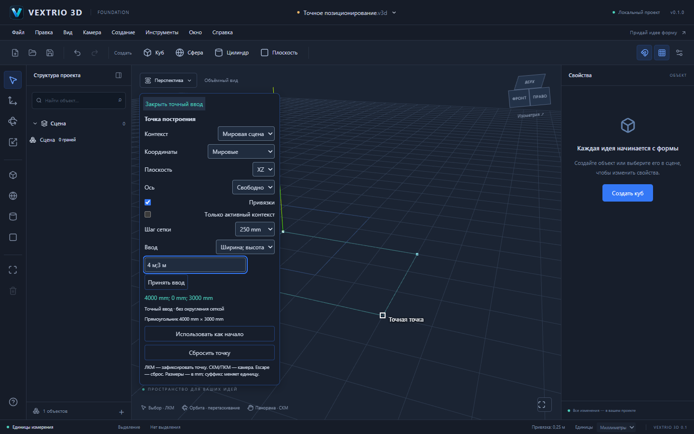

# S5 — точный ввод, координаты и интеллектуальные привязки

Дата: 25 октября 2026. Статус: реализация подготовлена к приёмке. Основание: PR 6, codex/s4-document-editor, commit b608eb7890f303037cf72588ed37ed5f242474e4, tree a82d9d79d555be7f6efe550c5fc27c69075cbc23. Автоматического объединения с main нет. S6 не реализован.

## Предварительная проверка S4

Изучены архитектура 0.2, план S5, отчёты S1–S4, production код документа, команд, GeometrySession, TopologyBridge и файлов. S4 не является временной заглушкой: реальная топология открывается, отображается и сохраняется через UI. Повторный базовый прогон дал 224/224 unit/integration; при разработке S5 повторно проверены все браузерные сценарии S4.

PR 6 остаётся черновиком и не объединён с main. Это не заявление о завершённом Windows-релизе или о проведённой владельцем приёмке PR. Пользователь явно поручил продолжить S5. Блокирующих функциональных разрывов для Web S5 не обнаружено. Открыт прежний release gate Windows: Cargo отсутствует.

Обнаружен дополнительный дефект жизненного цикла: успешная replace могла сохранять старое topologySelection и selectedPath. Исправлено до использования в S5: после валидации нового документа сбрасываются старое выделение, контекст и временная точка. Невалидный файл сохраняет действующий документ, точку и историю. Есть отдельная регрессия.

## Общие API и границы модулей

packages/snapping экспортирует независимые от Three.js, React, DOM и конкретного инструмента SnapEngine, SnapQuery, SnapCandidate, parseDimension, resolvePrecision, workPlane, frameMatrix, rayOnPlane и formatDimension. Старый snapPosition сохранён для прежних потребителей.

SnapEngine получает проверенный ProjectV2 и строит snapshot пространственного индекса из исходных GeometryModel и occurrence transforms. SnapQuery передаёт луч, CSS-позицию курсора, функцию проекции камеры, рабочую плоскость, начало, оси и политику поиска. Поэтому перспективная и ортографическая камеры используют один engine без зависимости ядра от viewport. Результат содержит мировую точку, тип привязки, canonical EntityRef с occurrencePath, устойчивый ключ и направляющую.

packages/editor содержит переиспользуемое временное precision state: контекст, систему координат, плоскость, начало, цель, точный результат и диагностику. Цель не записывается в геометрию от наведения или ввода. Реальное действие «Переместить выбранную вершину» использует existing editGeometry → GeometrySession.prepare → GeometryDocumentCommand → общую Undo/Redo, а не прямое изменение буфера или обход валидатора.

## Привязки

| Вид | Реальная операция |
| --- | --- |
| Vertex | Позиция канонической вершины, включая изолированную |
| Endpoint | Конец открытого ребра с valence 1 |
| Midpoint | Геометрическая середина ребра в мировом размещении |
| Edge | Ближайшая экранная точка ребра с perspective-correct интерполяцией; clipping на near/far planes |
| Face | Пересечение луча с реальной плоскостью грани, внутри внешнего обхода и вне отверстий |
| Intersection | Реальные 3D пересечения nearby рёбер через S3 segmentIntersections и существующие T/X junctions |
| Axis | Направления X/Y/Z выбранной системы через начало; возможна жёсткая фиксация |
| Grid | Узлы ортонормальной рабочей плоскости, шаг в физических метрах |
| Parallel/perpendicular | Направление ребра через начало и перпендикуляр к нему в рабочей плоскости; небольшой acquisition cache сохраняет направление при отводе курсора |

Приоритет: intersection → vertex/endpoint → midpoint → axis → inference → edge → face → grid. Захват 10 CSS px, удержание до 16 px. Более сильная привязка перехватывает удержанную лишь в центральных 4 px; равноприоритетные близкие кандидаты не заставляют маркер хаотично прыгать. Равенства разрешаются расстоянием, глубиной и устойчивым ключом. Новый документ, камера проекции, контекст, ось, настройки и перестроенная геометрия используют актуальные данные; смена контекста сбрасывает удержание и acquisition.

Скрытые вхождения не индексируются. Заблокированные вхождения по умолчанию не используются как references; API допускает явную read-only политику includeLocked. Видимые поверхности остаются occluders, включая заблокированные: скрытая за поверхностью вершина не получает преимущество только из-за совпадения пикселя. Occlusion проверяется от точки кандидата к камере, а не приблизительным процентом глубины. Рёбра разных geometry/occurrence никогда не образуют фиктивный Intersection Snap. Проекционное пересечение skew линий также не считается 3D пересечением.

## Числовой ввод

Внутренние координаты и размеры — Float64 в метрах, как в S2–S4. Смена отображаемых m/cm/mm не масштабирует документ и не меняет уже принятую мировую цель. Для каждой компоненты можно указать собственный суффикс m/cm/mm или м/см/мм, включая верхний регистр; без суффикса используется единица проекта.

- `4000,125 мм; 0; 0` → [4.000125, 0, 0] м.
- `2,5 м` при единицах проекта mm → длина 2.5 м.
- `=1,5; 0; -2` — абсолютные XYZ; `@1; 0; -0,25` — относительные XYZ.
- Компоненты отделяются **точкой с запятой**, чтобы десятичная запятая оставалась однозначной. Строка `1,2,3` не угадывается как набор координат.
- В режиме длины ввод задаёт физическую длину от начала в текущем направлении или по выбранной оси. Сетка не округляет точный результат. Отсутствие направления — понятная ошибка.
- В режиме прямоугольника `4 м; 3 м` задаёт физические ширину и высоту и показывает замкнутую направляющую из пяти точек. Это подготовка ввода для S6, не создание фиктивной документной грани.

Отрицательные координаты разрешены, отрицательные длина/ширина/высота — ошибка. Проверяются NaN/Infinity, неизвестные единицы, неоднозначный синтаксис, overflow/underflow, более 17 значащих цифр и выход за существующий диапазон ±10⁹ м. Относительное приращение или длина, исчезающие при сложении в Float64, отклоняются. Числа остаются IEEE-754, а не произвольной десятичной точности; безусловная точность для любых десятичных строк не заявляется. Неверный ввод не изменяет документ, dirty-state, историю или последнюю корректную точку. Противоречащие зафиксированной оси координаты дают ошибку.

## Координатные контексты

editGeometry поддерживает optional acceptContext — чистый предикат актуальности взаимодействия, проверяемый до подготовки и перед применением. UI точной точки проверяет тот же выбранный объект, путь, систему и target. Смена контекста или цели во время асинхронной подготовки отклоняет ответ без изменения документа/истории; отдельная регрессия подтверждает этот случай и для будущего Worker.

Поддержаны мировая система, локальная система occurrence и ортонормальная система рабочей плоскости. Доступны XY/XZ/YZ в мировой или преобразованной локальной системе; выбранную грань можно использовать как произвольную рабочую плоскость.

Путь экземпляра преобразуется полной affine матрицей occurrenceMatrix; обратный переход для геометрической команды выполняется inverseAffine. Неравномерный масштаб и shear вложенных TRS не теряются при декомпозиции. Local XYZ — координаты определения в метрах: масштаб экземпляра влияет на физическое размещение. Длина и размеры прямоугольника — физические мировые метры, независимо от масштаба локальной оси. Базис рабочей плоскости ортонормализован; размеры прямоугольника не превращаются в параллелограмм из-за shear.

Список контекстов содержит видимые незаблокированные вхождения. Поиск может использовать всю видимую топологию как reference или только активный контекст. Само наведение не редактирует никакую геометрию. Перемещение вершины доступно только при совпадении выбранного occurrencePath с активным; локальная точка записывается только в указанную GeometryModel. Отдельный тест подтверждает неизменность геометрии соседних независимых компонентов и их node transforms.

У общего определения компонента изменения намеренно видны во всех экземплярах, как в S4. Поэтому кнопка перемещения отключена до явного UI-подтверждения «Изменить все N экземпляра общего компонента». Блокировка любого вхождения продолжает запрещать изменение общего определения. Неявное make-unique или разрушение связи компонентов не добавлено.

## UI и рабочий сценарий

В сцене v2 доступен переключатель «Точная точка». Он включает реальные hover маркеры с подписями, координатную подсказку, оси, границу рабочей плоскости и направляющую. ЛКМ фиксирует вычисленную точку; «Использовать как начало» задаёт новую опорную точку. «Сбросить точку» или Escape возвращают hover. СКМ/ПКМ и колесо продолжают управлять камерой. Числовая цель удерживается при движении курсора и смене единиц; для новой hover-цели её нужно сбросить.

Маркер расположен в CSS-пикселях проекции реальной мировой цели. Временные линии используют координаты относительно начала, чтобы Float32 GPU buffer не терял небольшие размеры на больших мировых координатах. Для прямоугольника используется изменяемый buffer/draw range на пять точек; проверено реальное переключение из двухточечного preview. Ошибки ввода видны около поля; плотная область даёт отдельную диагностику.

Демонстрация:

1. Запустить pnpm dev и открыть tests/fixtures/v2/precision.v3d обычным «Открыть».
2. Выбрать правую вершину отрезка [0,0,0] → [4,0,0]. Включить «Точная точка»; навести на конец и середину — маркеры меняют тип, координаты совпадают с геометрией.
3. Ввести `4000,125 мм;0;0`, нажать «Принять ввод», затем «Переместить выбранную вершину».
4. Сохранить и открыть .v3d: тот же vertex ID имеет [4.000125,0,0]. Undo/Redo восстанавливают обе точные позиции.
5. Переключить единицы m→mm: физическая точка сохраняется. Неверный ввод оставляет предыдущую точку.
6. Выбрать «Ширина; высота», ввести `4 м;3 м` — получить замкнутый preview и точку [4,0,3] на XZ. Грань без команды рисования не добавляется.
7. Открыть S4 components.v3d, выбрать вершину экземпляра, включить local XYZ. Координата [4,0,0] во втором экземпляре с переносом +5 даёт [9,0,0]. Проверить явное подтверждение общего редактирования.

Точные входы, выходы и счётчики индекса: [S5_EXAMPLES.json](S5_EXAMPLES.json). Воспроизведение: `node scripts/precision-examples.mjs`. Этот генератор использует те же production API; snapshot соответствия и демонстрационный файл проверяются тестами.

## Производительность и защитные бюджеты

Индекс — world-space AABB BVH, построенный по snapshot документа. Не выполняется повторное построение на pointermove или изменении камеры; геометрия, размещения и видимость/блокировки требуют нового snapshot. Запрос отсеивает ветви по экранной проекции boxes; обновления pointermove объединяются requestAnimationFrame. Проекция не читает DOM rectangle заново для каждого кандидата.

Для 10000 разнесённых рёбер / 30000 индексных сущностей реальный пример: **25 узлов BVH посещены, 7 источников просмотрены, 2 прошли точную broad-phase проверку, 0 пар пересечений**, truncated=false. Это счётчики работы, не сертификация FPS произвольных сцен.

Бюджеты: до 500000 источников в индексе, до 10000 просмотренных источников на запрос, 64 локальных ребра / 2016 пар пересечений, 20000 occlusion checks. При исчерпании любого поискового бюджета результат не выдаётся из частично просмотренной сцены: candidate и raw равны null, показывается инструкция приблизить вид или ограничить контекст. Ошибка построения индекса также не меняет документ. Перестроение BVH пока синхронное и полное; Worker и инкрементальные обновления — дальнейшая оптимизация, не скрытая обещанная функция.

## Тестирование

52 новых unit/integration test покрывают все типы привязок, hysteresis, CSS radius при разных масштабах, perspective-correct interpolation и near clipping, skew линии, отверстия, occlusion на расстоянии 1 мкм, lock/visibility/context, affine координаты, конфликты ввода, единицы, переполнение, Float64 границы, source DTO isolation, плотные сцены, документ/историю/roundtrip и восстановление после ошибок.

4 новых E2E через production UI: endpoint/midpoint → numeric vertex edit → save/Undo; единицы/ошибка оси/rectangle; local component context с явным shared-edit подтверждением; face/hole/axis/intersection hover. Существующие 13 сценариев S1–S4 сохранены.

| Проверка | Фактический результат |
| --- | --- |
| pnpm test | **276/276**, 17 файлов: прежние 224 и 52 новых S5 теста |
| pnpm test:e2e | **17/17 Chromium**: прежние 13 и 4 S5 сценария |
| pnpm build | успешно: strict TypeScript + production Vite, 1633 модуля |
| pnpm check:deps | успешно: 12 package workspaces, рекурсивные imports/manifests/cycles |
| pnpm install --frozen-lockfile --ignore-scripts | успешно, воспроизводимая установка из lockfile |
| node scripts/precision-examples.mjs | реальные числовые выходы, .v3d и счётчики BVH; соответствие проверено тестом |
| pnpm desktop:build | **не пройдено**: cargo metadata — program not found |

Финальный браузерный прогон выполнен на неизменяемой версии файлов: 17/17 за 34.6 s. Один промежуточный прогон дал два отказа после обновления этого отчёта во время тестирования: Vite перезагрузил страницы на welcome. После прекращения изменений файлов полный прогон прошёл без retries и исключения сценариев.

Не проверены NSIS/MSVC/WebView2, нативные диалоги, atomic save и offline работа установленного приложения Windows. Web тесты выполняются на Windows в Chromium; это не проверка нативной оболочки.

## Границы этапа

S5 работает с канонической топологией v2. Legacy примитивы сохранены и отображаются прежним адаптером; аналитические привязки к их ещё не преобразованным поверхностям не заявляются. Старый v1 следует явно преобразовать в v2 для режима точной точки. Формат, @forma/*, app identifiers и Windows пути не переименованы.

Не добавлены новый рисующий Line/Rectangle tool, Push/Pull, boolean, экспорт, настоящий Worker или автоматическое разделение общих компонентов. Изменение существующих граней ограничено проверками текущей GeometrySession; если новое положение нарушает топологию, операция отклоняется атомарно. Следующий этап может потреблять готовые SnapQuery/resolvePrecision и временную точку, не заменяя геометрическое ядро или систему ввода.
