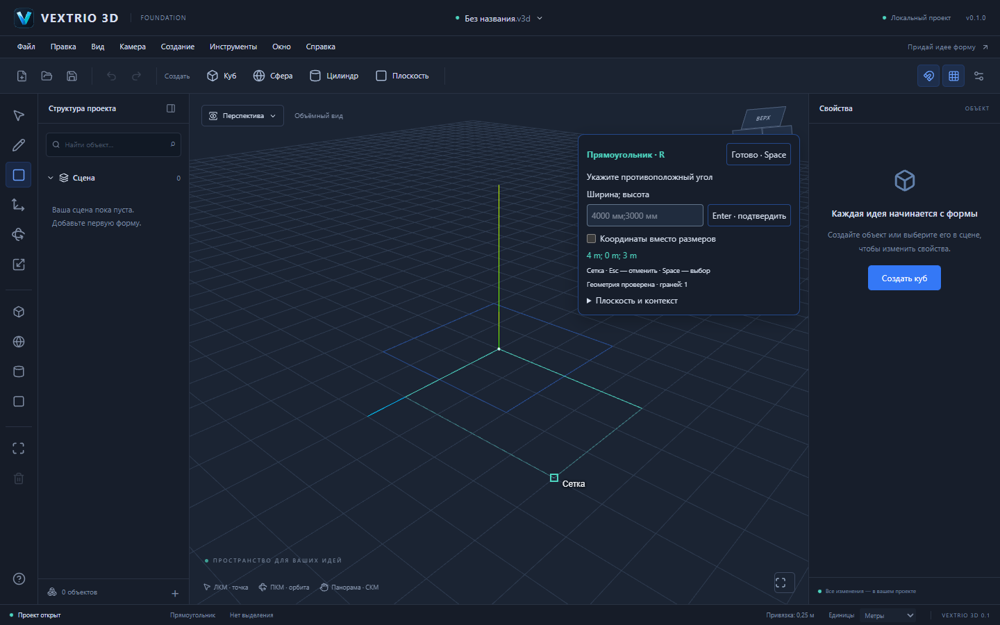
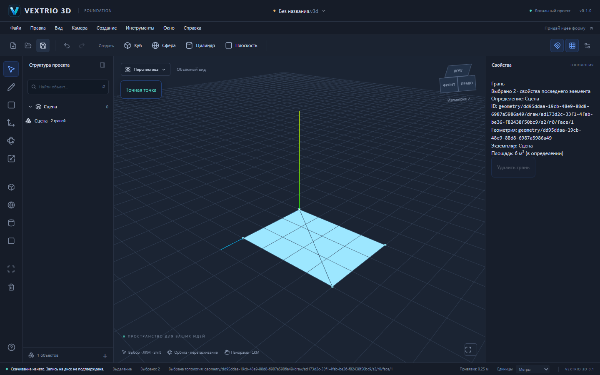

# S6 — интерактивное рисование Sketch

Дата: 25 октября 2026. Статус: реализация подготовлена к приёмке. Основание — PR 7, codex/s5-precision-snapping, commit 2757560a6354d1db04d27dc18f998525a9be712f, tree b048cdc81eeb155a0ad5e62087324d668e442f01. Автоматического merge нет. Push/Pull, boolean и последующие этапы не реализованы.

## Подготовка и совместимость

Проверены архитектура 0.2 и фактические API S3/S4/S5: GeometryModel, insert-segments, GeometrySession.prepare, документ v2, история, отображение и picking, SnapEngine и числовой ввод. S4/S5 подключены к рабочему редактору; отдельные PR 6/7 остаются черновиками. Известный release blocker Windows сохраняется: Cargo отсутствует. Это не заглушка геометрии и не подтверждённый Windows-релиз.

Схема .v3d v1/v2, format: "forma", @forma/* и Windows identifiers/пути не переименованы. v1 открывается по прежнему контракту; для рисования требуется явное «Файл → Преобразовать в v2», без автоматического перемещения или фасетирования старых примитивов. Старые инструменты, материалы, настройки, камера и файловые операции сохранены. V остаётся алиасом выбора; R теперь прямоугольник по требованию S6, вращение перенесено на E и доступно прежней кнопкой. Соответствующие UI assertions двух старых E2E обновлены с V-title на Space-title, смысл сценариев сохранён.

## Реальные инструменты

**Линия (L).** Первый щелчок задаёт начало; наведение показывает отрезок и S5-привязку. Второй щелчок вызывает insert-segments в выбранном определении. Успешный отрезок становится началом следующего; замыкание завершает цепочку. S3 разбивает рёбра в T/X/overlap пересечениях, устраняет дубликаты и автоматически строит плоские грани. Не создаётся дополнительный SceneObject или визуальная линия вместо документа.

**Прямоугольник (R).** Две точки задают четыре world-space угла в ортонормальной рабочей плоскости, затем четыре сегмента отправляются одной транзакцией S3. Отрицательное направление мышью поддерживается; нулевая ширина/высота или угол вне плоскости отклоняются. Результат — канонические вершины/рёбра/coedges/loops/faces/bodies, а не Three.PlaneGeometry. Вся фигура отменяется одним Undo.

**Точные размеры.** Компактная панель принимает длину линии или ширину;высоту, m/cm/mm и десятичную запятую. Enter фиксирует настоящую геометрию. Режим координат позволяет задать и первую точку клавиатурой, использовать absolute/relative синтаксис S5 и работать в world/local/plane frames. Курсор задаёт направление длины; фокус поля сохраняет последнее вычисленное направление. После успешного Enter фокус освобождается для Space/L/R/Ctrl+Z. Невалидный ввод оставляет документ и историю без изменения.

**Выделение (Space, алиас V).** Выбираются vertex/edge/face с каноническими ID и occurrencePath. Shift добавляет или исключает элемент, включая разные вхождения одного компонента. Пустой щелчок снимает выделение. Hover имеет отдельную подсветку; properties показывают тип, ID и последний элемент группы выбора, footer — число выбранных. Массовое удаление пока не заявляется: существующая кнопка удаления грани отключена для нескольких элементов. Выбор legacy примитива очищает native selection. Изменение топологии, Undo или новый документ сбрасывают устаревшие ссылки.

## Контроллер и маршрутизация ввода

packages/tools/src/controller.ts содержит ToolController с состояниями Idle → Hover → Start → Preview → Commit → Continue/Finish. ToolHost предоставляет preview/commit, не привязывая FSM к React, Three.js, Zustand или структуре окна. Editor связывает его с production документом; viewport маршрутизирует реальные pointer events, SketchPanel — клавиатуру и числовой ввод.

Generation и sequence различают отменённое взаимодействие, текущий preview и принятие команды. Отложенный preview не может перезаписать новое состояние. Новый сегмент/прямоугольник не принимается при Commit; повторный event ID подавляется. Pointer-down запоминает поколение и инструмент, поэтому отпускание после смены инструмента не начинает чужую операцию. Второй click двойного щелчка игнорируется; удержание Enter не дублирует команду.

Esc, смена инструмента/контекста, window blur и pointercancel сбрасывают незавершённые данные. Undo/Redo отменяют взаимодействие даже при пустой истории. Ошибка геометрии сохраняет начало для исправления и повторной попытки. Изменение сцены делает подготовленный ответ устаревшим; изменение только единиц сохраняет мировое начало. Новое открытие переводит редактор в выбор и очищает transient контекст.

## Команды и первая геометрия

Editor.drawSegments принимает occurrencePath и world segments. Полная обратная affine матрица переводит их в локальные координаты GeometryModel, включая nested nonuniform scale/shear. Скрытый или заблокированный контекст недоступен для изменения. Общий component definition по-прежнему изменяет все вхождения; UI требует явного подтверждения, а заблокированное вхождение запрещает общую правку.

Для пустого определения команда создаёт GeometryModel и при необходимости default material в изолированном candidate. GeometrySession.prepare рассчитывает прямой/обратный delta и lineage; GeometryDocumentCommand применяет результат, а общий validateProject проверяет полный документ до публикации/истории. Создание definition geometry link и материала включено в ту же команду. Undo первого штриха удаляет пустую seed geometry и созданный материал; Redo возвращает те же ID. Для определения с существующей wire geometry и без материала новая грань получает материал атомарно. Ошибка/preview/no-op не оставляют ни seed, ни историю.

GeometryDocumentCommand расширен optional seed и context reference; прежние entity-based команды S4/S5 сохраняют проверку EntityRef. Снимки всего документа не используются вместо delta для новых рисующих команд. Остальная snapshot-история legacy не переписана.

## Предпросмотр, привязки и измерения

Перемещение курсора использует индекс S5, приоритеты и hysteresis. Пересечения между контекстами не выдумываются; координаты привязки переводятся в активную геометрию только при явном commit. Рабочую плоскость можно выбрать из стандартных XY/XZ/YZ, локального frame или заранее выбранной грани. При начале построения свободная плоскость проходит через начало фигуры; её направления сохраняются.

Предпросмотр показывает будущие сегменты, маркер, координаты, длину и рабочую плоскость. После 100 ms неподвижного курсора тот же GeometrySession проверяет полную предполагаемую геометрию и показывает количество граней либо ошибку. До подтверждения документ и Undo/Redo не меняются; это проверяется и тестом, и браузерным face count 0 перед вторым щелчком. Прозрачная фиктивная грань не добавляется. Render buffers содержат только производные направляющие; большие мировые координаты выводятся относительно начала.

Реальные E2E выявили и закрепили регрессиями два разрыва: idle S6 controller не должен очищать exact target S5 при смене единиц; целевой origin должен быть точкой, а не произвольной позицией на оси после округления CSS cursor coordinates. Добавлен Origin Snap («Начало плоскости»); узел сетки на оси получает приоритет перед свободным положением на этой оси. Vertex/endpoint/intersection/midpoint сохраняют более высокий либо равный дискретный приоритет. Numeric input по-прежнему не округляется сеткой.

Для экземпляров отдельно показывается физическая world площадь с полным linear affine преобразованием; translation исключена из вычисления площадей для численной устойчивости. Площадь в определении также сохранена. Например, rectangle 4×3 м внутри group scale X=2 имеет local площадь 6 м² и physical площадь 12 м². Независимая геометрия соседних компонентов не меняется.

На ширине до 1200 px панель становится нижним input dock, а canvas освобождает для неё место. Геометрия остаётся доступной мышью; ResizeObserver корректирует камеру. На большом окне панель компактно размещена справа. Подсказки и справка отражают новые горячие клавиши и ПКМ-орбиту в режиме рисования.

## Приёмочные сценарии

| № | Действия настоящего пользователя | Проверенный результат |
| --- | --- | --- |
| 1 | Новый проект → R → щёлкнуть (0,0,0), (4,0,3) | 4 вершины, 4 ребра, одна грань 12 м² |
| 2 | L → углы (0,0,0) и (4,0,3) | 5 рёбер, две независимые грани по 6 м² |
| 3 | Два пересекающихся штриха | общая вершина, четыре участка; граничные рёбра также разбиваются |
| 4 | R → начало → 4000;3000 при mm → Enter | настоящая грань 12 м², одна запись истории |
| 5 | L → середина нижнего и верхнего рёбер | маркер midpoint; две области, 6 вершин и 7 рёбер |
| 6 | L → последовательность четырёх сторон → исходная вершина | автоматически созданная грань; Finish без лишнего штриха |
| 7 | Undo/Redo | исходные таблицы и ID восстанавливаются; seed первой операции удаляется/возвращается |
| 8 | Save → reload/close → Open скачанного .v3d → Save | полные geometry tables идентичны |
| 9 | Начать/навести → Esc, blur или pointercancel | документ не изменён; нет мусорных рёбер или истории |
| 10 | Выбрать group context → local coordinates → точный rectangle | новая геометрия принадлежит группе, чужая GeometryModel/instance transforms не меняются |

Дополнительно: точная линия 2500 мм, переключение инструмента при удерживаемой мыши, double click подтверждения, Shift выбор двух граней, ошибки размеров, display units во время построения и 1024×768 layout.

## Проверки и производительность

| Проверка | Итоговый фактический результат |
| --- | --- |
| pnpm test | **294/294**, 18 файлов: 276 прежних +18 S6 |
| pnpm test:e2e | **26/26 Chromium**, 1.3 min, 5 workers: 17 прежних +9 S6; без retries и исключения сценариев |
| pnpm build | strict TypeScript и production Vite успешно, 1636 модулей |
| pnpm check:deps | успешно, 12 package workspaces, imports/declarations/cycles |
| pnpm install --frozen-lockfile --ignore-scripts | успешно; новые зависимости только внутренние workspace |
| pnpm desktop:build | не пройдено: Cargo отсутствует, остановка до компиляции |

Добавлены 18 unit/integration regressions и 9 Playwright E2E. Браузерные тесты создают фигуры только мышью, клавишами, полем размеров и production UI; не вызывают insert-segments или editor store через page.evaluate. Существующий файл компонентов используется как стартовый контекст. Blur/pointercancel подаются браузерными событиями для проверки обработчиков потери ввода, а не геометрическим harness.

В [examples/s6-rectangle-diagonal.v3d](examples/s6-rectangle-diagonal.v3d) сохранён настоящий browser download основного E2E, а не сгенерированная отдельно геометрия: вершины (0,0,0), (4,0,0), (4,0,3), (0,0,3), пять рёбер и две грани по 6 м². Этот же файл повторно открыт через UI и сравнен по полным geometry tables. Оба screenshot просмотрены визуально. Для читаемости диагонали используются контрастные топологические рёбра и material depth offset; сетка смещена ниже номинальной рабочей плоскости. На снимке видны также вспомогательные линии сетки, которые не являются рёбрами документа. Эти изменения только производного отображения.

Промежуточные полные прогоны обнаружили регрессии сохранения target S5 и округления origin; они устранены и покрыты тестами. Проверка double-click первоначально ожидала транзитный Finish после следующего hover; исправлена на пользовательский инвариант «нет нового начального угла», сохранив проверку одной реальной грани. Финальный полный прогон чистый.

Замеры UI включают Playwright click/wait, WebGL software rendering Chromium и нагрузку других браузерных workers. В изолированном прогоне rectangle commit — 229–292 ms, diagonal commit — 325–352 ms; при пяти параллельных workers наблюдались 655/1071 ms. В итоговом прогоне — 504/1041 ms. Это воспроизводимые базовые измерения, не обещание FPS или производительности больших домов. Прогон выводит S6_UI_LATENCY_MS, чтобы сравнивать изменения.

S3 бюджеты остаются: bounded local executor, без настоящего Worker; preview отложен и stale результаты отбрасываются, но вычисление S3 на main thread ещё может блокировать большие операции. Сохранены ограничения S3 на число source edges/segments и проверки arrangements. Полная перестройка affected TopologyBridge и world-space Snap BVH при изменении модели пока сохраняется. Инкрементальное отображение и Worker относятся к дальнейшей оптимизации.

Windows native build вызывается отдельно. В этом окружении отсутствует Cargo: cargo metadata — program not found. Не подтверждены NSIS/MSVC/WebView2, native dialogs/atomic save и offline работа установленного приложения. Chromium E2E на Windows не заменяет проверку оболочки.

## Границы и следующий шаг

S6 подготовлен к приёмке основного сценария. Создание/перегруппировка компонентов, make-unique, массовое удаление, произвольное прямое редактирование граней и конверсия legacy поверхностей остаются отдельными этапами. Рисование внутри уже существующих native contexts поддержано. Не реализованы Push/Pull, boolean, новые форматы или платные ограничения. Продолжение объёмного моделирования возможно только после приёмки стабильного Sketch сценария.
