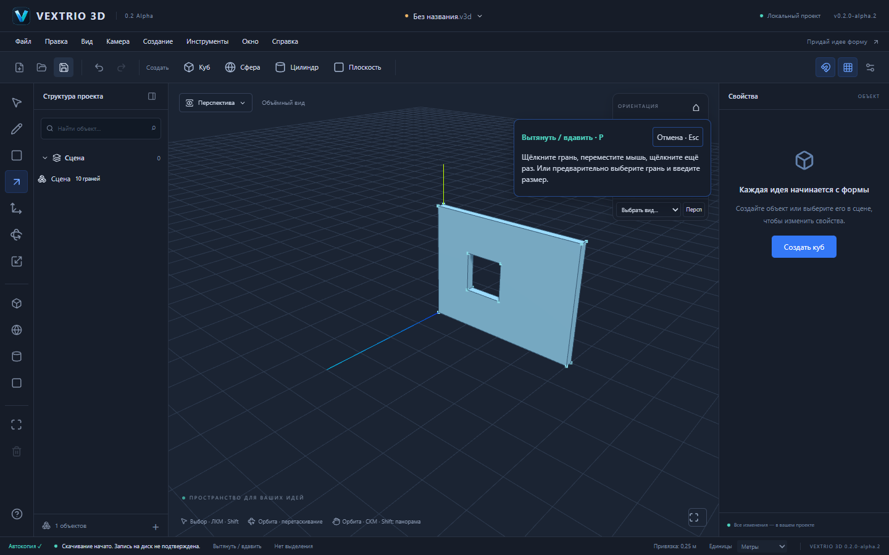

# VEXTRIO 3D 0.2.0-alpha.2 — рисование и Push/Pull

Цель этой доработки — привычная последовательность действий: нарисовать грань, вытянуть её, нарисовать контур на поверхности и продавить окно. Это следующая альфа поверх опубликованной alpha.1, без переписывания S1–S6. Полная функциональная совместимость со SketchUp пока не достигнута.

## Что работает

- **P: щелчок → движение → щелчок.** Первый щелчок выбирает настоящую грань в текущем контексте, движение показывает проверенный объём, второй подтверждает одну команду. Инструмент остаётся активен. Esc и смена инструмента отменяют незавершённое построение. Сохраняется точный ввод высоты и Enter.
- **L/R на поверхности.** До первой точки рабочая плоскость определяется по грани под курсором, в том числе вертикальной и преобразованной. После начала она фиксируется. Смена опорной поверхности не переводит пользователя в другой контекст редактирования.
- **Размеры прямоугольника сохраняют квадрант курсора.** Положительные ширина/высота задают физический размер в выбранном направлении, а не разворачивают фигуру в противоположную сторону.
- **Сквозное окно.** Внутренняя грань плоского контура на замкнутом теле продавливается до противоположной параллельной грани того же тела. Мышь останавливается на этой глубине; есть точная команда «До противоположной грани». За пределом разрешённой глубины числовой ввод отклоняется атомарно.
- **Группы:** двойной щелчок для входа, хлебные крошки и Esc/кнопка для выхода. Остальная сцена приглушается. Редактировать выбранную геометрию из чужого контекста нельзя: свойства предлагают войти в группу. Независимые экземпляры сохраняют свою форму; для общих определений остаётся подтверждение общей правки.
- **Навигация и клавиши:** средняя кнопка — орбита, Shift + средняя — панорама, колесо — масштаб. O/H включают орбиту/панораму левой кнопкой. M — перемещение, Q — поворот, S — масштаб, Shift+Z — показать модель. L/R/P/Space работают как инструменты линии/прямоугольника/вытягивания/выделения.

## Повторить оконный сценарий

1. Новый проект → R → начало координат → `4m;0.2m` → Enter.
2. P → щелчок внутри прямоугольника → двигайте мышь вверх. Для точной высоты введите `3m` в поле выдавливания → Enter. Получится стена объёмом 2,4 м³.
3. R → первая точка на вертикальной поверхности, вдали от её границ → укажите направление диагонали → `1m;1m` → Enter. Ручной выбор XZ/YZ не нужен.
4. P → внутренняя квадратная грань → двигайте мышь внутрь стены до противоположной поверхности → щелчок. Получится сквозной проём; также можно использовать кнопку точной глубины.
5. Ctrl+Z/Ctrl+Y возвращают контур/проём. Сохраните `.v3d`, откройте заново: геометрия и ID сохранятся. Браузер сообщает о начале скачивания, не обещая запись на диск.

## Входные данные и настоящая топология

Численный тест строит контур `(0,0,0) → (4,0,0) → (4,3,0) → (0,3,0)`, вытягивает на `+0.2` либо `-0.2` метра. На внешней плоскости строится квадрат с координатами X/Y от 1 до 2 м. Выдавливание внутренней грани на `-0.2m` создаёт:

| Состояние | Вершины | Рёбра | Грани | Объём |
|---|---:|---:|---:|---:|
| Стена | 8 | 12 | 6 | 2,4 м³ |
| Стена с окном | 16 | 24 | 10 | 2,2 м³ |

Оболочка остаётся замкнутой, обе основные поверхности получают внутренний контур, четыре откоса становятся настоящими гранями. Временная торцевая грань удаляется, её retirement фиксируется в lineage; существующая сохранённая ссылка остаётся валидной. Undo восстанавливает исходные сущности и идентификаторы, Redo возвращает ту же топологию. Второе отдельное окно 0,6 × 0,6 м сохраняет первое и оставляет объём 2,128 м³.

Алгоритм `extrusionStop` использует GeometryModel, контуры и физическую метрику occurrence transform. Three.js используется только для луча курсора, отображения и навигации. Изменение проходит существующие GeometrySession, GeometryDelta, валидацию контактов и общую историю. Жест и preview не являются документом; устаревший результат не может заменить новую ревизию.

## Проверки

- `pnpm test`: **330 тестов, 24 файла**, включая обе стороны стены, неравномерный масштаб + поворот, второе окно, overshoot, сохранённую ссылку на удалённую грань, устаревший ответ, точные размеры во всех квадрантах и прежние S1–S6.
- `pnpm test:e2e --workers=2`: **37 passed**. Три новых сценария выполняют реальные щелчки, движение мыши, ввод в поля, скачивание и открытие `.v3d`; геометрическое ядро напрямую из браузера не вызывается. Проверены изоляция независимого соседа, контекст группы, отмена и точное восстановление ID.
- Первый прогон с шестью браузерами и параллельной сборкой: 35 passed, два timeout на финальном screenshot/download. Полный повтор с двумя браузерами прошёл без retries и увеличения timeout.
- `pnpm build`, `pnpm check:deps`, `pnpm install --frozen-lockfile --ignore-scripts`, `pnpm check:pages` прошли. Pages smoke открывает production `/vextrio-3d/`, проверяет оба логотипа и отсутствие HTTP/JS ошибок. Vite предупреждает о JS chunk больше 500 kB; это не ошибка сборки.
- Windows NSIS и native FileSession проверяются отдельным CI этого PR. Локально Cargo отсутствует. Компиляция не заменяет ручную проверку установки, обновления, сохранения и offline WebView2. Итог CI указан в PR.

## Совместимость и ограничения

Номер приложения согласован в workspace manifests, UI, Tauri и Cargo. `.v3d`, `format: "forma"`, schema v1/v2, `@forma/*`, Windows identifier `studio.forma.editor`, бинарник и пути данных сохранены. Миграция и формат не менялись; старые v1 и v2 входят в регрессию. Исторические отчёты alpha.1 сохранены.

Это ограниченный сквозной Push/Pull между параллельными поверхностями, а не универсальная булева операция. Профиль должен целиком лежать внутри одной противоположной грани, не касаясь её границ/отверстий, и не иметь собственных отверстий. Дверь до края стены, вырез в наклонную/непараллельную поверхность, объединение тел, произвольное перемещение рёбер/граней, Offset, круг/дуга и полный набор inference SketchUp пока отсутствуют. Сложные пересечения отклоняются; искусственного «успешного» результата нет. Production Worker и большие сцены остаются отдельными задачами.

Следующая приёмка: проверить этот оконный сценарий мышью, независимые/общие компоненты и Windows offline; затем развивать дверные проёмы до границы, изменение формы, Offset и полноценные круг/дугу. Основной сайт обновляется только после отдельного разрешения на merge.
