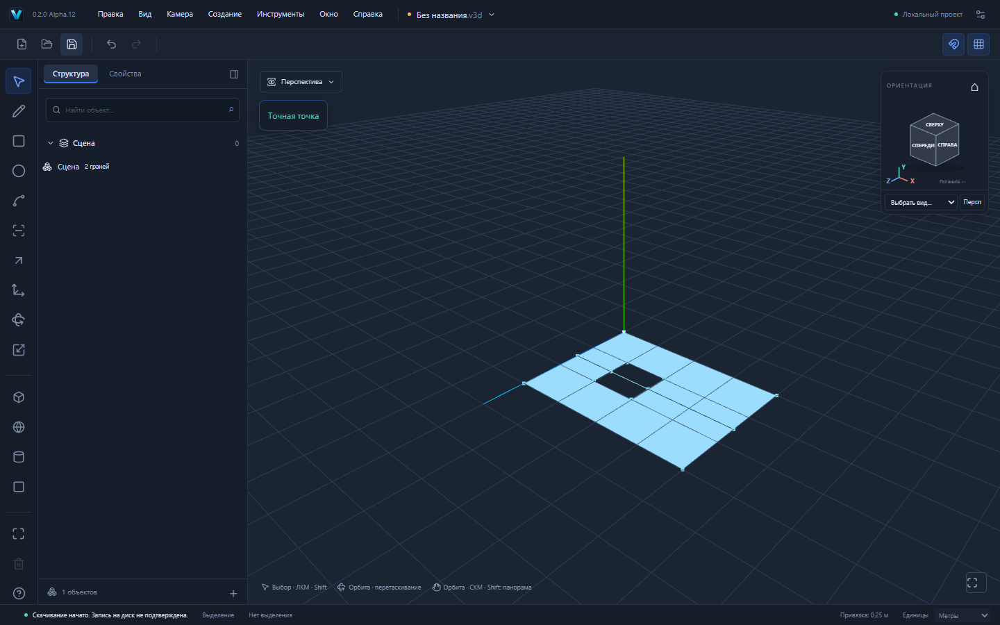

# VEXTRIO 3D Alpha.12 — свободные линии и поверхности

Продолжение Alpha.11 / PR №20. Ветка `codex/move-surface-contacts`, основана на `codex/move-wire-contacts`. Предыдущие PR №17–20 ещё не приняты; автоматического объединения или обновления основного сайта нет.

## Пользовательские сценарии

R: прямоугольник XZ (0,0,0), `4m;3m`. L: отдельная линия (5,0,1.5)→(6,0,1.5). Space выбрать первый конец, M, опорная точка там же, координаты `-1m;0;0`, Enter. Конец присоединяется к правой границе поверхности: исходная грань сохраняет ID и площадь **12 м²**, её внешний контур теперь состоит из пяти coedge. Результат: **6 вершин /6 рёбер /1 грань**. Есть настоящий общий узел, а исходное граничное ребро получает split provenance.

В отдельной сцене нарисуйте тот же прямоугольник и свободную линию (-5,0,1.5)→(-1,0,1.5). Выберите середину линии (-3,0,1.5), M, опорная точка, координаты `5m;0;0`. Линия оказывается между противоположными границами и создаёт **две отдельно выбираемые грани по 6 м²**: 6 вершин /7 рёбер /2 грани. Материалы обеих сторон наследуются. Undo/Redo возвращают точные сущности и ID; сохранение и повторное открытие восстанавливают топологию.

Если в прямоугольнике сначала вырезать квадратный проём X=1…2, Z=1…2, такое перемещение линии даёт две области с общей площадью **11 м²**: 12 вершин /15 рёбер /2 грани. Проём не заполняется; браузерный тест проверяет отсутствие picking-поверхности в точке (1.5,0,1.75). Часть линии внутри проёма остаётся настоящим свободным ребром.

[Присоединение к границе](examples/surface-contact-boundary.v3d) · [Разделённая грань](examples/surface-contact-split.v3d) · [Разрез через область с отверстием](examples/surface-contact-hole.v3d).

Модульный сценарий замкнутого тела: вытянуть прямоугольник 4×3 м по Y на 2 м. На высоте Y=2 перенести свободную линию на всю верхнюю грань по Z=1.5. Получается замкнутая оболочка с семью гранями и прежним объёмом **24 м³**; обе соседние боковые грани получают согласованные разбиения общих рёбер. Проверка выполняется после сохранения/открытия исходного тела, затем точными Undo/Redo и roundtrip результата.

## Архитектура

Перед общим алгоритмом Sketch проверяется, что исходные Face/Loop/Coedge, их граничные Edge и Vertex не изменены движением. Это разрешает перемещение и копирование только свободных линий рядом с неподвижными исходными поверхностями. Перемещение самих граней или их граничных вершин по-прежнему идёт прежним путём Move/Auto-fold; автоматическое слияние движущихся поверхностей не включено.

Существующий `splitSegments` создаёт реальные общие вершины и разбивает рёбра с их ориентированными coedge. Затем прежний алгоритм областей восстанавливает грани, материалы, отверстия, Shell/Body membership и provenance. В финализацию передаётся карта замены исходных граней, чтобы Face/Loop/Coedge и оболочки сохраняли проверяемые связи. Повторная реализация пересечений и построение геометрии через Three.js не используются.

Для сравнения областей используется граф до движения, поэтому удалённые проёмы не появляются снова из-за постороннего контакта. Каждая операция проходит прежние GeometrySession, валидацию, forward/inverse delta, preview/stale guards, историю и save barrier. Ошибка не меняет документ или историю.

## Проверки

Одиннадцать новых unit/integration проверяют угол поверхности, середину границы, реальный разрез, внутреннюю границу отверстия, оболочку 24 м³, атомарный отказ для внутреннего висячего ребра с сохранением Redo, копию, повёрнутую группу с неравномерным масштабом и неизменными соседними компонентами, прокалывание внутренней области, смешанную топологию и разрез через проём.

Три новых Playwright E2E рисуют исходные фигуры мышью и точным вводом, перемещают через M, выбирают новые грани, проверяют пустой проём, выполняют Undo/Redo и скачивают/открывают .v3d. Они не вызывают ядро вместо UI. Локально прошли **465 unit/integration в 35 файлах, 73/73 Playwright E2E**, `pnpm build`, `pnpm check:deps`, `pnpm check:pages`. Готовая production-сборка на 4182 отдельно прошла **3/3** новых UI-сценария; приведённые скриншоты и модели получены в этом прогоне. Timeout/retries не повышались. Независимые Web/Windows CI и установщик указываются в PR отдельно.

## Совместимость и ограничения

Файловые схемы v1/v2, `.v3d`, `format: "forma"`, пакеты @forma/*, Windows identifier и data paths сохранены. Новых зависимостей нет. Маркировка UI/package/Tauri/Cargo — Alpha.12. Сохраняются budgets reference Sketch (2048 вершин в кластерах, 250000 пар результирующих рёбер) и остальные ограничения плоскостей, ячеек, Move и валидации.

Поддерживаются контакты **свободных линий с неподвижными поверхностями**. Нет автоматического слияния самих движущихся граней/тел, булевых операций, соединения между контекстами, production Worker или проверки всей траектории. Висячее ребро внутри сплошной грани и прокалывание её внутренности без канонической границы отклоняются.

Оболочка и всё связанное тело — разные понятия. Если к замкнутой оболочке присоединить свободный хвост, классификатор всего тела возвращает `non-manifold`, а объём всего тела — `null`, сохраняя прежнее консервативное поведение. Исходная оболочка остаётся связанной, но такой результат не объявляется твёрдым телом. При разрезе всей верхней грани без лишних свободных рёбер тело остаётся closed-shell и объём 24 м³ измеряется. Отдельные объёмы оболочек в смешанном теле в UI пока не добавлены.

Представитель совпавших вершин выбирается существующим алгоритмом по ID; ID именно целевой вершины не гарантируется, но retired сущности получают lineage. Сложные или неоднозначные случаи могут отклоняться атомарно. Ручные установка/обновление Windows и offline WebView2 не проверены; CI отдельно указывается в PR. Сохраняется предупреждение размера основного JS chunk >500 kB.
