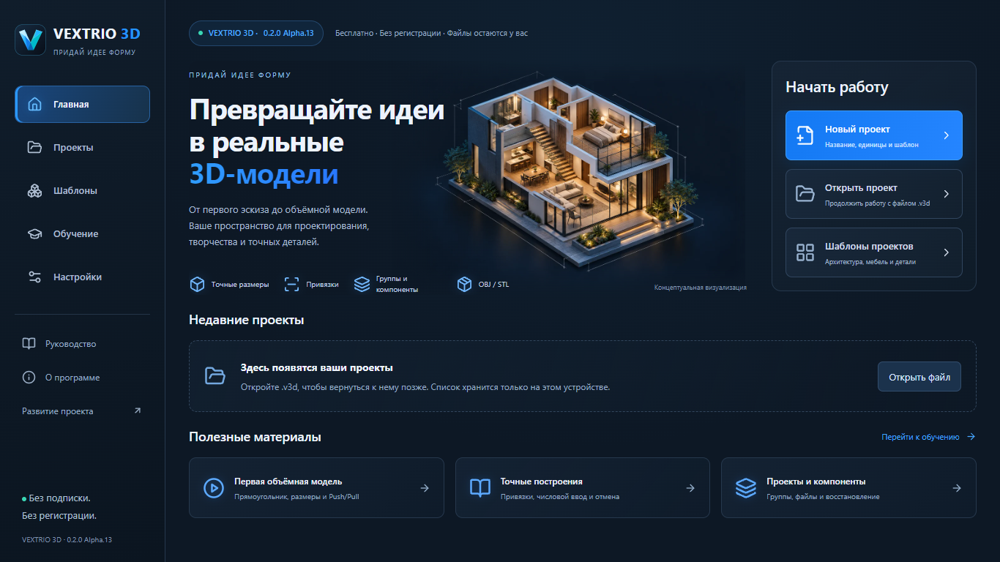
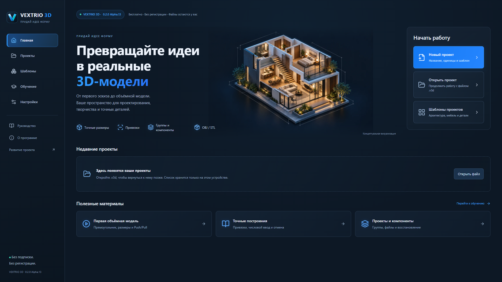
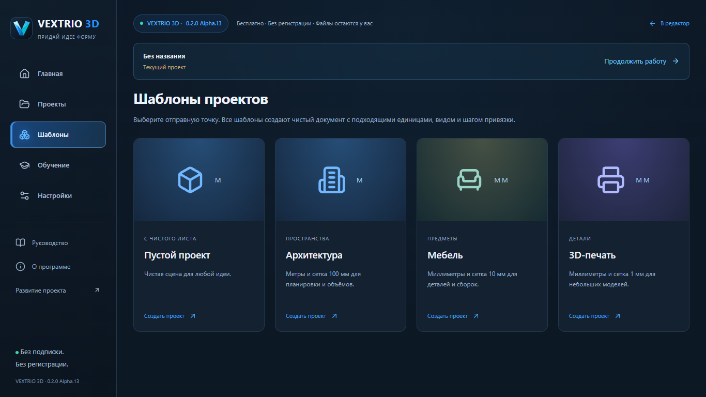
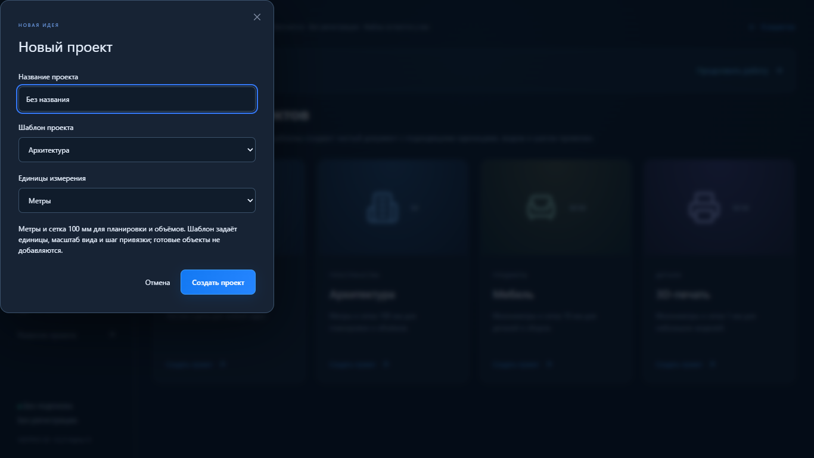
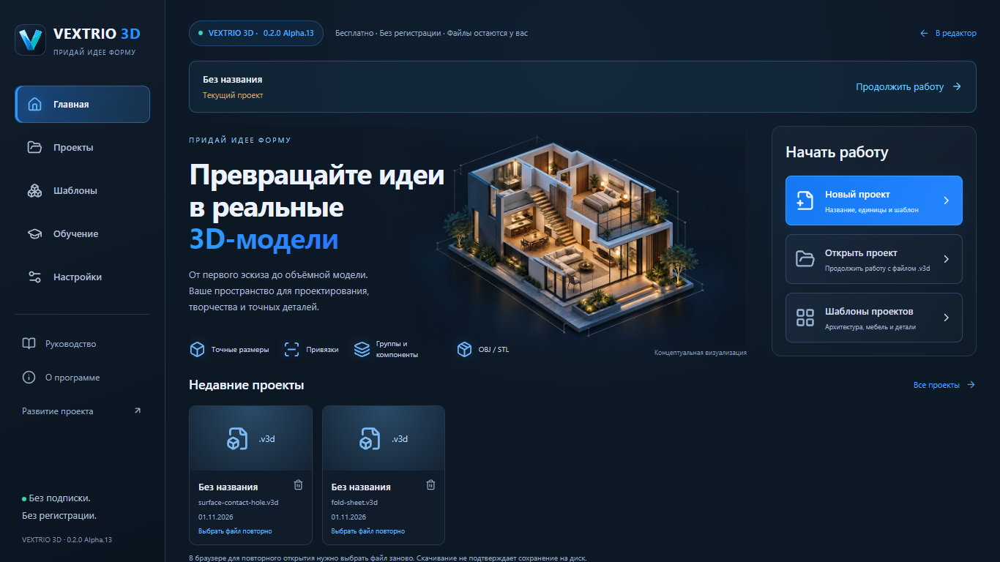

# VEXTRIO Home — Alpha.13

Отдельная реализация поверх Alpha.12 / PR №21, ветка `codex/vextrio-home`. Предыдущие PR №17–21 не объединены автоматически; этот этап не меняет main и опубликованный сайт. Источник визуального направления — предоставленный пользователем референс: левая навигация, архитектурная иллюстрация, действия справа, реальные проекты и обучение ниже.

## Работающие действия

- Главная, Проекты, Шаблоны, Обучение и Настройки — самостоятельные разделы Home.
- Новый проект: native HTML dialog с названием, единицами и шаблоном, фокусом на имени, клавиатурой и Esc. Создаёт настоящий Document v2 через прежний replace. Именованный/настроенный новый проект отмечается несохранённым и получает автокопию ещё до геометрии.
- Открытие .v3d: прежние браузерный/native адаптеры, валидация и файловая сессия. Старые v1 открываются без потери данных; прежнее явное преобразование в v2 остаётся доступным в редакторе.
- Windows: реестр до 16 реальных открытых/успешно сохранённых путей в `app_data_dir/recent-projects-v1.json`. Доступность проверяется при чтении списка в фоновой blocking-задаче и непосредственно перед открытием; сетевые пути не блокируют поток окна. Путь повторного открытия должен быть в реестре; используется прежний candidate/accept/reject. Запись реестра атомарная; команды используют блокировку файловой сессии. Удаление записи не удаляет проект. Ошибка реестра не отменяет успешное сохранение файла, но отображается при получении списка.
- Браузер: localStorage содержит только имя, имя файла, время открытия и идентичность метаданных реально выбранного файла. Ни полный путь, ни геометрия, ни разрешение на доступ не сохраняются. Повторное открытие вызывает обычный выбор файла и поясняет ограничение. Скачивание не добавляет запись якобы подтверждённого сохранения.
- Шаблоны: «Пустой проект» (метры, шаг 0.25 м), «Архитектура» (метры, 0.1 м), «Мебель» (мм, 0.01 м), «3D-печать» (мм, 0.001 м). Все создают пустую геометрию, подходящий физический масштаб вида и настройки точности; неподдерживаемые операции и готовые модели не имитируются. Начальные параметры сохраняются в расширении `vextrio:home`; единицы можно переопределить в диалоге.
- Три доступные инструкции: первая объёмная модель, точные построения, проекты/компоненты. Карточки открывают текстовые инструкции, откуда можно создать проект. Фиктивных видеоуроков нет.
- Настройки Home и редактора используют один EditorSettings и прежний useEditor; второго состояния нет.
- «Стартовый экран» возвращает из редактора без замены документа. «Продолжить работу» возвращает в тот же документ с историей. Подтверждённые геометрические команды дожидаются завершения; смена инструмента отменяет незавершённый preview. Создание/открытие/восстановление проверяют несохранённые изменения.
- Восстановление использует прежние IndexedDB и RecoveryWriter. Отслеживается также переход в несохранённое состояние для именованного нового документа без геометрических правок.

## Производительность и архитектура

WelcomeHome, HomeSidebar, HeroSection, QuickActions, RecentProjects, TemplateGallery, LearningSection, NewProjectDialog и EditorSettings выделены в компоненты. App монтирует либо Home, либо редактор. Viewport/NavigationCube загружаются через React.lazy при входе в редактор; на Home нет canvas, WebGL-контекста или animation loop viewport. Существующий cleanup viewport освобождает ресурсы при возврате.

Локальный hero — WebP около 91 КБ; [происхождение, путь и prompt](HOME_ASSET.md). Оригинальные логотип, название и слоган «Придай идее форму» сохранены. Компоновка проверяется на 1000 px, 1366×768 и 1920×1080; есть visible focus, системный focus trap диалога и reduced motion.

Геометрическое ядро, исходники модели документа и команд редактора не изменялись. Формат .v3d, `format: "forma"`, схемы v1/v2, @forma/* и Windows identifier сохранены. Версии workspace согласованы с Alpha.13. Новых веб-зависимостей нет; native-реестр использует serde_json (уже транзитивную зависимость Tauri, теперь объявленную явно).

## Проверки и ограничения

Локально прошли **478 unit/integration /36 файлов, 89/89 Playwright E2E**, `pnpm build`, `pnpm check:deps` и `pnpm check:pages`. Готовая production-сборка на 4183 отдельно прошла **16/16 Home E2E**, включая 1000 px, 1366×768 и 1920×1080. Cold Home: 0 canvas и 0 запросов three-*.js; отдельная проверка действий с настоящими example-файлами — без pageerror. Скриншоты ниже получены Playwright из готовой production-сборки. Timeout/retries не увеличивались. Windows CI указывается отдельно в PR. Старые E2E теперь создают проект через настоящий диалог; прямых вызовов ядра вместо UI не добавлено.

На этом рабочем месте Cargo не установлен: native-сборка и Rust-тесты проверяются Windows CI отдельно. Ручные установка/обновление Windows и offline WebView2 не проверены. E2E недоступного Windows-файла использует mock IPC только на границе ОС; native Rust-тесты отдельно проверяют реальную файловую систему, отсутствие файла и удаление записи без удаления проекта.

Реестр недавних проектов содержит максимум 16 записей и не является резервной копией. В браузере повторный выбор файла обязателен. Нативные записи обновляются после успешного открытия/сохранения; старые файлы, которые никогда не открывались новой версией, автоматически не сканируются. Автокопия хранит один последний редактируемый проект и не заменяет сохранение .v3d. Настройки оформления и навигации сохраняют прежний срок жизни сеанса. Шаблоны не являются готовыми домами/мебелью и не добавляют геометрию. Миниатюры недавних файлов — нейтральные значки, а не вымышленные рендеры моделей. Размер основного JS chunk по-прежнему превышает 500 КБ; тяжёлый three chunk отложен до открытия редактора.

## Настоящие скриншоты

### Шаблоны и диалог

### Реальный реестр файлов

Следующий снимок получен после открытия `fold-sheet.v3d` и `surface-contact-hole.v3d` из examples через обычный файловый диалог приложения. Это не начальные фиктивные записи; новый профиль по умолчанию имеет пустой список.

