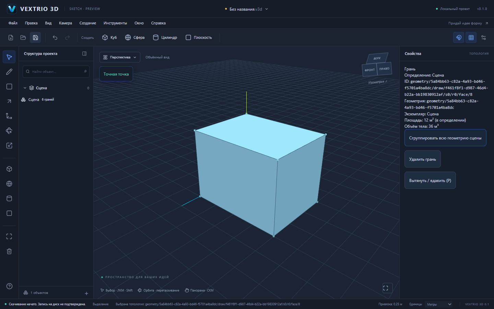
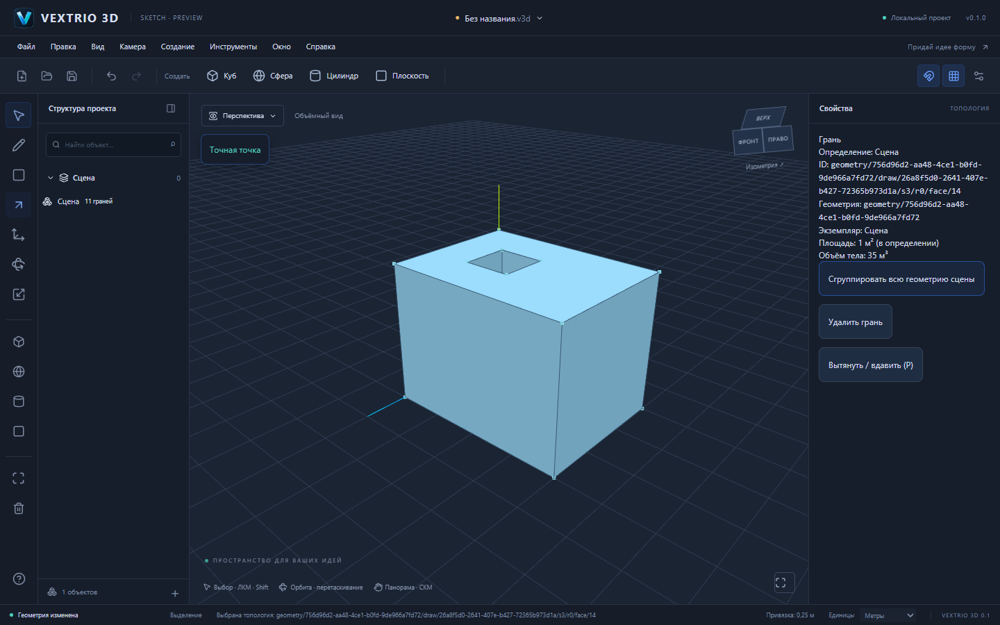
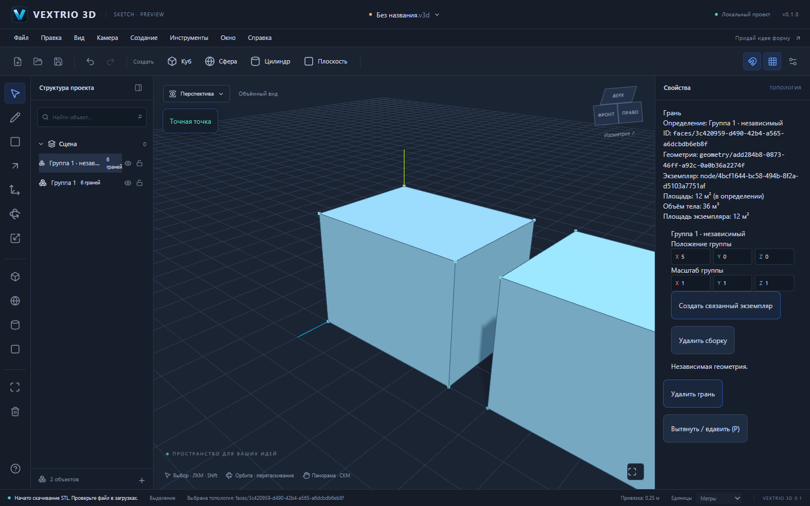

# Аудит GitHub и рабочее объёмное моделирование

Дата: 26 октября 2026. База: `main`, commit `d2f5c7d15577312907ce038cc917db23b884e471`, tree `9a0e690546da6d6f05a83e7f8a2d68d84c6c65e0`.

## Что реально было на GitHub

S1–S6 и ребрендинг уже включены владельцем в `main` (merge `7e3f292`), исходный S6 commit — `5d98c48ea1a4919efd628161ca867e94f6a5441c`. Нельзя продолжать цепочку от старого закрытого PR как будто main остался на 0.1. Новая работа основана на актуальном main, существующий `deploy-pages.yml` сохранён. Автоматического merge не выполнялось.

[Опубликованный редактор](https://dmitriy5885as-design.github.io/vextrio-3d/) отвечает HTTP 200, заголовок VEXTRIO 3D, asset base `/vextrio-3d/`. Найден отдельный deployment дефект: React img использовал `/vextrio.svg` (HTTP 404), тогда как `/vextrio-3d/vextrio.svg` отвечал 200. Путь исправлен через `import.meta.env.BASE_URL`; новый `pnpm check:pages` собирает production с префиксом и действительно открывает welcome/editor в Chromium, проверяя загрузку обоих логотипов и отсутствие HTTP/JS ошибок. До принятия новой ветки сайт содержит S6, а не описанное ниже выдавливание.

Документ v2, GeometrySession/Delta, топология, render/picking, привязки и инструменты L/R подключены. Главные практические пробелы: отсутствовало объёмное моделирование, нельзя было создать native группу из нарисованной геометрии, отделить экземпляр или экспортировать настоящую топологию. README и справка всё ещё описывали часть реализованных функций как отсутствующие. Локальный Cargo отсутствует; готового проверенного Windows installer нет. Это не полноценная замена SketchUp.

## Реализовано

### Настоящее выдавливание и углубления

`packages/geometry/src/volume.ts`: `prepareExtrusion` создаёт/меняет вершины, рёбра, coedge, контуры, грани, оболочки и тела; возвращает forward/inverse delta. Three.js не участвует в вычислении топологии. Плоский профиль с отверстиями получает верх/низ и стенки всех контуров. Исходный ID выбранной грани остаётся у перемещённой крышки. Материалы и пользовательские поля сохраняются.

Для призматической крышки перенос существующих вершин сохраняет ID и плоскости соседних стенок. Отрицательная высота уменьшает высоту. Для внутренней области, нарисованной на замкнутом теле, создаются стенки ограниченного углубления либо выступа. Сквозной проход и общая CSG не реализованы: столкновение с другой гранью отклоняется. Проверяются coplanar/non-coplanar контакты в одном geometry context; допустимы только общие топологические границы. Есть лимиты сложности и полная валидация candidate. Это проверка поверхностей, не универсальная сертификация отсутствия вложенных/самопересекающихся объёмов в произвольном импортированном теле.

Высота измеряется в мировых метрах, inverse linear affine переводит её в локальный контекст; неравномерный масштаб и вложенные преобразования не меняют физическую длину. `bodyVolume` вычисляет объём по ориентированным производным треугольникам и полной linear матрице, относительно локального начала для устойчивости. Треугольники не записываются в документ.

В S3 обнаружены два необходимых интеграционных исправления. При наличии оболочек новые support planes выводятся из свободных рёбер и существующих плоскостей граней; произвольные пары рёбер куба больше не порождают фиктивные диагональные плоскости. При разбиении грани сохраняется ориентация использования в оболочке с учётом направления нормали новой плоскости. Проверка: контур на крышке замкнутого тела остаётся замкнутым и не меняет объём.

### Рабочий интерфейс

P и кнопка в свойствах включают «Вытянуть / вдавить». Числовая высота поддерживает m/cm/mm и десятичные значения. После 120 ms debounce настоящий GeometrySession готовит candidate, GeometryDocumentCommand и validateProject проверяют его, отдельный render bridge показывает результат. Исходный документ, dirty-state и история остаются прежними. Камера не меняет зафиксированную сторону выдавливания. Изменение ревизии/контекста и Esc отменяют устаревший preview.

Enter применяет отдельный проверенный delta через общую Undo/Redo. Нулевые/нечисловые/слишком большие высоты, инверсия и неподдерживаемые пересечения отклоняются. Для общего определения требуется подтверждение изменения всех экземпляров; lock любого затронутого вхождения запрещает правку. В свойствах отображается физический объём.

### Группы и компоненты

Новая группа переносит всю свободную геометрию root в definition, создаёт identity placement, сохраняет geometry/entity ID и исправляет сохранённые EntityRef. Существующие группы/legacy объекты не перемещаются. Это **не группировка произвольного выбранного фрагмента**.

Связанный экземпляр использует общий definition; «Сделать независимым» копирует геометрию с новыми ID и исправленными внутренними ссылками. Исходная геометрия остаётся прежней. Положение/масштаб доступны численно, G/E/S — через настоящие TransformControls для native размещений верхнего уровня. При отказе команды derived transform восстанавливается. Удаление сборки сохраняет другие экземпляры и удаляет orphan definition только после последнего вхождения. Структурные команды валидируют полный candidate и используют общую snapshot историю; геометрические операции остаются delta-командами.

Новые copy/unique/delete команды ограничены leaf definitions без дочерних узлов; copy/delete — верхний уровень. Неподдерживаемая вложенная сборка не разваливается молча.

### Бесплатный экспорт

В браузерном меню «Файл» доступны OBJ (метры) и ASCII STL (миллиметры). Источник — canonical topology и occurrence matrices. Видимые экземпляры включаются, скрытые исключаются, ориентации оболочек сохраняются; OBJ также хранит свободные линии. Для STL требуются замкнутые тела без отдельных линий. При наличии видимых legacy примитивов экспорт отменяется с объяснением, чтобы не выдать неполную модель. Материалы в OBJ/MTL и native Windows export новых форматов не реализованы. Экспорт не изменяет `.v3d` или dirty-state.

## Проверяемые результаты

| Вход/операция | Полученная топология / результат |
| --- | --- |
| Прямоугольник `(0,0,0) → (4,0,0) → (4,0,3) → (0,0,3)` в UI; высота +3 м | 8 вершин, 12 рёбер, 6 граней, 1 замкнутая оболочка; 36 м³ |
| На крышке y=3 нарисован квадрат 1×1 м; высота −1 м | 16 вершин, 24 ребра, 11 граней; реальное углубление, 35 м³ |
| Профиль XY 4×3 м с отверстием `(1,1)–(2,2)`; высота ±3 м | 16 вершин, 24 ребра, 10 граней; замкнутая оболочка с проходом, 33 м³ |
| Призматическая крышка профиля с отверстием: +1 м, затем −2 м | Объёмы 44 и 22 м³; исходные ID вершин сохранены |
| Вогнутый L-профиль площади 7 м²; высота ±2 м | Замкнутое тело 14 м³ |
| Масштаб экземпляра (2,3,4), поворот; физическая высота 2 м | Физический объём 132 м³; соседний независимый контекст не меняется |
| Новый объём пересекает отдельную грань | Отказ; документ, revision, savedSignature и флаги Undo/Redo прежние |
| Копия → независимое определение → X=5 м → STL | Две независимые геометрии, 24 facet; исходное размещение [0,0,0] сохранено |

[Блок .v3d](examples/volume-block.v3d) и [модель с углублением .v3d](examples/volume-pocket.v3d) сохранены настоящей браузерной кнопкой, не изготовлены вместо пользовательских E2E.

## Проверки

- `pnpm install --frozen-lockfile --ignore-scripts` — успешно; новая внутренняя зависимость file-io → geometry объявлена и lockfile обновлён.
- `pnpm test` — **315/315**, 21 файл. Новые volume/structure/export тесты дополняют всю регрессию S1–S6.
- `pnpm test:e2e` — **30/30**, Chromium, 6 workers, 1,1 минуты. Четыре новых сценария реально нажимают инструменты, рисуют мышью, вводят размеры, читают скачанные файлы, выполняют Undo/Redo и повторное открытие. Дополнительный запуск 5 сценариев проверил справку и записал `.v3d`-примеры.
- `pnpm build` — успешно, TypeScript + Vite production build.
- `pnpm check:pages` — успешно, production URL prefix, welcome/editor, логотипы, HTTP/JS ошибки.
- `pnpm check:deps` — успешно, 12 workspaces, recursive imports/declarations/cycles.
- В полном E2E-прогоне задержки S6 на этой машине: rectangle 406 ms, diagonal 425 ms при параллельных software-WebGL браузерах. Это наблюдение, не гарантия производительности на любых моделях.
- `.github/workflows/verify.yml` добавляет Linux проверки и Windows NSIS artifact. Первая реальная [CI-проверка commit 78f5547](https://github.com/dmitriy5885as-design/vextrio-3d/actions/runs/40329837918) завершилась успешно: Web, E2E и Windows NSIS. [Установщик](https://github.com/dmitriy5885as-design/vextrio-3d/actions/runs/40329837918/artifacts/12655071852) `VEXTRIO 3D_0.1.0_x64-setup.exe`, 2,07 MiB; artifact ZIP SHA-256 `e9877c06c4624c136e8c59a817a51186936cea5884f5873fa153023ca706bd81`. Последующее уточнение ветки добавляет Pages smoke и запуск трёх native FileSession тестов через `cargo test --release`; результаты смотрите в checks PR. Локально нет Cargo/Rust: native dialogs, установка/обновление, offline WebView2, ручная Windows приёмка и цифровая подпись не проверены.

## Совместимость и следующие задачи

Не менялись `.v3d`, `format: "forma"`, schema v1/v2, `@forma/*`, Tauri identifier `studio.forma.editor`, binary `forma-editor`, Windows save paths. Миграция v1 не стала автоматической, старые примитивы не превращаются молча в новую топологию. Старые проекты и absolute legacy child placement проходят имеющиеся тесты.

Полный аналог SketchUp ещё не готов. Следующие существенные задачи: production Worker с измеримыми бюджетами, сквозные отверстия и CSG, произвольный subentity move, более широкое управление сборками, конверсия legacy примитивов, внешние импорты, native экспорт, автосохранение/recovery и проверенный Windows выпуск. Неизвестные случаи не скрываются за фиктивной геометрией или работающими только на вид кнопками.
