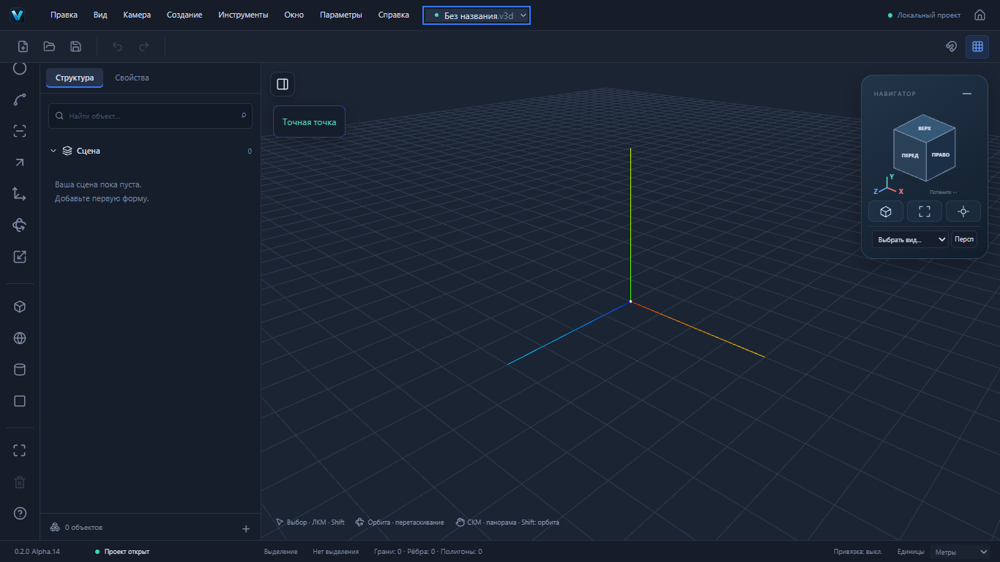
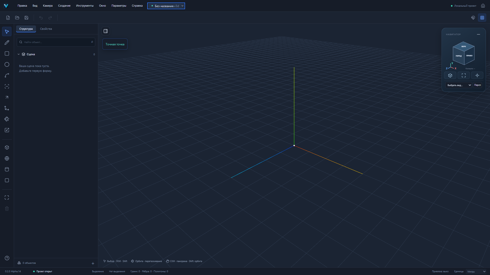
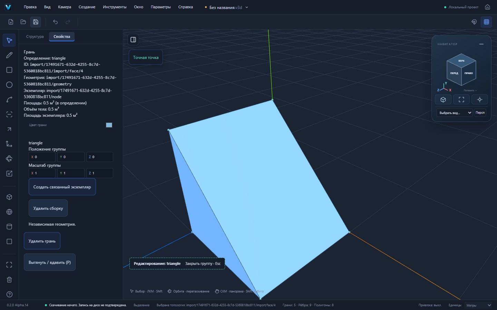

# VEXTRIO 3D Alpha.14 — аудит и доработка рабочего пространства

## Основа и аудит оставленной работы

Работа ведётся в отдельной ветке `codex/editor-workspace` поверх `codex/vextrio-home` / e3c32ea / PR №22, а не в старой рабочей папке. Незакоммиченные изменения основной папки сохранены. Её HEAD 43deb3e относится к Alpha.4; там найдены компактное меню, общий dock, журнал изменений, частичная переработка куба и тесты компактного окна. Нельзя использовать эту копию как основу вместо Alpha.13: потеряются поздние этапы геометрии и Home.

В актуальной Alpha.13 уже есть компактный dock, реальные M/PushPull, дуги, группы, сохранение v1/v2 и Home. Аудит подтвердил проблемы: скрытый dock возвращался только через меню, стрелка проекта не была кнопкой, проекция дублировалась, СКМ вращала камеру, версия оставалась у логотипа; Delete UI принимал только одну грань, старые примитивы не имели топологических вершин, внешнего импорта не было. Это отчёт о проверенном состоянии кода, а не предположение об авторстве каждого незакоммиченного изменения OpenCode.

## Проверяемые пользовательские изменения

| Запрос | Результат / способ проверки |
| --- | --- |
| Скрыть и вернуть панель | Постоянная кнопка у левого края сцены; структура, свойства и выделение сохраняются. Меню Окно тоже работает. |
| Современный гизмо | Переработанный SVG-навигатор с читаемыми гранями, рёбрами, углами и осями; стандартные виды и перетаскивание управляют настоящей камерой. |
| Дополнительные кнопки | Изометрия, вписать модель, фокус, переключение проекции рядом с кубом. Старые нижняя кнопка камеры и отдельная верхняя проекция убраны. |
| Скрыть навигатор | Минус скрывает куб; остаётся значок возврата. |
| Средняя кнопка | Панорама в плоскости камеры без изменения направления. Shift+СКМ — орбита; колесо — масштаб. |
| Версия / параметры | Alpha.14 внизу слева; Параметры непосредственно перед Справкой. Общий EditorSettings для Home и редактора. |
| Справка | Самостоятельные разделы Руководство, Горячие клавиши, О программе. Поиск, тематические категории, раскрываемые описания и ограничения; native dialog, Esc и удержание фокуса. |
| Подсказки | Название и описание при наведении/фокусе, клавиша в названии инструментов; один общий overlay, без обработчика на каждом движении мыши. |
| Стрелка проекта | Настоящее меню: новый, открыть, Home, реальные недавние. В браузере требуется повторно выбрать файл; защита несохранённого документа прежняя. |
| M | Физический KeyM работает при русской раскладке; топологический M не конфликтует с манипулятором всего экземпляра. |
| Вершины примитивов | В свойствах «Редактировать вершины»: атомарная конверсия с Undo. Куб: 8 вершин / 12 рёбер / 6 граней. Сохраняются ID узла, имя, материал, размещение и исходные данные в extensions. |
| Delete | Единая команда пользовательского удаления для объектов и топологии; вершины, рёбра, грани и одноконтекстное множественное выделение. Блокировки и общие компоненты защищены. |
| Полигоны | Внизу — реальные топологические грани, рёбра и треугольники отображения видимых экземпляров. Это разные числа, не подмена граней треугольниками. |
| Структура | Раскрываемые категории граней, рёбер/отрезков и вершин с реальными ID; ленивое раскрытие, выдача по 40 элементов. Дуги/окружности представлены цепочками рёбер. |
| Дуги / отрезки и P | Существующий пользовательский сценарий замыкания дуги хордой, появления грани и выдавливания проходит. Открытая кривая объёма не задаёт; добавлена явная инструкция в P и справке. |

## Импорт и редактируемая модель

Файл → Импорт модели; в браузере поддерживаемые модели также можно выбрать через Открыть. Импорт добавляет отдельные группы в текущий документ одной командой Undo, не заменяя его. Старый документ v1 мигрирует атомарно при подтверждённом импорте/преобразовании. Отмена, ошибка и устаревший результат не изменяют документ или историю.

- **OBJ:** вершины, положительные/отрицательные индексы, плоские многоугольники и линии. Внешние MTL/текстуры не загружаются. Неплоские/вырожденные грани и неподдерживаемые поверхности отклоняются.
- **STL:** бинарный и ASCII; явные исходные единицы, по умолчанию мм. Проверяются размер, число фасет, индексы и конечность координат. Совпадающие вершины объединяются в пределах допуска, общие рёбра имеют один ID.
- **STEP / IGES / BREP:** настоящий `occt-import-js@0.0.23`, JS + WASM 7 604 031 байт загружаются локально только при CAD-импорте. Worker завершается после результата, ошибки или отмены; лимит времени 60 секунд. STEP/IGES переводятся в метры с учётом единиц файла; BREP не задаёт единиц, они выбираются явно.
- Полученные координаты превращаются в обычный GeometryModel: вершины, уникальные рёбра, coedges, loops, плоские faces, connected bodies. Источник истины — эта модель, не Three.js Mesh. Нет отдельного одноразового renderer-only формата импорта.
- Импорт ограничен **20 МБ, 3000 граней, 15000 исходных вершин на часть, 128 частей**. Валидатор документа может отклонить сложную модель раньше общего лимита. Большие производственные сборки ещё не поддерживаются.

CAD импортируется **как фасетная редактируемая геометрия**: без истории построения, точных аналитических кривых/поверхностей, оригинальных материалов, текстур и сборочной иерархии. Каждая часть становится отдельной группой; исходные пространственные координаты сохраняются. Это не полноценный CAD roundtrip. Для .blend/.m3d/.sldprt/.sldasm/.f3d сначала экспортируйте OBJ/STL или STEP из исходной программы; FBX/glTF/PLY пока не поддерживаются. SDK действительно подключает три CAD-reader, но полноценный геометрический браузерный smoke в этом этапе покрывает STEP; отдельные реальные IGES/BREP-файлы вручную не принимались.

[Источник и API CAD-импортера](https://github.com/kovacsv/occt-import-js/tree/c2148e54b456b571238d35cac037d304053d64b2). Неизменённая LGPL-библиотека и лицензии поставляются раздельными заменяемыми ресурсами, [уведомления](../../public/CAD-NOTICES.txt). Сеть/CDN во время работы не требуются. В Windows CSP добавлены только собственный Worker, собственные fetch-ресурсы и `wasm-unsafe-eval`; обычный eval и внешние скрипты не разрешаются.

## Реальные входные данные и результат

1. OBJ: восемь точек куба `(±1, ±1, ±1)`, шесть ориентированных четырёхугольников. Результат: **8 вершин, 12 рёбер, 6 граней, 12 отображаемых треугольников**. Удаление одного ребра удаляет две инцидентные грани; Undo возвращает все исходные ID. Сохранение/открытие сохраняет идентичную топологию.
2. Собственный [STEP-тетраэдр](../../tests/fixtures/import-tetra.step): `(0,0,0)`, `(10,0,0)`, `(0,10,0)`, `(0,0,10)` в мм; настоящее AP214 advanced BREP с вершинами, edge curves, loops, planes, faces и closed shell. Результат Worker: **4 вершины, 6 рёбер, 4 грани**, максимум координат **0.01 м**. Не используется чужая тестовая CAD-модель.
3. ASCII STL: треугольник `(0,0,0)`, `(1000,0,0)`, `(0,1000,0)` в мм. После импорта и P=1м получается настоящая призма из **5 граней**, доступная общим командам и сохранению.
4. Куб-примитив: перенос `(4,5,6)`, поворот Y=90°, масштаб `(2,3,4)`. После конверсии исходная локальная точка `(-1,-1,-1)` находится в `(0,2,8)`; материал и ID узла сохранены; Undo возвращает исходный примитив.

## Надёжность и совместимость

Схемы v1/v2, format:"forma", .v3d, @forma/*, Windows identifier `studio.forma.editor`, имя бинарного файла и пути данных сохранены. Старый .v3d без расширения тоже открывается; этот случай пойман прежним E2E и исправлен. Конверсия старых примитивов с legacy-родительскими связями отклоняется до их отсоединения, чтобы не изменить положение связанных объектов.

Пользовательский Delete отделён от низкоуровневого `editGeometry`: сохраняется прежний контракт явного редактирования общего определения, но Delete не меняет соседние экземпляры молча. Удаление работает с копией топологии без ненужного перерасчёта всех пересечений; разъединённые оболочки перестраиваются, история сохраняет точные дельты и lineage. Автоматическое слияние копланарных областей при удалении разделяющего ребра пока не реализовано: инцидентные грани удаляются.

## Проверки

Финальная локальная приёмка Alpha.14: **501/501 unit/integration, 37 файлов; 97/97 Playwright E2E, 6 минут**, `pnpm build`, `pnpm check:deps`, `pnpm check:pages` — успешно. Добавлены **23 unit/integration и 8 настоящих UI E2E**. Показатели базового UI-сценария во время параллельного прогона: прямоугольник 124 мс, диагональ 124 мс; это локальная проверка, не гарантия производительности на любых моделях. Timeout и retries не повышались. Независимый Web/Windows CI публикуется в описании PR перед переводом в готовый к ревью. Новые unit проверяют импорт, допускаемые единицы, неверные индексы/плоскость/фасеты, примитивы, трансформации, ID, сохранение и обратимость, блокировки и защиту компонентов. Новые E2E выполняют настоящие действия UI, включая чтение собственного STEP настоящим Worker, импорт STL с выдавливанием, M вершины, Delete, Undo, сохранение/открытие и отмену работающего Worker. Прямых вызовов ядра вместо пользовательских действий в E2E нет.

Production Pages smoke дополнительно проверяет импорт STEP под `/vextrio-3d/` с настоящим CSP Windows. Это проверка веб-ресурсов и CSP, не ручная приёмка WebView2. Локального Cargo нет. Ручные установка/обновление Windows, native import chooser и offline WebView2 пока не проверены. Наличие собранного установщика само по себе их не подтверждает. Предупреждение Vite о большом основном chunk сохраняется.

## Скриншоты Playwright

Основа — PR №22; принимать после предшествующих PR №17–21 с проверкой base/diff. Автоматического merge и обновления публичного сайта нет. Старый предварительный просмотр на 4183 сохранён; новая production-приёмка использует отдельный порт 4184.
