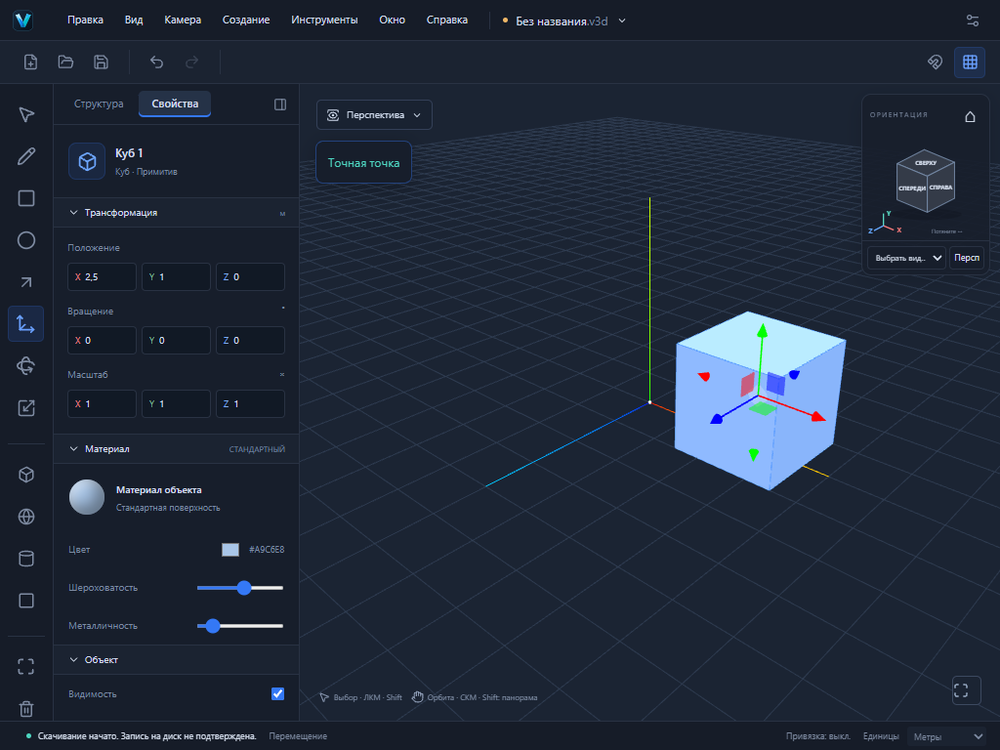

# VEXTRIO 3D — проверка изменений 31 октября 2026

## Сравнение с 30 октября

- main и сайт остаются на 0.2.0-alpha.2, commit 64c89a4. Вчера опубликованы дверные проёмы (PR №11, alpha.3) и окружности (PR №12, alpha.4); оба PR пока не объединены.
- После полуночи доработаны picking исходной грани при скрытом preview-root и проверка отмены Idle/Hover. Финальный CI окружностей 41098277750 прошёл: 355 unit, 42 E2E, Web/Pages/deps, Windows NSIS и 3 native FileSession теста. PR №12 переведён из черновика в готовый к ревью.
- Локальная папка теперь D:/Other/Vextrio 3D. Рабочая копия находится на настоящей ветке codex/circle-sketch, HEAD 43deb3e; нынешние незакоммиченные изменения интерфейса сохранены и проверены отдельно от геометрического этапа.

## Рабочее окно

Сохранены сегодняшние компактные верхнее меню и панель инструментов, общий левый dock «Структура / Свойства», стартовый экран и справка с журналом из CHANGELOG.md. Файловое меню открывается значком V слева сверху, имеет доступное имя «Файл» и подсказку; Ctrl S/O/N сохраняются. Реальные инструменты C/L/R/P и топология не заменялись.

Выявлена и исправлена регрессия повторного выбора: открыв структуру и щёлкнув уже выделенный объект, пользователь теперь действительно возвращается к свойствам. Исправление охватывает примитивы и настоящие топологические сущности. Блокировка, трансформации и скрытие/возврат панели не теряют значения.

Убрано неверное обещание хранения истории в .v3d: проект хранит геометрию, материалы и структуру, а не весь Undo-стек. Скачивание в браузере по-прежнему не объявляется подтверждённой записью на диск. Импорт Markdown ?raw проверяется по существованию и реальному пути внутри репозитория; исторические названия сохранены в документации, в журнале приложения видны последние пять записей.

## Приёмка

Новый Playwright сценарий работает мышью и клавиатурой на 1024×768: создать куб → X=2,5 м → структура → заблокировать → свойства недоступны → разблокировать → повторно выбрать → скрыть/вернуть dock → сохранить из меню значка → проверить фактический .v3d и предупреждение о скачивании. Сценарий настоящей грани с отверстием дополнен повторным выбором через структуру и сохранением entity ID.

Unit включает parser/sync журнала и правила raw-import. Полные результаты финального исходного commit и Windows CI фиксируются в описании PR. Повышения timeout и retries не добавлялись. Предупреждение Vite о chunk больше 500 kB сохраняется.

## Совместимость и дальнейшая работа

Формат forma, схемы v1/v2, расширение .v3d, внутренние @forma-пакеты, идентификатор Windows и пути данных не менялись. Версия остаётся alpha.4: это завершение и проверка текущего этапа интерфейса, а не объявление нового геометрического релиза. Ручная установка/обновление/offline Windows остаются непроверенными.

PR основан на PR №12, который зависит от №11. Объединять последовательно, с проверкой base; автоматического merge нет. Следующий геометрический этап — дуга, затем Offset и свободное редактирование существующих рёбер/граней. Полный паритет со SketchUp пока не достигнут.
